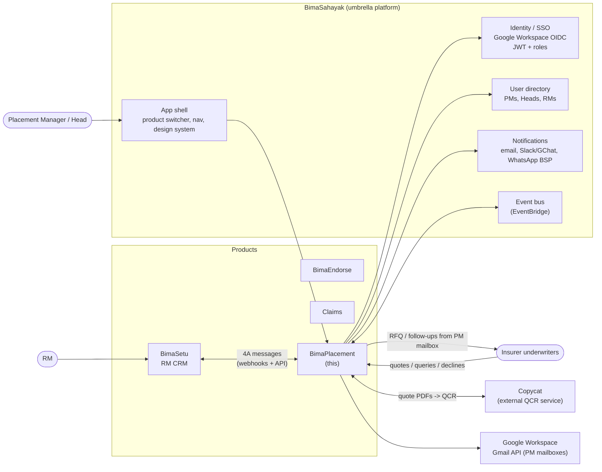
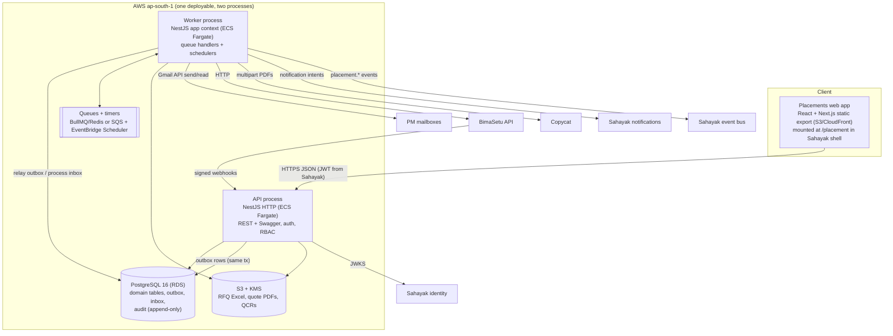
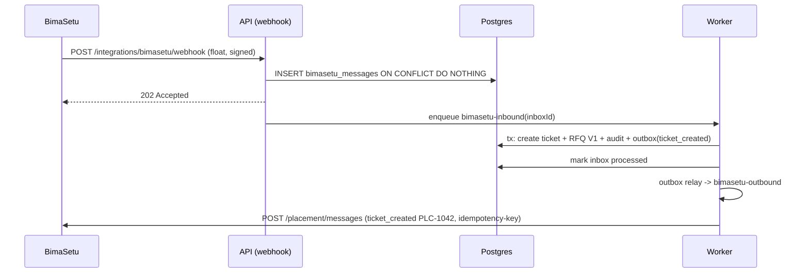
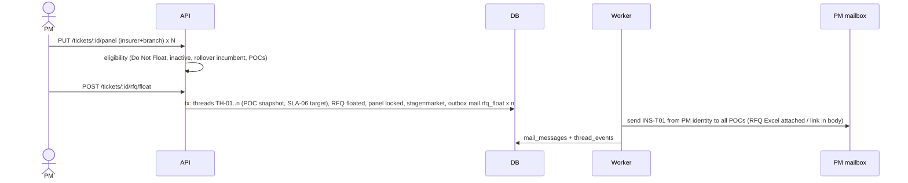

# BimaPlacement - High-Level Design (HLD)

| | |
|---|---|
| Status | Draft v0.1 - 29 Oct 2026 |
| Owner | Rohit Mishra (Engineering) |
| Inputs | [PRD v1.7](../product/PRD-v1.7.md) (8 Oct 2026), [Architecture & Build Plan](../product/Architecture-and-Build-Plan.md) (14 Oct 2026), designer prototype -> [UI-SPEC](../design/UI-SPEC.md) |
| Stack | NestJS 11 + TypeScript + TypeORM 0.3 + PostgreSQL 16 · BullMQ/Redis or AWS SQS/EventBridge (ports) · React 19 + Next.js 16 (Turbopack) + Tailwind |
| Companion | [LLD](./LLD.md) · [ADRs](./adr) · [PLAN](../../PLAN.md) |

---

## 1. What we are building

BimaPlacement is the **Placement Workbench** of BimaKavach: it takes one product line of a client's requirement
from the moment an RFQ reaches the Placement team to the client's decision.

```
RFQ (BimaSetu float / manual ticket)
  -> RFQ review, queries to the RM, risk tier
  -> insurer selection (insurer + branch, eligibility, Do Not Float)
  -> one independent thread per insurer + branch, RFQ mailed from the PM's mailbox
  -> follow-ups, clarifications, held clocks, SLA ladder
  -> quotes captured as received, PM marks usable
  -> 3 usable distinct insurers -> Copycat builds the QCR (or early release / manual upload)
  -> PM sends the QCR round to BimaSetu -> client decision (quote selected / revision / lost / no appetite)
```

Users: **Placement Manager (PM)** (a.k.a. Placement Executive) and **Placement Head**; Admin for configuration.
RMs never log in to BimaPlacement - they work in **BimaSetu** (RM CRM), which talks to us through a message interface.

### 1.1 Scope reconciliation (important)

The two input documents disagree on scope. This design follows the **PRD v1.7 for V1** (it is the business-signed
spec and matches the prototype) and keeps seams for the Architecture plan's broader items as later phases.

| Topic | PRD v1.7 (V1 - we build) | Architecture & Build Plan | Resolution |
|---|---|---|---|
| Quote extraction | None by BimaKavach; Copycat builds the QCR from PDFs | OCR (Textract) + LLM extraction, confidence, review queue (W6) | V1: store-as-received + Copycat port. Extraction = Phase 5, behind the same `quotes` model |
| QCR | Copycat / manual upload / single quote | In-house QCR PDF generator (W7) | V1: Copycat port. In-house generator can later implement the same `CopycatClient` port |
| Insurer channels | Email only (PM mailbox) | Email + insurer APIs + portal tasks (W5) | V1: `MailboxConnector`. Integration-gateway adapter interface reserved (`requestQuote/getQuote/bind/fetchPolicy`) |
| Payment / bind / policy | Out of scope - BimaSetu continues after Quote selected | W10 payment, binding, policy capture | V1 ends at `placement.quote_selected` bus event. W10 later |
| Automations | Fixed V1 automations, configurable timings | Config-driven rules engine A1-A10 | V1: code + config tables (SLA master, ladder, thresholds). Rules engine = Phase 4 |
| Renewals | Business type New/Renewal/Rollover only | A10 renewal kickoff | Later (CTO decision: renewals start in BimaSetu or here) |
| Roles | PM, Head, Admin (RM in BimaSetu) | + Finance, RM | Roles come from BimaSahayak; Finance added with W10 |
| Insurer email | PM personal mailbox connector | SES inbound + per-placement plus-addressing | ADR-0004: PM mailbox (PRD) behind a port; SES plus-addressing kept as an alternative adapter |

---

## 2. Context - BimaSahayak suite

**Assumption (confirmed by you):** *BimaSahayak* is BimaKavach's umbrella internal platform that hosts the
product family (BimaSetu CRM, BimaEndorse, Claims, Ops, now BimaPlacement) and provides shared platform
services. The prototype already shows this: one login, an environment switcher between Endorse / Claim / Ops /
Placement, a shared shell and design system.



### 2.1 What BimaPlacement owns vs. consumes

| Record / capability | Owner (system of record) | BimaPlacement's role |
|---|---|---|
| Client, opportunity, line, RM | BimaSetu | Reads from the float; never writes back business type corrections (BR-139) |
| Placement ticket, RFQ versions, queries, insurer threads, quotes, QCR versions, mandates, outcomes | **BimaPlacement** | Single writer (Placement core) |
| Users, roles, SSO session | BimaSahayak | Local projection (`users`) for FKs |
| Notification delivery + channel prefs | BimaSahayak | Emits notification intents |
| Insurer / branch / POC master | BimaPlacement (Placement Head) | Owner; can be promoted to a Sahayak shared master later |
| Payment, policy issuance | BimaSetu / downstream | Receives `placement.quote_selected` |

---

## 3. Container view



**Why one deployable, two processes:** a modular monolith keeps one codebase, one schema and one CI pipeline for a
small team (Architecture plan), while HTTP latency is isolated from slow integrations (Copycat, Gmail, BimaSetu).
The worker can be split further (integration gateway, extraction) without code moves because every integration is
already behind a queue + port.

---

## 4. Module map

Code lives in `apps/api/src`. Each NestJS module maps to PRD modules (M1-M12) and Architecture workstreams (W1-W13).

| Code module | Responsibility | PRD | Workstream |
|---|---|---|---|
| `modules/tickets` (Placement core) | Ticket aggregate, `TicketWorkflow` unit of work, state machine, status derivation, SLA clock, assignment | M1, M3, 5 | W2 |
| `modules/rfq` | RFQ versions, risk tier, queries to the RM, validate | M2, M11 | W2 |
| `modules/insurers` | Insurer / branch / POC master, appetite, eligibility, change log | M4, App. C/F | W2 |
| `modules/threads` | Panel selection, float, insurer threads, hold/resume, follow-ups, calls, restart | M5, M6, M7 | W2, W5 |
| `modules/quotes` | Quote versions, usability decisions, premium + target flag, threshold trigger | M8 | W7 |
| `modules/qcr` | QCR versions, rows, Copycat requests, early release, manual upload, release, next version | M9 | W7 |
| `modules/decisions` | Revision rounds, client decision, no appetite, lost, RFQ V2 | M10, M11 | W2 |
| `modules/mandates` | Exclusive / Incumbent mandates, mandate requests (MR-nn) | M4 3.1 | W2 |
| `modules/inbound-mail` | Mailbox polling, mapping, classification, Manual Review queues, product matcher | M7 | W5 |
| `modules/communications` | Template rendering, outbound mail sender, Mail Trail | M5, M6 s12 | W5, W9 |
| `modules/notifications` | In-app inbox, delivery via Sahayak | 7 | W9 |
| `modules/automation` | SLA sweeper: follow-up ladder, SLA-P1 escalation | M6, 8 | W8 |
| `modules/sla` | Business calendar, SLA master cache, SLA-06 matrix resolver | 8 | W8 |
| `modules/masters` | Product types, lookups, SLA master, matrix, holidays, settings, templates | M12, App. C | W2 |
| `modules/documents` | Upload, storage keys, download URLs, scan status | - | W4 |
| `modules/audit` | Append-only audit timeline | 10.6 | W1 |
| `modules/reporting` | Desk counts, pipeline, SLA, insurer outcomes | 9 | W12 |
| `integrations/bimasetu` | Webhook inbox, outbound sender, reconciliation | 4A | W3 |
| `integrations/copycat` | Copycat client port (mock/live), single runner | M9 | W7 |
| `integrations/sahayak` | Auth guard (JWT/JWKS), directory, notifications | - | W1, W9 |
| `infrastructure/*` | Messaging ports + drivers, outbox, storage, mailbox port | - | W1 |

---

## 5. Core design principles

1. **Placement core is the only writer of ticket state.** Every command runs through `TicketWorkflow.run()`:
   `SELECT ... FOR UPDATE` -> guard -> mutate -> re-derive status -> reconcile the single SLA clock ->
   audit + outbox in the same transaction. (Mirrors the prototype's `patch()` pipeline.)
2. **Layered status.** One ticket **stage** (+ derived internal / RM-facing status); every insurer thread, quote and
   QCR has its own status. One insurer event never overwrites the ticket (PRD 5).
3. **Exactly-once integration semantics on at-least-once infrastructure.** Inbound: inbox table with a unique
   message id. Outbound: transactional outbox; consumers dedupe on the outbox id. Copycat: unique request id,
   stale responses ignored.
4. **Business time everywhere.** All SLAs are business minutes (Mon-Fri 10:00-19:00 IST minus holidays, 540/day).
   External clocks (RM, client, insurer) never count as Placement breaches.
5. **Configuration over code.** SLA master, SLA-06 matrix, ladder, thresholds, templates, reasons, product types
   are tables, editable by Admin / Head, applied prospectively (BR-091).
6. **Immutable commercial history.** RFQ versions once floated, released QCRs, audit, thread events, SLA events,
   master change log are append-only (DB triggers).
7. **Ports and adapters for everything external**: messaging (BullMQ | AWS), storage (local | S3), mailbox
   (dev | Gmail | Graph), Copycat (mock | live), BimaSetu (mock | live), identity (dev | Sahayak).

---

## 6. BimaSahayak integration

> All claim names, endpoints and handshake mechanics below are **assumptions to confirm with the Sahayak team**.
> They are isolated in `integrations/sahayak/*` and `apps/web/src/lib/auth.ts`.

### 6.1 Identity & access
- Sahayak fronts **Google Workspace SSO (OIDC)** (Architecture plan) and issues a JWT for audience `bimaplacement`.
- Claims used: `sub`, `email`, `name`, `picture`, `roles[]` (`placement_manager`, `placement_head`, `placement_admin`, `rm`), optional `scopes[]` for LOB / team scoping.
- API verifies via JWKS (`SahayakAuthGuard`), upserts a local `users` row (FK target for owner/actor), and enforces RBAC with `@Roles()` + per-ticket visibility (a PM never sees Head-owned escalated tickets - FR-208).
- Local dev: `AUTH_MODE=dev` + `x-dev-user` header.

### 6.2 Shell embedding
- Web app built with `NEXT_PUBLIC_BASE_PATH=/placement`, served from CloudFront and mounted by the Sahayak shell (route or micro-frontend - decide with the platform team). The product switcher, user card and session live in the shell; the token reaches the app via a postMessage handshake or a shared-domain cookie (`lib/auth.ts`).
- Deep links: `/placement/tickets/PLC-1042/qcr` are stable and used in notifications and in BimaSetu ("Open in Placements").

### 6.3 Directory, notifications, events
- **Directory:** nightly + on-demand sync of PMs, Heads and RMs (`SahayakUsersClient`) for pickers and assignment.
- **Notifications:** Placement decides *who* and *what* (PRD 7 matrix, INT-T01..T06); Sahayak decides *how* (channel credentials, user preferences, WhatsApp opt-in).
- **Domain events on the shared bus** (`source=bimaplacement`): `placement.ticket_created`, `placement.stage_changed`, `placement.quote_selected`, `placement.closed`, later `placement.bound`. Consumers: BimaSetu (optional mirror), policy admin / finance, analytics.

### 6.4 Shared conventions to adopt from the suite
Same design tokens (purple `#4100CF` chrome, per-product accent - Placement blue `#1458D2` on `#EEF4FF`), Anek Latin, ikkat rule motif, pino JSON logs with correlation id, ap-south-1, Secrets Manager.

---

## 7. BimaSetu integration (PRD 4A)

| Direction | Message | Our handling |
|---|---|---|
| In | `float` | Validate (RFQ present, required fields, product mapped) -> create ticket (`PLC-nnnn`, one per line) -> out `ticket_created`; else out `float_rejected` with reason (FR-281/282) |
| In | `query_answer` (`Q-nn` or `TH-nn`) | Attach answer; ticket back to RFQ Review / thread answer recorded; never resolves the query (FR-284, BR-111) |
| In | `revision_request` | New round, stage `revision_requested`, PM task, no insurer contacted (FR-287, FR-250) |
| In | `client_confirmation` | Close `quote_selected` with the selected row (FR-288) |
| In | `line_lost` | Close `lost` |
| Out | `ticket_created`, `stage_changed`, `query_raised`, `qcr_round` (PDF + rows, never insurer docs - FR-290), `closed_no_appetite` (+ zero-row round) | Outbox -> `BIMASETU_OUTBOUND` queue -> HTTP with idempotency key, retry/backoff, DLQ |

Transport: **signed webhooks in** (HMAC-SHA256 over `t.body`, 5-minute tolerance) into the `bimasetu_messages` inbox
(unique message id = exactly-once), **API calls out**; **nightly reconciliation** for drift; **polling fallback** if
BimaSetu cannot emit webhooks (CTO decision).



---

## 8. Key flows

### 8.1 Float to insurers (M4/M5)


### 8.2 Insurer reply (M7/M8)
Mailbox poll / Gmail push -> `inbound_mails` (dedupe) -> map by `[PLC-nnnn | TH-nn]`, reply chain, sender -> classify
(rules now, LLM later) -> confident: apply (ack / clarification / decline / new quote version) -> else Manual Review
(**My reviews** if mapped, **Unmatched** otherwise). Nothing ambiguous updates commercial data (BR-046).

### 8.3 Threshold -> QCR -> BimaSetu (M9/M10)
PM marks the 3rd distinct insurer usable -> same tx: follow-ups stop, draft QCR V1 (`copycat`), `copycat_requests`
row `CC-PLC-1042-V1-1`, outbox -> single runner calls Copycat outside any tx -> result applied only if the request id
is still current -> PM checks quote rows -> **Send to BimaSetu** freezes the version -> `qcr_round` out.
Early release: 2 quotes -> Copycat with reason; 1 quote -> its PDF is the QCR. Manual upload is always possible.

### 8.4 SLA engine (M6, PRD 8)
- **Ticket clock** (one at a time): resolved from stage + thread/quote/QCR state; re-anchored at full target when it changes.
- **Thread clock**: SLA-06 matrix target per thread; held while waiting on the RM; resumes with the exact remainder.
- **Follow-up ladder**: FU1/FU2/escalation at 1/2/3 business days to all POCs; stops at threshold / decline.
- **SLA-P1**: internal breach -> reminders at breach, +30, +60 BM -> owner moves to the Placement Head.
- Implementation: `sla_due_at` precomputed on the ticket + a 1-minute sweeper (idempotent). Timers per thread can move to EventBridge Scheduler later without changing the domain.

---

## 9. Cross-cutting concerns

| Concern | Design |
|---|---|
| Security | Sahayak JWT + RBAC (PRD 6); per-ticket visibility; Copycat/BimaSetu/Gmail secrets in Secrets Manager; S3 SSE-KMS; presigned downloads (5 min) with access audit; HMAC webhooks; helmet; PII redaction in logs |
| Compliance | Data in ap-south-1 (DPDP residency); IRDAI broker record retention for RFQs, quotes, correspondence (S3 object lock + append-only tables); retention/deletion policy = OPEN (App. A #18) |
| Reliability | Outbox/inbox, idempotent handlers, retries with backoff, DLQ = failed jobs, optimistic locking (`row_version`) + row locks in the workflow, nightly reconciliation |
| Observability | pino JSON logs with correlation id across HTTP -> outbox -> worker; health endpoint; metrics/alarms: outbox lag, DLQ depth, unmatched review queue size, Copycat failures/latency, mailbox connector errors, SLA engine errors (PRD 10.5) |
| Performance | NFR targets OPEN (PRD 10.3). Expected volume is low (hundreds of tickets/month); Postgres indexes on stage/owner/sla_due_at; reporting on read replica |
| Availability / DR | RDS Multi-AZ, PITR backups, S3 versioning; RPO/RTO OPEN (PRD 10.4) |
| Environments | local (docker compose) -> dev -> staging -> prod; feature flags for dev simulators (never in prod) |

---

## 10. Deployment

- **Images:** one Docker image (`apps/api/Dockerfile`), two ECS services: `placement-api` (`node dist/main.js`) and `placement-worker` (`node dist/worker.js`).
- **Migrations:** run as a one-off ECS task before the API rolls (`npm run migration:run`).
- **Web:** `next build` (Turbopack, `output: 'export'`) -> S3 -> CloudFront; `NEXT_PUBLIC_BASE_PATH=/placement`. See ADR-0006.
- **CI:** GitHub Actions - typecheck, unit tests, migrations against Postgres, build (`.github/workflows/ci.yml`). CD per the BimaKavach standard pipeline.

---

## 11. Decisions & open questions

ADRs: [0001 modular monolith on NestJS + TypeORM](./adr/0001-modular-monolith-nestjs-typeorm.md) ·
[0002 messaging ports](./adr/0002-messaging-ports-bullmq-aws.md) ·
[0003 BimaSahayak as platform provider](./adr/0003-bimasahayak-platform-integration.md) ·
[0004 PM mailbox connector](./adr/0004-pm-mailbox-connector.md) ·
[0005 V1 scope = PRD v1.7](./adr/0005-v1-scope-prd-v17.md) ·
[0006 web on Next.js + Turbopack](./adr/0006-web-nextjs-turbopack.md)

**Open - needs an owner before the related phase starts**

| # | Question | Blocks | Ask |
|---|---|---|---|
| 1 | Sahayak token claims, JWKS URL, shell embedding mechanism, notification + directory APIs | Phase 0/1 auth | Sahayak team |
| 2 | BimaSetu webhooks available? message wire format, auth, rendered RFQ view, product codes | Phase 2 | BimaSetu team (F7/F8) |
| 3 | Copycat endpoint, auth, sync vs job+poll, response shape, metadata (App. A #4-8) | Phase 3 | Copycat owner |
| 4 | PM mailbox provider (Gmail API delegation vs Graph vs SES plus-addressing) | Phase 2 mail | IT / CTO |
| 5 | LLM provider for inbound classification (Bedrock vs Anthropic API) + data terms | Phase 4 | CTO |
| 6 | ~~PM visibility~~ **Decided 2026-11-02 (Rohit):** a PM sees all non-escalated team tickets; escalated tickets are hidden from PMs on every route (`TicketVisibilityInterceptor`) | Queue | Placement Head |
| 7 | ~~Initial assignment~~ **Decided 2026-11-02 (Rohit):** BimaSetu floats land with the Placement Head, who reassigns | Float intake | Business |
| 8 | Masters still pending: appetite grid, holiday list, users/RMs, final template wording (App. A #11, #20) | Seeding | Himani |
| 9 | NFRs, RPO/RTO, retention (PRD 10.3/10.4, App. A #17/18) | Go-live | Eng + Security |
| 10 | ~~`no_response`~~ **Decided 2026-11-02 (Rohit):** never set; a thread waiting after the ladder keeps showing "Awaiting Insurer Response" | Threads tab | Product |
