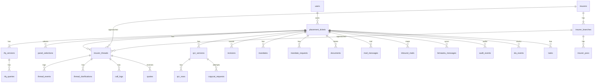
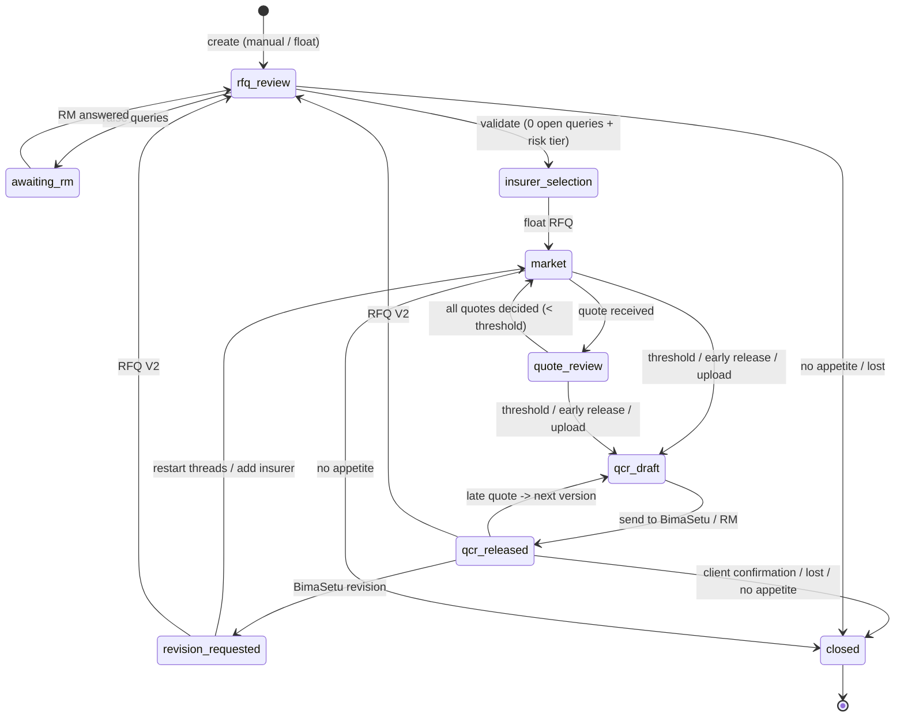

# BimaPlacement - Low-Level Design (LLD)

Companion to the [HLD](./HLD.md). This describes the code as scaffolded in this repo and the rules the remaining
code must follow. Status column legend: **done** = implemented + tested in the scaffold, **partial** = core path
implemented, TODOs inside, **stub** = signature + guards documented, body throws `NOT_IMPLEMENTED`.

---

## 1. Repository layout

```
bimaplacement/
├── apps/
│   ├── api/                      NestJS (HTTP API + worker), TypeORM, Postgres
│   │   └── src/
│   │       ├── main.ts / worker.ts            two entrypoints, one codebase
│   │       ├── app.module.ts / worker.module.ts
│   │       ├── config/                        typed env config
│   │       ├── common/                        auth decorators/guards, errors, request context, business calendar, base entities
│   │       ├── infrastructure/                messaging (ports + BullMQ/AWS drivers), outbox, storage, mailbox port
│   │       ├── integrations/                  sahayak, bimasetu, copycat
│   │       ├── modules/                       domain modules (see HLD s4)
│   │       └── database/                      data-source, migrations, seeds
│   └── web/                      React 19 + Next.js 16 (Turbopack) + Tailwind + react-query
│       └── src/{app,design-system,shell,features,api,lib}   app/ = Next entry; the SPA itself is react-router (Root.tsx)
├── packages/contracts/           shared enums, labels, state machine table, SLA seeds, masters, DTO read models
├── docs/                         architecture (HLD/LLD/ADRs), product (PRD + plan), design (UI-SPEC), reference
└── infra/                        docker-compose (local), cdk (AWS: network, data, app, monitoring)
```

`@bimaplacement/contracts` is consumed **compiled (CJS)** by the API and **from source (ESM)** by the web app via a tsconfig path (`turbopack.root` = monorepo root).
Rebuild it (`npm run build:contracts`) after editing.

---

## 2. Backend layering

```
Controller (DTO validation, @Roles)  ->  Service (guards, orchestration)
     -> TicketWorkflow.run(ticketId, actor, fn)        // the unit of work
          ctx.manager  (transactional EntityManager)
          ctx.moveTo(stage, command)                   // validated against STAGE_TRANSITIONS
          ctx.audit(event, detail)                     // audit_events, same tx
          ctx.outbox({destination, eventType, payload}) // outbox_events, same tx
     <- afterCommand: loadSnapshot -> deriveStatus -> resolveTicketSlaId -> re-anchor clock -> stage_changed outbox
Worker: OutboxRelayHandler -> queues -> @QueueHandler classes (mail, bimasetu, copycat, notifications) / SlaSweeper
```

Rules:
- Domain code throws `DomainError` (`NOT_FOUND`, `GUARD_FAILED`->422, `TRANSITION_NOT_ALLOWED`->409, `TERMINAL_TICKET`->409, `FORBIDDEN`, `CONFLICT`, `INTEGRATION_FAILED`->502, `NOT_IMPLEMENTED`->501). Never `HttpException` in services.
- **Never** write ticket stage / status / SLA columns outside `TicketWorkflow`.
- **Never** call an external system inside a DB transaction - write an outbox row instead.
- Pure logic (status deriver, SLA resolver, next action, eligibility, calendar, target flag, matcher) lives in plain functions with unit tests; services stay thin.
- Every worker handler is idempotent (jobId = outbox id / message id / request id).

---

## 3. Data model

### 3.1 ERD (core)



### 3.2 Tables (generated migration: `apps/api/src/database/migrations/*-InitialSchema.ts`)

| Table | Key columns | Notes / constraints |
|---|---|---|
| `placement_tickets` | `ticket_no` (PLC-nnnn, unique, from `placement_ticket_no_seq` start 1001), `channel`, `bimasetu_line_ref` (unique partial), `owner_id`, `escalated`, intake (`business_name`, `industry_type`, `product_type`, `business_type` + `business_type_at_intake`, `renewal_date`, `incumbent_insurer_*`, `client_spoc`, `urgency`, `target_premium`, `note_to_placement`), `risk_tier`, `stage`, `internal_status`, `rm_status`, `active_rfq_version`, `panel_locked`, `thread_seq`, `qcr_round`, `mandate_request_seq`, `follow_ups_stopped`, clock (`sla_id`, `sla_owner_type`, `sla_anchor_at`, `sla_target_mins`, `sla_due_at` idx), SLA-P1 (`p1_armed_at`, `p1_reminders_sent`, `p1_escalated_at`), outcome (`outcome_type`, `outcome` jsonb, `closed_at`), `float_payload` | aggregate root; `row_version` optimistic lock |
| `rfq_versions` | `ticket_id`, `version` (unique together), `status`, `excel_document_id`, `link_url`, `rendered_view_url`, `change_note`, `validated_*`, `floated_at` | immutable once floated |
| `rfq_queries` | `ref` Q-nn, `label`, `send_count`, `answer*`, `resolved*` | resolved only by PM |
| `panel_selections` | (`ticket_id`,`rfq_version`,`insurer_id`,`branch_id`) unique | pre-float picks; carried forward on RFQ V2 (TODO) |
| `insurer_threads` | `thread_ref` TH-nn (unique per ticket), `rfq_version`, `insurer_id`, `branch_id`, `pocs` jsonb snapshot, `status`, clock (`floated_at`, `target_mins`, `held_mins`, `paused_since`, `pause_reason`), ladder (`follow_ups_sent`, `follow_ups_active`), `decline_reason`, `mail_thread_id` | |
| `thread_events` | `thread_id`, `kind`, `actor_*`, `text`, `mail_message_id`, `at` | append-only |
| `thread_clarifications` | `question`, `rm_request*`, `rm_response*`, `reply_text`, `replied_at` | |
| `call_logs` | `outcome`, `notes`, `next_follow_up_at` | |
| `quotes` | `thread_id` + `version` unique, `insurer_id`, `rfq_version`, `document_id`, `content_hash`, `decision`, `decision_note`, `premium`, `superseded_by_quote_id`, `clarification_text` | stored as received |
| `qcr_versions` | `ticket_id` + `version` unique, `rfq_version`, `round`, `status`, `source`, `quote_ids[]`, `early_release_*`, `document_id`, `copycat_result`, `current_copycat_request_id`, `rows_checked`, release fields, `objection` | frozen on release |
| `qcr_rows` | (`qcr_id`,`quote_id`) unique, `insurer_name`, `premium`, `sum_insured`, `validity_date`, `terms_note` | delivered to BimaSetu |
| `copycat_requests` | `request_id` unique `CC-<ticket>-V<qcr>-<attempt>`, `status`, `documents`, timings, `error`, `result*` | |
| `revisions` | (`ticket_id`,`round`) unique, `by`, `reason`, `asks[]`, `handled_*` | |
| `mandates` / `mandate_requests` | type, reference, preferred insurer / `ref` MR-nn, status, `events` jsonb; partial unique index = one open request | |
| `insurers` / `insurer_branches` / `insurer_pocs` | status (insurer-wide), branch status, POCs by product group, `cc_emails`, `routing` jsonb | Head-editable |
| `master_change_log` | entity, field, before/after, by, at | append-only |
| `product_types`, `lookup_values`, `sla_definitions`, `quote_target_matrix`, `holidays`, `app_settings`, `communication_templates` | masters | retire, never delete |
| `documents` | `kind`, `visibility`, `storage_key`, `sha256`, `scan_status` | |
| `mail_messages` | Mail Trail (in/out), recipients, attachments, provider ids, status | |
| `inbound_mails` | `provider_message_id` unique, mapping + classification + review queue fields | |
| `bimasetu_messages` | (`direction`,`message_id`) unique, `type`, `status`, `attempts` | inbox + out log |
| `outbox_events` | `destination`, `event_type`, `payload`, `published_at` | relay with SKIP LOCKED |
| `audit_events` | bigserial, ticket, entity, actor, event, detail, before/after, correlation id | append-only trigger |
| `sla_events` | ticket/thread, `sla_id`, `kind` | append-only |
| `notifications`, `tasks`, `users` | | |

Conventions: snake_case columns, `timestamptz` everywhere (IST rendering only in the UI), money as `numeric(14,2)`
INR, enums stored as text (values from `@bimaplacement/contracts`), soft retirement for masters.

---

## 4. State machines

### 4.1 Ticket stage (`packages/contracts/src/state-machine.ts`)



`closed` is terminal; `TicketWorkflow` refuses commands on it (FR-135). A returning client = new ticket with
`previous_ticket_id`.

### 4.2 Derived status (PRD 5.1) - `tickets/domain/status-deriver.ts`

| Stage / condition | Internal | RM-facing |
|---|---|---|
| rfq_review | Ready for Placement | Placement In Progress (Updated... for RFQ V2+) |
| awaiting_rm | RFQ Clarification Required | Action Required |
| insurer_selection (unlocked / locked) | Insurer Selection Pending / Insurers Approved | Placement In Progress |
| market/quote_review + a thread awaiting RM | Awaiting RM Information | Action Required |
| market/quote_review + undecided quote | Quote Review Required | Placement In Progress |
| market/quote_review otherwise | Quote Collection In Progress | Placement In Progress |
| qcr_draft (copycat queued/generating / failed / ready or file) | QCR Generation In Progress / QCR Generation Failed / Pending Placement Release | Placement In Progress |
| qcr_released | Pending RM Review | QCR Ready |
| revision_requested | Revision Requested | Placement In Progress |
| closed | Quote Selected / Lost / No appetite | Quote Selected / Closed / Closed |

A change of **internal** status on a BimaSetu ticket emits `stage_changed` (FR-283).

### 4.3 Thread status

```
rfq_sent -> acknowledged -> insurer_clarification -> awaiting_rm (clock held) -> acknowledged (resumed)
any open -> quote_received -> quote_usable | quote_clarification | quote_excluded
any open -> declined (follow-ups off) | not_applicable
restart (Request More Quotes / revision) -> rfq_sent with fresh clock + ladder reset
```

### 4.4 Quote decision
`null (awaiting) -> usable | clarification | excluded`; prior undecided versions on the same thread become
`superseded` when a revision arrives; a newly-usable revision supersedes the previous usable one. `clarification`
blocks `usable` until a revised quote arrives (FR-264).

### 4.5 QCR + Copycat
`draft(copycat: queued -> generating -> ready | failed) -> released (frozen) -> superseded (on RFQ V2)`;
`draft(manual | single_quote)` is ready immediately. Release requires ready + `rows_checked`. Retry/regenerate =
new attempt + new request id; responses for non-current ids are ignored (FR-240).

### 4.6 Mandate request
`requested -> considering -> signed | declined`, `requested|considering -> withdrawn`; one open at a time; signing
writes a `mandates` row (EPM). Informational only (BR-136).

---

## 5. SLA engine

### 5.1 Business calendar - `common/time/business-calendar.ts` (**done**, tested)
`minutesBetween(a,b)`, `addMinutes(from, n)`, `nextBusinessMoment`, `addBusinessDays`. Config from
`app_settings.business_calendar` + `holidays`, cached in `SlaConfigService` (refresh on Admin edit).

### 5.2 Ticket clock - `tickets/domain/sla-resolver.ts` (**done**, tested)

| Stage / state | SLA | Owner type |
|---|---|---|
| rfq_review | SLA-02 (60) | internal |
| awaiting_rm | SLA-03 (540) | external |
| insurer_selection (unlocked / locked) | SLA-04 (120) / SLA-05 (30) | internal |
| market/quote_review: thread awaiting RM / undecided quote / else | SLA-03 / SLA-10 (120) / SLA-06 (matrix) | ext / int / ext |
| qcr_draft (generating / ready) | SLA-11 (15) / SLA-12 (120) | internal |
| qcr_released | SLA-14 (1620) | external |
| revision_requested | SLA-17 (240) | internal |

On change: `sla_anchor_at = now`, `sla_target_mins`, `sla_due_at = calendar.addMinutes(now, target)`, SLA-P1 state
reset, `sla_events` started/stopped. Remaining (read model) = `target - calendar.minutesBetween(anchor, now)`.

### 5.3 SLA-06 target - `sla/quote-target.resolver.ts` (**done**, tested)
Scenario: Renewal -> `renewal`; Rollover -> EB ? `nonPreferred` : `preferred`; New -> risk tier. Target =
`matrix[timingLob][scenario] x 540`; fallback 1080 (18 BH).

### 5.4 Thread clock - `threads/thread-clock.ts` (**done**)
`remaining = target - (elapsed(floated_at -> now) - held_mins - elapsed(paused_since -> now))`; null when stopped
(usable/excluded/declined/NA) or after auto-stop. Hold sets `paused_since`; reply adds the paused span to `held_mins`.

### 5.5 Sweeper - `automation/sla-sweeper.handler.ts` (**partial**)
Every 60 s, worker only:
1. **Follow-up ladder** (TODO): for threads with `follow_ups_active`, ticket not `follow_ups_stopped`, status eligible:
   step n due at `addBusinessDays(floated_at, n)`; if `now >= due` and `follow_ups_sent < n` -> set n, outbox
   `mail.insurer_follow_up` (INS-T02/T03/T04), thread event. Batch with `FOR UPDATE SKIP LOCKED`.
   Proposed: after step 3 + one more business day without reply -> status `no_response` (open question).
2. **SLA-P1** (implemented): internal clocks with `sla_due_at <= now`: reminders at breach, +30, +60 BM
   (`p1_reminders_sent`), escalation after +90 BM -> `escalated = true` (TODO: assign to Head + INT-T06 to both).
   A clock change (PM action) resets the ladder.

---

## 6. API surface (`/api/v1`, Swagger at `/api/v1/docs`)

Roles: PM = `placement_manager`, Head = `placement_head`, Admin = `placement_admin`.

| Method & path | Roles | Purpose (PRD) | Status |
|---|---|---|---|
| GET `/health` | public | liveness + DB | done |
| GET `/tickets?tab=mine\|action\|sla\|all&scope=me\|team&stage=&businessType=&productType=&q=&sort=&page=` | PM, Head | queue (UI 3.2, FR-208/209) | done (filters), read model TODO |
| GET `/tickets/desk-counts?scope=` | PM, Head | Home desk (FR-226/271) | stub |
| GET `/tickets/:id`, `/tickets/by-no/:ticketNo` | PM, Head | header/rail | done (entity; `TicketDetail` read model TODO) |
| POST `/tickets` | PM, Head | manual ticket (M1) | done |
| PUT `/tickets/:id/target-premium` | PM, Head | target premium | done |
| PUT `/tickets/:id/business-type` | PM, Head | correct before float (FR-029) | done |
| POST `/tickets/:id/reassign` | Head, owner | FR-024..027 | done (notify TODO) |
| GET `/tickets/:id/rfq/versions`, `/rfq/queries` | PM, Head | RFQ tab | done |
| PUT `/tickets/:id/rfq/risk-tier` | PM, Head | FR-259 | done |
| POST `/tickets/:id/rfq/queries` | PM, Head | raise queries (FR-202/203) | done |
| POST `/tickets/:id/rfq/queries/:qid/resolve` | PM, Head | FR-204 | done |
| POST `/tickets/:id/rfq/validate` | PM, Head | FR-014/260 | done |
| POST `/tickets/:id/rfq/versions` | PM, Head | RFQ V2 (M11) | done (panel carry-forward TODO) |
| GET `/tickets/:id/insurer-entities` | PM, Head | panel list + locks (FR-211..214) | done |
| PUT `/tickets/:id/panel` | PM, Head | toggle entity; after lock = add insurer (FR-219) | done |
| POST `/tickets/:id/rfq/float` | PM, Head | float (M5) | done |
| GET `/tickets/:id/threads`, `/threads/:tid/timeline` | PM, Head | threads tab | done |
| POST `/tickets/:id/threads/:tid/hold-for-rm` / `reply` / `follow-up` / `calls` | PM, Head | M6/M7 | done |
| POST `/tickets/:id/threads/restart` | PM, Head | Request More Quotes (FR-067) | done |
| GET `/tickets/:id/quotes` | PM, Head | quotes tab | done |
| POST `/tickets/:id/quotes/:qid/decision` | PM, Head | usable / clarification / excluded + threshold | done |
| PUT `/tickets/:id/quotes/:qid/premium` | PM, Head | FR-265 | done |
| GET `/tickets/:id/qcrs`, `/qcrs/:qcrId/rows` | PM, Head | QCR tab | done |
| POST `/tickets/:id/qcrs/early-release` | PM, Head | FR-106/107 | done |
| POST `/tickets/:id/qcrs/upload` | PM, Head | manual QCR (FR-266) | stub |
| POST `/tickets/:id/qcrs/next-version` | PM, Head | late quote (FR-105) | done |
| POST `/tickets/:id/qcrs/:qcrId/regenerate` | PM, Head | retry / regenerate (FR-242) | done |
| PATCH `/tickets/:id/qcrs/:qcrId/rows/:quoteId`, PUT `.../rows-checked` | PM, Head | quote rows | done |
| POST `/tickets/:id/qcrs/:qcrId/release` | PM, Head | Send to BimaSetu / RM | done (payload build in outbound handler TODO) |
| POST `/tickets/:id/close/no-appetite` | PM, Head | FR-133/289 | done |
| POST `/tickets/:id/client-decision` | PM, Head | manual tickets (FR-269) | done |
| GET/POST `/tickets/:id/mandate[...]` | PM, Head | mandate requests (FR-276..280) | request done; remind/withdraw/response stub |
| GET `/tickets/:id/audit?actorType=` | PM, Head | audit trail | done |
| GET `/manual-review?queue=`, POST `/manual-review/:id/classification`, `/mapping` | PM, Head | M7 | list done; confirm stub |
| POST `/documents` (multipart), GET `/documents/ticket/:id`, `/documents/:id/download-url` | PM, Head | W4 | done (scan TODO) |
| GET `/insurers`, `/insurers/change-log`; PATCH `/insurers/:id` | read all; edit Head/Admin | M4 master | done (branch/POC CRUD TODO) |
| GET `/masters/bootstrap`, `/masters/product-types`, `/masters/lookups/:kind`, `/masters/templates`; PUT `/masters/settings/:key` | | M12 | read done; edits stub |
| GET `/reports/pipeline`, `/reports/insurer-outcomes`, `/reports/sla` | PM, Head, Admin | PRD 9 | partial |
| GET `/me/notifications`, `/unread-count`; POST `/:id/read` | any | in-app | done |
| POST `/integrations/bimasetu/webhook` | HMAC | 4A inbound | done (dispatch TODO) |
| POST `/dev/clock/advance`, `/dev/mail/inbound`, `/dev/tickets/:id/rm-reply`, `/dev/tickets/:id/threads/:tid/insurer` | dev flag | simulators | done |

Headers: `x-correlation-id` (echoed), `idempotency-key` on mutating calls (interceptor TODO), `Authorization: Bearer`.

---

## 7. Async processing

### 7.1 Queues & handlers

| Queue | Handler | Trigger | Idempotency |
|---|---|---|---|
| `outbox-relay` | `OutboxRelayHandler` (done) | every 2 s | `FOR UPDATE SKIP LOCKED`, `published_at` |
| `bimasetu-inbound` | `BimaSetuInboundHandler` (stub dispatch) | webhook insert | inbox unique message id + status |
| `bimasetu-outbound` | `BimaSetuOutboundHandler` (stub) | outbox `bimasetu` | jobId = outbox id; idempotency-key header |
| `copycat-runner` | `CopycatRunnerHandler` (partial) | outbox `copycat` | request id; stale ignored |
| `mail-outbound` | `MailOutboundHandler` (stub) | outbox `mail` | jobId = outbox id; `mail_messages` row per outbox id |
| `mail-inbound` | `MailPollerHandler` (partial) | every 60 s / Gmail push | `provider_message_id` unique |
| `notifications` | `NotificationsHandler` (stub) | outbox `notification` | jobId = outbox id |
| `sla-sweep` | `SlaSweeperHandler` (partial) | every 60 s | row lock + counters |
| `bimasetu-reconciliation` | reconciliation (stub) | daily | read-only + re-send |

Drivers: `MESSAGING_DRIVER=bullmq` (implemented: queues, delayed jobs, job schedulers, workers) or `aws` (stub:
SQS + EventBridge Scheduler + EventBridge PutEvents). Failed BullMQ jobs are retained = DLQ; alarm on count.

### 7.2 Outbox event catalogue

| destination | eventType | Payload (min) | Produced by |
|---|---|---|---|
| bimasetu | `ticket_created`, `stage_changed`, `query_raised`, `qcr_round`, `closed_no_appetite`, `float_rejected` | lineRef, ticketNo, + type fields | tickets, rfq, threads, qcr, decisions |
| mail | `mail.rfq_float`, `mail.rfq_resend`, `mail.insurer_follow_up`, `mail.insurer_reply`, `mail.quote_clarification`, `mail.rm_queries`, `mail.rm_thread_info`, `mail.qcr_to_rm`, `mail.no_appetite_to_rm`, `mail.mandate_request` | ticketId, threadId?, templateId, fromUserId | threads, quotes, rfq, qcr, decisions, mandates |
| copycat | `copycat.generate` | requestId, qcrId | qcr |
| notification | `quote.received`, `qcr.ready`, `qcr.failed`, `thread.clarification`, `thread.decline`, `rfq.rm_replied`, `rfq.v2_created`, `revision.requested`, `ticket.reassigned`, `sla.p1_reminder` | ticketId, ownerId, templateId? | many |
| bus | `placement.ticket_created`, `placement.stage_changed`, `placement.quote_selected`, `placement.closed` | ticketNo + summary | tickets, decisions |

---

## 8. Integration contracts (proposals - confirm with owners)

**BimaSetu** - `packages/contracts/src/bimasetu.ts`: envelope `{messageId, type, occurredAt, lineRef, ticketNo?, payload}`;
payload types `FloatPayload`, `QueryAnswerPayload`, `RevisionRequestPayload`, `ClientConfirmationPayload`,
`LineLostPayload`, `QcrRoundPayload` (rows with our `rowId` so a confirmation can reference a row).
Signature header `x-bimasetu-signature: t=<unix>,v1=<hmac_sha256(secret, t + "." + rawBody)>`.

**Copycat** - `integrations/copycat/copycat.port.ts`: multipart PDFs + metadata (`requestId`, ticket, QCR/RFQ version,
product type, RFQ template, early-release reason); response `{qcrFile?, comparison?, quoteRows?}`. Timeout 60 s,
mock mode with delay.

**Mailbox** - `infrastructure/mail/mailbox.port.ts`: `send(OutboundMail)`, `fetchNew(mailbox, cursor)`, `health()`.
Subject always carries `[PLC-nnnn | TH-nn]`; headers `X-Placement-Ticket/Thread`; replies keep provider thread id.

**Sahayak** - JWT claims `{sub, email, name, picture, roles[], scopes[]}`; notification intent
`{recipientEmail, channels[], templateKey, title, body, deepLink}`; directory `listByRole(role)`.

---

## 9. Frontend LLD (`apps/web`)

| Route | Screen | Data | Status |
|---|---|---|---|
| `/` | Home: greeting, desk cards, escalated table, progress | `GET /tickets/desk-counts` | layout |
| `/tickets` | Placement Queue (tabs, filters, sort) | `GET /tickets` | working list |
| `/tickets/:ticketNo/:tab?` | Case workspace: header, tabs, rail | `GET /tickets/by-no` + per-tab | header + RFQ + Audit working; others spec stubs |
| `/manual-review` | My reviews / Unmatched | `GET /manual-review` | stub |
| `/insurer-master` | Master table + edit drawer + change log | `GET /insurers` | stub |
| `/reports` | Pipeline, SLA, insurer outcomes | `/reports/*` | stub |

- State: server state only, via react-query (`api/hooks.ts`); every mutation invalidates `['ticket']`.
- Design system (`design-system/`): tokens from UI-SPEC s1 in `tailwind.config.ts` + `tokens.ts`; components
  `Button, Chip, StatusPill, Card/SectionCard/KeyValue/Callout, Modal, Tabs/FilterPills, EmptyState, Avatar,
  SlaCountdown, PhaseBar, UsableMeter`. Remaining components listed in `components/index.ts`.
- Assets: `public/insurers/*.webp` (23 logos), `public/products/*.webp` (16), `public/brand/ikkat-*.svg`.
- Rules (from DESIGN-SYSTEM): purple = action, never status; dense ops console; Title Case labels, never ALL CAPS;
  no em dashes in UI copy; tabular numbers; durations as business time; external clocks show "On hold", never red.
- Resolved prototype inconsistencies: rail on the **right**; header "Placement Manager" = ticket owner; tertiary ink
  `#A9ACB1` (per DESIGN-SYSTEM); premium/row inputs commit on blur (no per-keystroke audit); desk cards should deep-link
  to a pre-filtered queue; thread countdown uses live remaining minutes.

---

## 10. Configuration (`apps/api/.env.example`)

`DATABASE_URL`, `MESSAGING_DRIVER` (bullmq|aws), `REDIS_URL`, `STORAGE_DRIVER` (local|s3), `S3_BUCKET`, `S3_KMS_KEY_ID`,
`AUTH_MODE` (dev|sahayak), `SAHAYAK_*`, `BIMASETU_MODE` (mock|live), `BIMASETU_*`, `COPYCAT_MODE` (mock|live),
`COPYCAT_*`, `MAILBOX_DRIVER` (dev|gmail|graph), `FEATURE_DEV_SIMULATORS`.
Runtime business config lives in DB masters (`app_settings`, `sla_definitions`, `quote_target_matrix`, `holidays`, ...).

---

## 11. Testing strategy

| Layer | Tooling | What |
|---|---|---|
| Pure domain | Jest (`*.spec.ts` next to code) | calendar, SLA resolver, status deriver, next action, eligibility, target flag, matcher, HMAC, templates (32 tests today) |
| Service + DB | Jest + real Postgres (CI service) | each workflow command: guards, transitions, audit rows, outbox rows - use a test DB per run + `migration:run` |
| API e2e | Jest + supertest (`test/`) | golden path: manual ticket -> validate -> float -> 3 quotes -> threshold -> Copycat mock -> release -> client decision; BimaSetu webhook signature + dedupe |
| Worker | handlers with mocked ports | outbox relay, Copycat stale-response ignore, SLA-P1 ladder with `Clock.advance` |
| Web | Vitest + Testing Library (add), Playwright smoke | queue renders, RFQ tab validate gating, QCR release gating |

Seeds (`npm run seed`) load PRD master defaults; prototype seed data should become **fixtures** for tests/storybook only.
