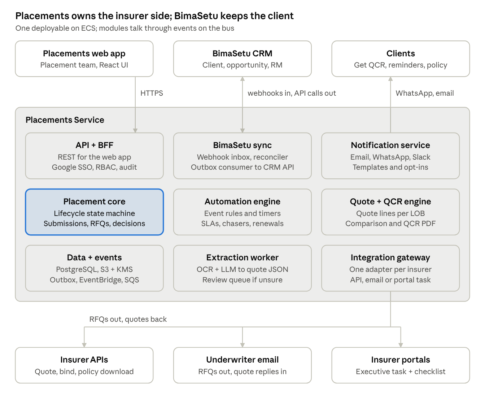

# Placements Platform — Architecture and Build Plan

Oct 14, 2026 · @Rohit Mishra

The Placements Platform is an internal service that takes a BimaSetu
opportunity from requirement to issued policy: insurer RFQs, quote
capture, comparison, client decision, binding and renewal, with CRM sync
and automations throughout. This doc covers the architecture and the
full list of what must be built; it carries no timelines.

## Architecture at a glance

Nine modules run in one service; BimaSetu talks only to the sync module
and insurers only to the Integration gateway, so each external change
touches one adapter.

platform architecture · 9 modules, BimaSetu, clients, 3 insurer channels

Placement core is the only writer of placement state; every other module
reacts to its events, and every external call goes out through the
outbox so nothing is lost on failure.

## Key architecture decisions

The platform is a modular monolith on AWS with event-driven
integrations; each decision below favours a small team shipping fast
while keeping clean seams to split later.

| Area                   | Decision                                                                                               | Why                                                                                                              |
|------------------------|--------------------------------------------------------------------------------------------------------|------------------------------------------------------------------------------------------------------------------|
| Service shape          | Modular monolith, one deployable, strict module boundaries                                             | One team, one deploy pipeline; Integration gateway and Extraction workers can be split out first if load demands |
| System of record       | BimaSetu owns client and opportunity; Placements owns placement, RFQs, quotes, decision, policy        | One writer per record avoids sync conflicts                                                                      |
| CRM sync               | Inbound signed webhooks + fetch-on-event; outbound via transactional outbox; nightly reconciliation    | No lost or double updates; drift self-heals                                                                      |
| State management       | Explicit state machine in Placement core; every transition emits an event                              | Auditable, and automations hang off events, not polling                                                          |
| Insurer connectivity   | Integration gateway with one adapter per insurer behind a common interface (API, email or portal task) | New insurer = new adapter; core logic never changes                                                              |
| Insurer email          | Per-placement inbound address with plus-addressing for each insurer thread                             | Every reply maps to its placement and RFQ without manual tagging                                                 |
| Quote capture          | OCR + LLM extraction to a per-LOB JSON schema, with confidence score and human review                  | Removes manual re-typing; low-confidence cases stay supervised                                                   |
| Automations            | Config-driven rules engine (trigger, condition, action) with scheduled timers                          | Ops can tune reminders and SLAs without a deploy                                                                 |
| Data                   | PostgreSQL with JSONB for LOB-specific fields; S3 + KMS for documents                                  | Relational core with flexible per-LOB schemas                                                                    |
| Async                  | EventBridge as event bus, SQS per worker, EventBridge Scheduler for timers                             | Managed, cheap, fits the AWS footprint                                                                           |
| Workflow orchestration | In-house state machine + timers now; Temporal only if flows become long and branchy                    | Avoids running extra infra before it is needed                                                                   |
| Hosting                | ECS Fargate in ap-south-1, React app on CloudFront                                                     | Data residency in India; no servers to manage                                                                    |
| Auth                   | Google Workspace SSO (OIDC), role- and LOB-scoped RBAC                                                 | Reuses staff identity; least privilege                                                                           |

## Workstreams

The product breaks into 13 workstreams; the foundation, Placement core
and BimaSetu integration are prerequisites for everything else.

| \#  | Workstream                          | Delivers                                                                   | Depends on           |
|-----|-------------------------------------|----------------------------------------------------------------------------|----------------------|
| W1  | Platform foundation                 | Repo, CI/CD, environments, auth, RBAC, audit, event bus                    | —                    |
| W2  | Placement core                      | Domain model, lifecycle state machine, submissions, RFQs, decisions        | W1                   |
| W3  | BimaSetu integration                | Two-way sync, stage mapping, deep links, reconciliation                    | W1, W2               |
| W4  | Document management                 | Upload, storage, versioning, virus scan, previews                          | W1                   |
| W5  | Integration gateway                 | Insurer adapters (email, API, portal tasks), inbound email parsing         | W2, W4               |
| W6  | Quote extraction                    | OCR + LLM extraction, confidence scoring, review queue                     | W4, W5               |
| W7  | Quote and QCR engine                | Quote lines per LOB, comparison, QCR PDF, approval                         | W2, W6               |
| W8  | Automation engine                   | Rules, timers, SLA clocks, the 10 automations                              | W2, W9               |
| W9  | Notifications                       | Email, WhatsApp, Slack channels with templates and opt-ins                 | W1                   |
| W10 | Payment, binding and policy         | Payment tracking, bind requests, policy capture and verification, hand-off | W2, W5               |
| W11 | Placements web app                  | All internal screens for executives, leads and RMs                         | W2–W10 APIs          |
| W12 | Reporting and analytics             | Ops dashboards, insurer performance, turnaround metrics                    | Event stream from W2 |
| W13 | Security, compliance and operations | DPDP and IRDAI controls, observability, backups, runbooks                  | Cuts across all      |

## What needs to be built

Each item is a buildable unit of work; tick it off as it ships.

### W1 · Platform foundation

- [ ] Monorepo with backend, web app and infra-as-code (Terraform or
  CDK)

- [ ] CI/CD pipeline: lint, tests, image build, deploy to dev, staging,
  prod

- [ ] AWS environments in ap-south-1: VPC, ECS Fargate, RDS PostgreSQL,
  S3, KMS, Secrets Manager

- [ ] Google Workspace SSO (OIDC) and session handling

- [ ] RBAC: Placement Executive, Placement Lead, RM, Finance, Admin; LOB
  and team scoping

- [ ] Audit log service: who changed what, when, before/after values

- [ ] Event infrastructure: transactional outbox table, outbox relay,
  EventBridge bus, SQS queues, DLQs

- [ ] Scheduler wrapper for timers (create, cancel, fire) on EventBridge
  Scheduler

- [ ] Shared libraries: error handling, idempotency keys, correlation
  IDs, config loader

### W2 · Placement core

- [ ] Data model and migrations: Placement, Requirement, Submission,
  InsurerRFQ, Quote, QCR, Decision, Policy, Insurer, Task

- [ ] Lifecycle state machine with guarded transitions and the
  closed-lost exit

- [ ] Per-LOB requirement schemas (Fire, GMC/GPA, WC, Marine, Liability,
  Cyber, D&O), versioned

- [ ] LOB document checklists and completeness check

- [ ] Submission builder: freeze a versioned document set and cover note

- [ ] RFQ management: create per insurer, status tracking, due dates,
  underwriter contacts

- [ ] Decision capture: chosen quote, accepted by, lost reason taxonomy

- [ ] Task model for human work items (assign, due, complete) used by
  automations

- [ ] Insurer master: LOBs written, channels, contacts, SLAs, appetite
  notes

- [ ] Domain events for every transition (placement.\*, rfq.\*,
  quote.\*)

### W3 · BimaSetu integration

- [ ] Signed webhook endpoint (HMAC, timestamp check) with inbox table
  and dedupe

- [ ] Opportunity fetch and mapping into placements (one per LOB)

- [ ] Client and contact read-through cache

- [ ] Document import from BimaSetu into S3

- [ ] Outbound sync consumer: stage updates, timeline notes, QCR and
  policy attachments, won/lost

- [ ] Configurable stage mapping table

- [ ] Retry with backoff, DLQ, alerting

- [ ] Nightly reconciliation job and drift report

- [ ] "Open in Placements" deep link and context panel contract with the
  BimaSetu team

- [ ] Polling fallback if BimaSetu webhooks are not available

### W4 · Document management

- [ ] Upload API with presigned URLs, per-placement S3 prefixes, KMS
  encryption, versioning

- [ ] Virus scanning on upload

- [ ] Document types and tagging (proposal form, previous policy, claims
  history, quote, QCR, policy)

- [ ] In-app preview for PDF and images

- [ ] Access control and access logging per document

### W5 · Integration gateway

- [ ] Common adapter interface: requestQuote, getQuote, bind,
  fetchPolicy

- [ ] Email adapter: RFQ templates per LOB, send from per-placement
  address

- [ ] Inbound email pipeline: SES receipt → S3 → parser → thread
  matching by plus-address

- [ ] Attachment extraction and hand-off to W6

- [ ] API adapters for the highest-volume insurers that expose APIs

- [ ] Portal adapter: generates an executive task with checklist and
  captures the outcome

- [ ] Per-insurer credentials, rate limits and health checks

### W6 · Quote extraction

- [ ] OCR pipeline (Textract) for PDFs and scanned documents

- [ ] LLM extraction prompts and JSON schemas per LOB

- [ ] Field-level confidence scoring and threshold config

- [ ] Review queue UI hooks: side-by-side source and extracted fields

- [ ] Policy-document extraction for verification against the chosen
  quote

- [ ] Evaluation set of real quotes per LOB and an accuracy regression
  test

- [ ] Prompt, model and output logging; PII minimisation before LLM
  calls

### W7 · Quote and QCR engine

- [ ] Quote versioning and manual edit with audit

- [ ] Normalisation per LOB: premium, GST, sum insured, deductibles,
  add-ons, exclusions

- [ ] Comparison view logic and recommendation field

- [ ] QCR PDF generator with BimaKavach branding

- [ ] QCR approval step (lead) and share action

- [ ] Regeneration on any quote change

### W8 · Automation engine

- [ ] Rules model: trigger (event or timer), condition, action, channel,
  enabled flag

- [ ] Event consumer and rule evaluator

- [ ] Timer lifecycle: scheduled on state entry, cancelled on exit

- [ ] Idempotent action execution with audit events

- [ ] Pause controls: per placement, per insurer, global

- [ ] Automations A1–A10: auto-create placement, missing-info chaser,
  insurer shortlist and RFQ fan-out, underwriter chaser, quote
  extraction trigger, QCR auto-build, client decision follow-up, payment
  and bind, policy chase and delivery, renewal kickoff

- [ ] Admin screen to edit timings and templates

### W9 · Notifications

- [ ] Notification service with a channel abstraction

- [ ] Email (SES or SendGrid) with templates

- [ ] WhatsApp via the existing BSP: template registration, opt-in check
  against BimaSetu

- [ ] Slack or Google Chat alerts to team channels

- [ ] In-app notifications for the web app

- [ ] Delivery status tracking and retries

### W10 · Payment, binding and policy

- [ ] Store insurer payment link on the accepted quote

- [ ] Payment status from insurer webhook, API poll or manual
  confirmation

- [ ] Bind request per channel (API, email, portal task)

- [ ] Policy document capture and check against the chosen quote

- [ ] policy.issued hand-off to policy admin and renewals

- [ ] placement.bound event to finance for expected brokerage

### W11 · Placements web app

- [ ] App shell, navigation, SSO login, role-aware menus

- [ ] My placements dashboard: queue by state, SLA badges, at-risk flags

- [ ] Placement workspace: requirement, documents, RFQs, quotes,
  timeline, tasks

- [ ] Client and opportunity side panel (live from BimaSetu)

- [ ] Submission builder screen

- [ ] Insurer selection and RFQ send screen

- [ ] Quote entry and extraction review screen

- [ ] QCR comparison, approval and share screen

- [ ] Decision, payment and policy screens

- [ ] Task inbox

- [ ] Admin: insurers, LOB schemas, stage mapping, automation rules,
  templates, users

- [ ] Global search across placements, clients, policies

### W12 · Reporting and analytics

- [ ] Event-to-warehouse pipeline (or Postgres read replica to start)

- [ ] Ops dashboard: open placements by state and LOB, SLA breaches,
  turnaround

- [ ] Insurer scorecard: response time, quote rate, win rate, decline
  reasons

- [ ] Team performance: placements per executive, conversion

- [ ] Data feed for insurer recommendation in A3

### W13 · Security, compliance and operations

- [ ] Data residency in India and DPDP controls: consent, purpose,
  retention, deletion

- [ ] PII masking in logs; encryption at rest and in transit

- [ ] IRDAI broker record retention for quotes, RFQs and correspondence

- [ ] Structured logging, tracing, metrics, alerting (sync failures, DLQ
  depth, SLA breaches)

- [ ] Backups and restore drills; RPO/RTO targets agreed

- [ ] Security review and penetration test before go-live

- [ ] Runbooks for CRM sync, insurer adapter failures, extraction
  outages

- [ ] Data migration of in-flight placements from current spreadsheets
  or email

## Decisions needed from the CTO

These choices change what gets built, so they should be settled before
W2 and W3 start.

- [ ] Backend language and framework: match BimaSetu's stack, or FastAPI
  vs NestJS on its own merits?

- [ ] Can BimaSetu ship outbound webhooks, or do we build the polling
  fallback in W3?

- [ ] LLM provider for extraction (Bedrock vs Anthropic API direct) and
  data-handling terms for client documents.

- [ ] Which insurers get API adapters first, and who owns insurer
  relationships for API access?

- [ ] Is premium ever routed through BimaKavach, or always
  insurer-direct? (Changes W10 scope.)

- [ ] Do renewals start as a new BimaSetu opportunity or directly in
  Placements?

- [ ] Reporting: Postgres read replica to start, or a warehouse from day
  one?

- [ ] Team ownership: one squad for the whole platform, or split
  integrations (W3, W5, W6) from product (W2, W7, W11)?
