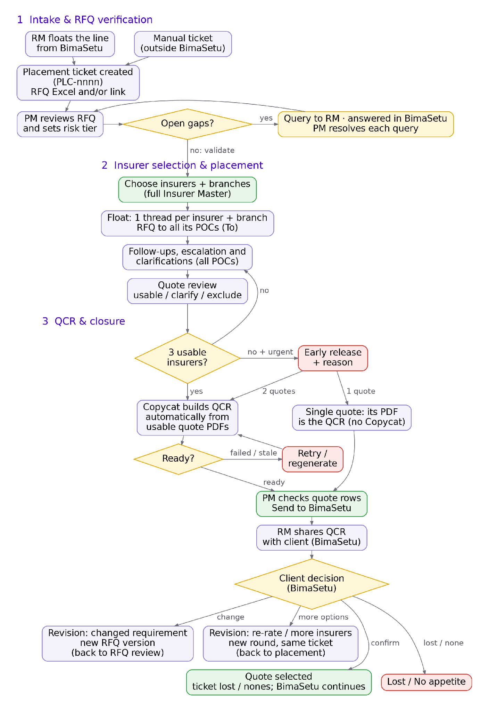

**PRODUCT REQUIREMENTS DOCUMENT**

**Placement Automation Platform**

RFQ, Insurer Placement, Quote Management & QCR

Version 1.7 · 8 October 2026 · BimaKavach Product

BimaKavach Insurance Broking Pvt. Ltd.

**Table of Contents**

**1. Introduction & Business Context 3**

> 1.1 Purpose 3
>
> 1.2 Background 3
>
> 1.3 Problem Statement 3
>
> 1.4 Product Vision 4
>
> 1.5 Product Principles 4
>
> 1.6 Product Objectives 4
>
> 1.7 Scope 5
>
> 1.8 Stakeholders 6
>
> 1.9 User Personas 6
>
> 1.10 Assumptions 6
>
> 1.11 Definitions & Glossary 7
>
> 1.12 Reference Inputs 8

**2. Solution Overview 8**

> 2.1 Overview 8
>
> 2.2 System Components 8
>
> 2.3 End-to-End Placement Lifecycle 10
>
> 2.4 Core Data Hierarchy 11
>
> 2.5 Automation vs Human Control 11

**3. Placement Workflow Summary 12**

> 3.1 Overview 12
>
> 3.2 Lifecycle Stages 12
>
> 3.3 Stage Model 13
>
> 3.4 Workflow Ownership Matrix 13
>
> 3.5 RM Journey 14
>
> 3.6 Placement Manager Journey 14
>
> 3.7 Automation Touchpoints 14

**4A. BimaSetu ⇄ BimaPlacement Interface 15**

**Module M1 - RFQ Intake & Placement Ticket Creation 17**

**Module M2 - RFQ Review, Queries to the RM 21**

**Module M3 - Placement Assignment & Ticket Classification 24**

**Module M4 - Insurer Master, Eligibility & Selection 26**

**Module M5 - Insurer RFQ Threads & RFQ Float 29**

**Module M6 - Follow-up, SLA & Escalation Engine 32**

**Module M7 - Insurer Response & Clarification Management 37**

**Module M8 - Quote Ingestion & Usability Review 40**

**Module M9 - Quote Pool, Copycat QCR & Placement Release 42**

**Module M10 - RM Review & Client Communication 47**

**Module M11 - Requote, RFQ Versioning & Closure 49**

**Module M12 - Workflow, Administration, Audit & Reporting 52**

**5. Consolidated Status Lifecycle 55**

> 5.1 Status Catalogue 55
>
> 5.2 Valid Transitions 55
>
> 5.3 Master Status at Each Touchpoint 56

**6. Role & Permission Matrix 57**

**7. Consolidated Notification Matrix 58**

**8. SLA Framework 59**

> 8.1 Business-Hours Rule 59
>
> 8.2 TAT Definitions 59
>
> 8.3 SLA Master - Initial Values 60
>
> 8.4 Configurable Follow-up Framework 61
>
> 8.5 SLA Stop, Hold and Switch Conditions 61

**9. Reporting 61**

> 9.1 Placement Manager Dashboard 61
>
> 9.2 Placement Head Dashboard 61
>
> 9.3 Insurer Performance Dashboard 62
>
> 9.4 Placement Funnel 62
>
> 9.5 Workbench Views (Prototype) 62

**10. Non-Functional Requirements 62**

> 10.1 Security & Access 62
>
> 10.2 Reliability & Idempotency 63
>
> 10.3 Performance 63
>
> 10.4 Availability / DR 63
>
> 10.5 Observability 63
>
> 10.6 Data & Audit Integrity 63

**11. Dependencies 63**

**12. Out of Scope 63**

**13. End-to-End Data Flow & Field Catalogue 64**

> 13.1 End-to-End Flow 64
>
> 13.2 Field Catalogue (Mandatory / Optional) 64

**14. Required Masters 65**

**15. Automation Catalogue 65**

**Appendix A - Open Items 66**

**Appendix B - Future Enhancements 67**

**Appendix C - Configurable Masters 67**

**Appendix D - Rejection & Requote Taxonomy 69**

**Appendix E - Data Objects & Suggested Field Catalogue 69**

**Appendix F - Insurer Contact Data Mapping 71**

**Appendix G - QCR Reference 71**

# 1. Introduction & Business Context

## 1.1 Purpose

This Product Requirements Document (PRD) defines the functional and
non-functional requirements for the BimaKavach Placement Automation
Platform. It is intended to be the primary reference for Product,
Engineering, QA, UX and Placement Operations during solution design,
implementation, testing and rollout.

The platform digitizes the Placement lifecycle from the point at which
an RFQ reaches the Placement Team - floated by an RM from BimaSetu, or
created manually by the Placement team for requests outside BimaSetu -
through insurer outreach, quote review, QCR delivery to BimaSetu and the
client's decision.

## 1.2 Background

The current Placement process is primarily coordinated through RM
communication, email, WhatsApp, insurer contact sheets, manual
follow-ups and manually prepared QCR reports. The RM prepares or
collates an RFQ and the Placement team determines the market strategy,
contacts selected insurers and follows each insurer independently until
enough usable quotations are available.

The current business flow differs by case type. New cases are generally
marketed broadly; renewals may stay with the incumbent for smaller cases
or be tested across the market for larger cases; rollover business
normally excludes the incumbent insurer unless the client provides the
required mandate. Insurer responses arrive independently and may include
a quote, a clarification request, a decline or no response. Placement
currently waits for a usable set of quotes, prepares a QCR (Quote
Comparison Report) and insurer PDFs, and shares the grouped output with
RM.

The current process provides strong human judgement but has limited
system support. It is difficult to scale because insurer selection,
contact routing, follow-up timing, response tracking, quote extraction,
QCR preparation, negotiation versioning and management reporting rely
heavily on manual effort.

## 1.3 Problem Statement

### Operational Challenges

RFQ information is fragmented across forms, messages, emails and
attachments before it becomes actionable for Placement.

Placement must manually validate whether product-specific underwriting
information is complete.

Insurer selection depends on individual experience and manual reference
to insurer/contact information.

Insurer requests progress independently, creating substantial follow-up
and tracking overhead.

Email replies, quote PDFs, clarification requests and revised quotes are
not normalized into a single structured record.

Placement manually extracts quote terms and prepares QCR sheets.

Late quotes, revised quotes and changed requirements create
version-control risk.

SLA breaches and pending actions are detected manually rather than by an
orchestrated workflow.

Insurer performance data is not systematically reused to improve future
insurer recommendations.

### RM Challenges

RM does not have a consistent, aggregate self-service view of Placement
progress.

RM may need to follow up with Placement for status updates.

QCR preparation delays the point at which RM can discuss options with
the client.

Client rejection and requote reasons are not always captured in a
structured form that can trigger the correct next action.

### Business Challenges

Operational effort rises roughly with insurer count and RFQ volume.

Insurer response quality and TAT cannot be easily compared across
product, industry and risk types.

Inconsistent tracking reduces auditability and makes process improvement
difficult.

Manual QCR preparation limits scalability and increases the chance of
commercial-data errors.

## 1.4 Product Vision

Build a centralized Placement platform where an RFQ - sent by an RM by
mail or uploaded by Placement - becomes a Placement ticket per product
type; the Placement Manager confirms the RFQ is complete, approves
insurers, insurer workflows run independently per insurer + branch,
follow-ups and escalations are automatically orchestrated, insurer
replies and quote documents are captured, Placement validates usable
quotes, Copycat builds the QCR from the usable quote PDFs, Placement
releases it to RM, and any additional-market or requirement-change cycle
stays within the same traceable ticket.

## 1.5 Product Principles

One ticket per product type: a multi-product RFQ creates one Placement
ticket per product; tickets from the same RFQ are linked and the link is
visible at Placement Head level.

Platform as system of record: V1 Placement tickets are created by a
BimaSetu float or as a manual ticket by the Placement team; either way
the Placement ticket is the single record of the placement work.

RFQ as a document: the RFQ is stored and sent to insurers as received -
an Excel file, a link, or both - and is not extracted into data in V1.

Human-controlled commercial decisions: the system may recommend and
automate coordination but does not silently choose or reject a
commercial quote.

Independent insurer state: every approached insurer + branch has an
independent thread (all its POCs on every mail), SLA, communication
history and quote history.

Confidence-based automation: uncertain inbound-email
mapping/classification routes to human review rather than silently
updating commercial data.

Configuration over hard-coding: outreach behaviour, thresholds, SLAs,
templates and field masters are configurable where business rules may
change.

Version everything commercially material: RFQ versions, quote versions
and released QCR versions remain traceable.

RM visibility without operational overload: the RM sees the desk stage,
open queries and QCR rounds on the BimaSetu line, not insurer-by-insurer
follow-up details.

Complete auditability: every override, release, edit, communication and
terminal outcome is attributable to a user or system event.

## 1.6 Product Objectives

### Business Objectives

Reduce average Placement operational effort per RFQ.

Reduce time from complete RFQ to QCR release.

Increase insurer follow-up consistency and SLA adherence.

Improve RM visibility without increasing Placement coordination
overhead.

Create structured insurer-performance data to improve future market
selection.

Standardize requote and requirement-change handling.

### Product Objectives

Support one Placement ticket per product type; link tickets created from
the same RFQ.

Capture standard intake fields and masters (Product Type, Business Type,
Industry Type) and map each product type to its RFQ template.

Set a PM-chosen risk tier at RFQ review that selects the insurer
quote-collection SLA.

Select insurers from the full Insurer Master with eligibility and Do Not
Float enforced; no automated insurer recommendation in V1.

Automate insurer emails, reminders and escalations through independent
insurer threads.

Ingest and classify insurer replies; send usable quote PDFs to Copycat
for QCR generation.

Automatically generate the QCR through Copycat from the usable quote
PDFs once the configured threshold is reached (or two usable quotes are
released early); a single usable quote is released as the insurer's own
quote PDF without Copycat.

Require Placement review before commercial information is released to
RM.

Provide structured client-decision, additional-market and RFQ-version
workflows.

Provide configurable dashboards, SLA management, masters and audit
history.

## 1.7 Scope

### In Scope - V1

RFQ intake as a document: Excel and/or RFQ link - floated with the line
from BimaSetu, or uploaded on a manual ticket created by the Placement
team.

One Placement ticket per product line; each line floated from BimaSetu
creates its own ticket, and tickets are not linked.

Intake masters: Product Type (21 values, each mapped to one RFQ
template), Business Type (New, Renewal, Rollover) and Industry Type (11
values).

PM-set Risk Tier (Preferred / Non-preferred) at RFQ review, used to
select the quote-collection SLA.

Manual ticket creation by Placement Managers and the Placement Head,
with owner assignment by the Placement Head.

RFQ review with queries raised to RM by mail and resolved by the PM.

RFQ link rendered as a read-only sheet with an Open link action;
uploaded Excel stored as a downloadable document.

Personal Placement Manager mailbox connector for sending to and reading
from insurers.

Business type (New, Renewal, Rollover) classification.

Placement assignment, reassignment and escalation of ownership to the
Placement Head.

Insurer Master, product-type appetite and Insurer Contact (POC) Master.

Insurer selection from the full Insurer Master with eligibility
filtering and Do Not Float enforced, and product-type appetite chips for
context; no automated insurer recommendation in V1.

Placement insurer-list approval and override, with Do Not Float enforced
on every add path.

Independent insurer RFQ threads (one per insurer + branch) with the RFQ
attached, sent from the assigned PM email ID to all POCs of that
insurer + branch in To.

Configurable follow-up and escalation engine; the insurer
quote-collection SLA is a configurable LOB x risk-tier x case-type
matrix seeded from the business TAT baseline.

Inbound email mapping, classification, product-type alias matching and
Manual Review.

Placement quote usability validation (mark usable, request
clarification, exclude from QCR); quote extraction for the QCR is
performed by Copycat.

Three-usable-quote threshold, automatic follow-up stop and Request More
Quotes workflow.

Urgency/exception release with one or two usable quotes and mandatory
reason; a single quote is released as its own PDF without Copycat.

QCR generation by Copycat from usable quote PDFs, with retry,
regeneration, release approval and versioning.

RM handover through BimaSetu: queries, QCR rounds with quote rows,
revision requests, client confirmation and line lost (Section 4A).

Additional insurer outreach and RFQ Version 2.

Terminal outcomes: Quote selected, No appetite and Lost.

Configurable masters, notifications, SLA framework, dashboards and
complete audit trail.

### Out of Scope - V1

A separate RM portal for BimaPlacement (RMs work in BimaSetu), and
automated insurer recommendation / ranking / scoring.

BimaKavach-side quote extraction, OCR, confidence scoring and correction
capture - Copycat performs quote extraction for the QCR.

Duplicate-case detection and the Duplicate terminal outcome.

Insurer API integrations and insurer portal automation.

Automatic quote rejection based on premium or model output.

Weighted AI best-quote recommendation for client-facing decisioning.

Direct customer QCR in BimaKendra.

Automatic client communication without RM approval.

Payment, binding, policy issuance and downstream policy generation.

Urgency-specific SLA cadence - urgency changes visibility and
prioritisation, not the clock.

Negotiation rounds, reconsideration requests and final-revision requests
(moved to Future Enhancements).

Extraction of RFQ content into structured fields; the RFQ is stored and
sent as a document.

BimaNetra advisory risk report.

## 1.8 Stakeholders

| Stakeholder                | Interest / Responsibility                                                                                                                                                                         |
|----------------------------|---------------------------------------------------------------------------------------------------------------------------------------------------------------------------------------------------|
| Product                    | Owns requirements, prioritization and release scope.                                                                                                                                              |
| Engineering                | Builds Placement Workbench/TMS workflow, integrations (mailbox, Copycat), email processing, recommendation and reporting.                                                                         |
| QA                         | Validates functional flows, state transitions, SLAs, edge cases and commercial-data integrity.                                                                                                    |
| UX                         | Designs the Placement Workbench experience; the RM experience is in BimaSetu.                                                                                                                     |
| Relationship Manager       | Floats the line to Placement from BimaSetu, answers queries, receives the QCR in BimaSetu, shares it with the client and confirms the client's choice in BimaSetu.                                |
| Placement Manager          | Primary Placement ticket owner (Placement Executive in the prototype); creates manual tickets, raises and resolves RFQ queries, sets risk tier, approves insurers, reviews quotes, releases QCRs. |
| Placement Head             | Operational oversight; creates and assigns manual tickets; owns cases escalated after the SLA ladder is exhausted; reassignment and Insurer Master governance.                                    |
| Customer                   | Provides product and risk information and the commercial decision through the RM.                                                                                                                 |
| Insurer                    | External partner providing quote, decline or query response through email.                                                                                                                        |
| Administrator              | Configures masters, rules, templates and role permissions.                                                                                                                                        |
| Copycat (external service) | Builds the QCR from the usable quote PDFs sent by the platform.                                                                                                                                   |

## 1.9 User Personas

| Persona                   | Description                                                                                                                                                                                                                |
|---------------------------|----------------------------------------------------------------------------------------------------------------------------------------------------------------------------------------------------------------------------|
| Relationship Manager (RM) | Client-facing owner who collects the RFQ from the client and floats it to Placement from BimaSetu, answers queries, receives the QCR rounds, shares them with the client and confirms the client's decision in BimaSetu.   |
| Placement Manager (PM)    | Operational owner of one Placement ticket (one product) end to end across its insurer threads. Called Placement Executive in the prototype. Creates manual tickets when an RFQ reaches Placement outside a parsed RM mail. |
| Placement Head            | Supervisory user responsible for workload, escalations, reassignment, insurer performance and Insurer Master governance. Creates and assigns tickets, sees a Team view and a Me view of cases they own.                    |
| Customer                  | Provides the RFQ and chooses commercial options through the RM.                                                                                                                                                            |
| Insurer POC               | External actor receiving RFQs and follow-ups and returning quotes, queries or declines.                                                                                                                                    |
| Administrator             | Configures system masters and permissions.                                                                                                                                                                                 |

## 1.10 Assumptions

V1 supports the same Placement-ticket workflow whether the RFQ arrives
as an Excel file, a link or both, and whether it came from a BimaSetu
float or a manual ticket created by Placement.

The assigned Placement Manager has the final insurer-selection decision
in all case types (New, Renewal, Rollover), even when system rules or
client/RM preferences influence recommendation order.

Quote extraction for the QCR is performed by Copycat from the usable
quote PDFs; BimaKavach does not extract quote terms into structured data
in V1.

Insurer email automation is designed around a configurable connector to
the assigned Placement Manager's work mailbox; mailbox/provider-specific
implementation remains configurable.

A line is floated from BimaSetu, or a manual ticket is created by
Placement; either path creates the Placement ticket immediately (one per
product line).

One Placement Manager owns one Placement ticket.

Outbound insurer emails are sent from the assigned Placement Manager
email identity.

Email remains the primary insurer communication channel in V1.

Normal quote threshold for QCR generation is three usable quotes from
three distinct insurers.

Placement may release one or two usable quotes in an urgent/exception
case with mandatory reason; a single quote is never sent to Copycat.

A received quote does not count toward the threshold until the PM marks
it usable.

The insurer quote-collection SLA is selected from a configurable LOB x
risk-tier x case-type matrix; the PM sets the risk tier at RFQ review
before float, and working-day ranges collapse to a single target by the
configured rule (initial: upper bound of the range).

RM sees aggregate insurer progress before QCR release and does not need
insurer-by-insurer detail.

Placement V1 ends at Quote Selected and hands off to the existing
downstream payment/policy journey.

All SLAs, thresholds, reminders and escalation timings are configurable
unless explicitly stated otherwise.

Default business calendar is Monday-Friday, 10:00-19:00 IST; one
business day equals 540 business minutes.

## 1.11 Definitions & Glossary

| Term                        | Meaning                                                                                                                                                                                                                                                                                        |
|-----------------------------|------------------------------------------------------------------------------------------------------------------------------------------------------------------------------------------------------------------------------------------------------------------------------------------------|
| Placement Ticket            | Parent system record created for one product line floated from BimaSetu, or for one manual ticket; tickets are not linked.                                                                                                                                                                     |
| RFQ Version                 | Immutable snapshot of customer/risk requirements at a point in time.                                                                                                                                                                                                                           |
| Insurer Thread              | Independent workflow for one insurer + branch, including communications, queries, quotes and SLA. Every mail on the thread goes to all POCs of that insurer + branch in To. The same insurer at two branches is two threads. Identified by a Thread ID (TH-nn) that is never reused on a case. |
| Usable Quote                | Current-RFQ-version quote that PM has validated and marked usable with no material missing information. Counts once per distinct insurer.                                                                                                                                                      |
| Quote Threshold             | Normal requirement of three usable quotes from three different insurers before QCR release workflow begins.                                                                                                                                                                                    |
| QCR Version                 | Versioned, immutable snapshot of a QCR once released to RM.                                                                                                                                                                                                                                    |
| Incumbent Approach Mandate  | Client permission allowing BimaKavach to approach the incumbent insurer in a rollover case.                                                                                                                                                                                                    |
| Exclusive Placement Mandate | Client authority for BimaKavach to choose the final commercial option subject to RM + Placement approval.                                                                                                                                                                                      |
| Target Premium              | Client/RM commercial target used as a decision-support flag only.                                                                                                                                                                                                                              |
| Risk Tier                   | Preferred or Non-preferred/High-risk; set by the PM at RFQ review; selects the insurer quote-collection SLA.                                                                                                                                                                                   |
| Manual Review               | Human review state for uncertain email mapping or classification.                                                                                                                                                                                                                              |
| PM                          | Placement Manager.                                                                                                                                                                                                                                                                             |
| RM                          | Relationship Manager.                                                                                                                                                                                                                                                                          |
| SLA                         | Configurable business-time service-level target.                                                                                                                                                                                                                                               |
| BimaSetu                    | BimaKavach's RM CRM. RMs float lines to Placement, answer queries, receive QCR rounds and confirm the client's choice there; it talks to BimaPlacement through the interface in Section 4A.                                                                                                    |
| Manual Ticket               | A Placement ticket created by a Placement Manager or the Placement Head by uploading the RFQ Excel and/or entering the RFQ link and typing the intake fields.                                                                                                                                  |
| RFQ Source                  | The RFQ as received: an Excel file, a link, or both. Stored on the RFQ Version and sent to insurers as is.                                                                                                                                                                                     |
| Product Type                | Intake value from the Product Type Master; maps to exactly one RFQ template.                                                                                                                                                                                                                   |
| RFQ Template                | The product-specific RFQ workbook or section a product type uses, grouped in the EB, Liability and P&C folders.                                                                                                                                                                                |
| Business Type               | New (new policy), Renewal (our renewal) or Rollover (other company renewal).                                                                                                                                                                                                                   |
| Industry Type               | Intake value from the Industry Type Master (11 values).                                                                                                                                                                                                                                        |
| Query to RM                 | A missing RFQ item the PM raises as a query to the RM, answered in BimaSetu (by mail on a manual ticket). Open until the PM marks it resolved; any open query blocks RFQ validation.                                                                                                           |
| Copycat                     | External QCR service. Receives the usable quote PDFs and returns the QCR (comparison and/or QCR file).                                                                                                                                                                                         |
| Escalated Case              | A case whose internal SLA ladder is exhausted; ownership moves to the Placement Head.                                                                                                                                                                                                          |
| Placement Executive         | Prototype name for the Placement Manager role.                                                                                                                                                                                                                                                 |

QCR - Quote Comparison Report: the QCR built by Copycat from
PM-validated usable insurer quotes and released to RM only after PM
approval.

## 1.12 Reference Inputs

- Endorsement Management Platform PRD - used only as the structural and
  > formatting reference for requirement documentation.

- Current Placement Flow As-Is - used as the operational baseline being
  > replaced.

- Existing RFQ examples and insurer-contact master previously reviewed
  > during requirement discovery.

- Placement Automation future-state Figma flow and the confirmed
  > requirement decisions from the Product/Placement working sessions.

- BimaPlacement prototype (prototype.jsx, 10 Sep 2026) - behaviour,
  > statuses, SLA values and master data used in this PRD.

- Intake definitions for Product Type, Business Type and Industry Type
  > (10 Sep 2026).

- Product decisions taken while specifying the prototype changes (10 Sep
  > 2026).

- Placement Repository - Insurer Contact Details workbook (Oct 2026) -
  > insurer, branch and POC data (Appendix F).

- BimaSetu epics F7 · RFQ and F8 · Placement, quotes and the QCR
  > (BPV30-1386, BPV30-1390) - RM handover decisions of 26–27 Sep 2026,
  > and the Placement Jira stories P1–P11 (BPV30-1446 to BPV30-1513).

# 2. Solution Overview

## 2.1 Overview

offers the full Insurer Master with eligibility and Do Not Float
enforced and product-type appetite chips (there is no automated insurer
recommendation in V1)

## 2.2 System Components

| Component                          | Responsibility                                                                                                                                                                                                                |
|------------------------------------|-------------------------------------------------------------------------------------------------------------------------------------------------------------------------------------------------------------------------------|
| BimaSetu (RM CRM)                  | Floats lines with the RFQ and intake fields, carries queries and answers, receives QCR rounds with quote rows, and sends revision requests, client confirmations and line lost (Section 4A).                                  |
| Placement Workbench / TMS          | Primary PM work queue, manual ticket creation, RFQ review and queries, risk-tier setting, insurer selection, threads, quote review, QCR review and closure.                                                                   |
| RFQ Intake & Document Service      | Stores the RFQ Excel and/or link, renders links as a read-only sheet, maps product types to RFQ templates, tracks queries.                                                                                                    |
| Assignment & Classification Engine | Ownership, Head assignment and escalation, and business type.                                                                                                                                                                 |
| Insurer Contact Master             | Insurer, product-type appetite, POCs and geography/branch routing.                                                                                                                                                            |
| Insurer Eligibility Engine         | Eligibility filtering and Do Not Float enforcement for all tickets; product-type appetite chips. No automated recommendation, ranking or scoring in V1.                                                                       |
| Email Bot / Integration            | Outbound email with the RFQ attachment / link; inbound insurer-mail mapping, classification and Manual Review through the assigned PM's mailbox.                                                                              |
| Workflow / SLA Engine              | State transitions; business-hour timers; the quote-collection SLA selected from the LOB x risk-tier x case-type matrix; reminders; internal escalation ladder to the Placement Head; hold/resume; three-quote threshold stop. |
| QCR Service (Copycat adapter)      | Sends usable quote PDFs to Copycat, tracks generation status, stores the returned QCR, handles retry, regeneration and versioning.                                                                                            |
| Notification Engine                | Configurable user/channel notifications.                                                                                                                                                                                      |
| Administration & Configuration     | Intake masters, business masters, thresholds, SLA matrix, templates, holidays and role controls.                                                                                                                              |
| Reporting Layer                    | Placement, RM and insurer-performance dashboards.                                                                                                                                                                             |
| Audit Service                      | Immutable activity history and before/after changes.                                                                                                                                                                          |
| Copycat (external)                 | Builds the QCR from quote PDFs; performs quote extraction for the QCR.                                                                                                                                                        |

## 2.3 End-to-End Placement Lifecycle

Figure 1. V1 Placement lifecycle

| Stage                                   | Primary Owner                             | Key Outcome                                                                                                                                                           |
|-----------------------------------------|-------------------------------------------|-----------------------------------------------------------------------------------------------------------------------------------------------------------------------|
| Stage 1 - RFQ Intake                    | RM (BimaSetu float) / PM / Placement Head | Placement ticket(s) created from the RFQ Excel and/or link and intake fields - one per product type.                                                                  |
| Stage 2 - RFQ Review                    | PM / RM                                   | PM reviews the RFQ, sets the risk tier, raises queries to the RM and resolves them; RFQ validated.                                                                    |
| Stage 3 - Assignment & Classification   | PM                                        | One owner; business type and strategy confirmed.                                                                                                                      |
| Stage 4 - Insurer Selection             | System / PM                               | Insurers chosen from the full Insurer Master (eligibility + Do Not Float); branches chosen (all POCs of each insurer + branch included automatically); list approved. |
| Stage 5 - RFQ Float                     | System / Insurer                          | One thread per insurer + branch; RFQ attached / linked in one mail to all its POCs (To).                                                                              |
| Stage 6 - Follow-up & Clarification     | System / PM                               | Insurer SLAs, reminders, queries and escalation managed.                                                                                                              |
| Stage 7 - Quote Intake                  | System / PM                               | Quote captured (PDF/link) and validated as usable, needs clarification, or excluded.                                                                                  |
| Stage 8 - QCR                           | System / Copycat / PM                     | Threshold reached; Copycat builds the QCR; PM releases it to RM.                                                                                                      |
| Stage 9 - RM / Client Decision          | RM                                        | QCR sent to client and decision captured.                                                                                                                             |
| Stage 10 - Requote / Requirement Change | PM / RM                                   | More quotes from restarted or new threads, or RFQ Version 2.                                                                                                          |
| Stage 11 - Handoff / Closure            | PM / RM                                   | Quote Selected or terminal unsuccessful outcome.                                                                                                                      |

## 2.4 Core Data Hierarchy

| Object                     | Parent                       | Purpose                                                                                                                |
|----------------------------|------------------------------|------------------------------------------------------------------------------------------------------------------------|
| Placement Ticket           | Client / Opportunity         | One ticket per RFQ product; the single record.                                                                         |
| RFQ Version                | Placement Ticket             | Immutable requirement snapshot: RFQ source (Excel and/or link), the ticket's product type and its mapped RFQ template. |
| Query                      | RFQ Version                  | Item raised to RM by mail; resolved by PM.                                                                             |
| Insurer Thread             | Placement Ticket             | Independent insurer + branch communication and response workflow (TH-nn), covering all its POCs.                       |
| Quote Version              | Insurer Thread + RFQ Version | Versioned insurer commercial output.                                                                                   |
| QCR Version                | Placement Ticket             | Versioned QCR built by Copycat from a set of usable quotes on one RFQ version.                                         |
| Copycat Generation Request | QCR Version                  | Request id, documents sent, status, returned QCR.                                                                      |
| Mandate                    | Placement Ticket             | Incumbent/Exclusive authority proof.                                                                                   |
| Task                       | Placement Ticket / Thread    | Human action required.                                                                                                 |
| Audit Event                | Any object                   | Immutable timeline event.                                                                                              |

## 2.5 Automation vs Human Control

| Area               | Automated                                                                                                                      | Human Control                                                             |
|--------------------|--------------------------------------------------------------------------------------------------------------------------------|---------------------------------------------------------------------------|
| RFQ intake         | Ticket creation (one per product); product type -\> RFQ template mapping; RM-mail parsed into intake fields; no RFQ extraction | RM sends the RFQ / Placement enters intake fields and attaches the RFQ.   |
| Completeness       | Tracks open/resolved query state; blocks Validate while any query is open (no automatic query detection)                       | PM raises queries to the RM (answered in BimaSetu) and resolves each one. |
| Risk tier & SLA    | Quote-collection SLA selected automatically from the LOB x risk-tier x case-type matrix                                        | PM sets the risk tier at RFQ review before float.                         |
| Case type          | Business Type master values                                                                                                    | RM/PM select; PM can correct.                                             |
| Insurer selection  | Eligibility + Do Not Float enforcement; product-type appetite chips. No recommendation/ranking in V1.                          | PM selects from the full Insurer Master; approves/adds/removes.           |
| RFQ float          | Email generation/send                                                                                                          | PM approval before float.                                                 |
| Follow-up          | Scheduled email/tasks; reminders; internal escalation to Placement Head                                                        | PM may call, pause or restart.                                            |
| Inbound email      | Mapping/classification                                                                                                         | Manual Review on ambiguity.                                               |
| Quote extraction   | Quote captured as PDF/link; no BK extraction (Copycat extracts for the QCR)                                                    | PM validates usability (usable / clarification / exclude).                |
| QCR                | Automatic Copycat generation (no Generate QCR action), retry, versioning; a single-quote release skips Copycat                 | PM reviews, regenerates if needed, and releases.                          |
| Target premium     | Automatic flag                                                                                                                 | No auto rejection.                                                        |
| Requirement change | Versioning and reset                                                                                                           | RM records; PM chooses insurers.                                          |
| Final selection    | No automatic choice in V1                                                                                                      | RM + client / RM + Placement by mandate.                                  |

# 3. Placement Workflow Summary

## 3.1 Overview

The workflow is designed as a parent Placement ticket with independent
insurer subflows (one per insurer + branch). The ticket remains owned by
one PM (or the Placement Head after escalation) while the current action
owner can change between RM, insurer, Copycat and PM. The normal
business objective is to obtain three Placement-validated usable quotes
from three different insurers. Reaching this threshold stops further
automated insurer follow-ups and sends the usable quote PDFs to Copycat.
The PM must still review and explicitly release the QCR to RM.

## 3.2 Lifecycle Stages

| \#  | Stage                             | Owner                                     | Key Outcome                                                     |
|-----|-----------------------------------|-------------------------------------------|-----------------------------------------------------------------|
| 1   | RFQ Intake (mail / manual ticket) | RM (BimaSetu float) / PM / Placement Head | Placement ticket created (one per product)                      |
| 2   | RFQ Review                        | PM / RM                                   | Risk tier set; queries resolved; RFQ validated                  |
| 3   | Assignment & Classification       | PM                                        | Strategy confirmed                                              |
| 4   | Insurer Selection                 | System / PM                               | Insurer list approved (full Insurer Master)                     |
| 5   | RFQ Float                         | System / Insurer                          | Independent insurer threads active                              |
| 6   | Insurer Follow-up                 | System / PM                               | Responses or escalation                                         |
| 7   | Quote Review                      | PM                                        | Usable quote pool maintained                                    |
| 8   | QCR                               | System / Copycat / PM                     | QCR built (Copycat, manual upload or single quote) and released |
| 9   | RM / Client Decision              | RM                                        | Select / more quotes / change / close                           |
| 10  | Requote / Requirement Change      | PM / RM                                   | More quotes or RFQ V2                                           |
| 11  | Handoff / Closure                 | RM / PM                                   | Quote Selected or terminal close                                |

## 3.3 Stage Model

The workbench tracks a stage per ticket. The stage decides the tab a
ticket opens on and which SLA clock runs. Stages group into six phases
shown on the ticket Overview.

| Stage Code        | Stage             | Phase                  | Default Internal Status                                         | SLA                                         |
|-------------------|-------------------|------------------------|-----------------------------------------------------------------|---------------------------------------------|
| rfq_review        | RFQ Review        | RFQ Verification       | Ready for Placement                                             | SLA-02                                      |
| awaiting_rm       | RFQ Clarification | RFQ Verification       | RFQ Clarification Required                                      | SLA-03                                      |
| insurer_selection | Insurer Selection | Insurer Selection      | Insurer Selection Pending / Insurers Approved                   | SLA-04 -\> SLA-05                           |
| market            | Quote Collection  | RFQ Placement          | Quote Collection In Progress                                    | SLA-06 (LOB x risk-tier x case-type matrix) |
| quote_review      | Quote Review      | Quote & QCR Generation | Quote Review Required                                           | SLA-10                                      |
| qcr_draft         | QCR Ready         | Quote & QCR Generation | QCR Generation In Progress / Failed / Pending Placement Release | SLA-11 -\> SLA-12                           |
| qcr_released      | Pending RM Review | Quote & QCR Generation | Pending RM Review                                               | SLA-14                                      |
| closed            | Closed            | Ticket Closure         | Terminal outcome                                                | \-                                          |

## 3.4 Workflow Ownership Matrix

| Current Stage              | Ticket Owner   | Action Owner     | Expected Next Action                                                                 |
|----------------------------|----------------|------------------|--------------------------------------------------------------------------------------|
| RFQ Clarification          | PM             | RM               | Provide missing customer/risk information.                                           |
| Ready for Placement        | PM             | PM               | Review the RFQ, set the risk tier, resolve queries and validate.                     |
| Insurer Selection          | PM             | PM               | Select insurers from the full Insurer Master; approve and float.                     |
| RFQ Floated                | PM             | Insurer          | Respond / query / quote / decline.                                                   |
| Awaiting RM Information    | PM             | RM               | Provide clarification requested by insurer.                                          |
| Quote Review Required      | PM             | PM               | Validate the quote and mark usable / needs clarification / excluded.                 |
| QCR Generation In Progress | PM             | Copycat / System | Return the QCR, or fail with an error the PM can retry.                              |
| QCR Ready                  | PM             | PM               | Review and release the QCR (Copycat-generated, manually uploaded or a single quote). |
| Pending RM Review          | PM             | RM               | Send to client / request more / record decision.                                     |
| RFQ Version 2 (RFQ Review) | PM             | PM / RM          | Review the new RFQ source; raise queries; validate.                                  |
| Quote Selected             | PM             | RM + PM          | Handoff to downstream journey.                                                       |
| Escalated case             | Placement Head | Placement Head   | Act on the overdue stage; reassign if needed.                                        |

## 3.5 RM Journey

Collect the RFQ from the client as the product-specific Excel template
and/or link.

Float the line to Placement from BimaSetu with the RFQ (Excel and/or
link), product, business type and industry type; target premium,
exclusive mandate and a note to placement are optional.

Answer queries from Placement in BimaSetu, including insurer information
requests.

Receive the Placement-released QCR (built by Copycat or uploaded by the
PM) and insurer PDFs.

Review the QCR round in BimaSetu and share it with the client.

Confirm the client's choice in BimaSetu, send the QCR back for revision,
or mark the line lost.

If a quote is selected, the ticket hands off to the downstream
payment/policy journey.

Note: RMs work in BimaSetu. Floats, queries, QCR rounds, revision
requests, client confirmation and line lost pass through the BimaSetu
interface (Section 4A). Manual tickets use mail, and the PM records the
outcome on the workbench.

## 3.6 Placement Manager Journey

Receive a ticket created from a parsed RM mail or an assigned case, or
create a manual ticket when an RFQ reaches Placement outside a mail (the
Placement Head may assign it to a PM).

Review the RFQ document; set the risk tier; raise queries to the RM;
mark each query resolved; validate the RFQ.

Choose insurers from the full Insurer Master (eligibility and Do Not
Float enforced, appetite chips for context) with branch (all POCs
included automatically); approve and float with the RFQ attached.

Monitor one thread per insurer + branch: answer clarifications, hold a
thread's clock while RM information is pending, follow up and log calls.

Review inbound quotes and mark them usable, needs clarification or
excluded.

At the threshold, or on early release with two quotes and a reason,
Copycat generates the draft QCR automatically; on early release with one
quote, that insurer's quote PDF becomes the QCR without Copycat; the PM
may instead upload a QCR file manually; retry if Copycat fails,
regenerate if the usable set changes.

Click Send to BimaSetu; create a new QCR version only when a later quote
needs to reach the client.

Handle Request More Quotes (restart threads or approach another insurer)
or RFQ Version 2.

Close as No appetite when no insurer will quote; Quote selected and Lost
arrive from BimaSetu.

## 3.7 Automation Touchpoints

| Touchpoint                        | Automated Action                                                                                                 | Human Check / Control                                                    |
|-----------------------------------|------------------------------------------------------------------------------------------------------------------|--------------------------------------------------------------------------|
| RFQ intake (mail / manual ticket) | Ticket creation (one per product); RFQ stored as Excel/link; template mapping; RM-mail parsed into intake fields | RM sends the RFQ by mail / PM enters intake fields and attaches the RFQ. |
| RFQ review                        | Sends the PM's queries to the RM; tracks open / resolved queries; blocks Validate while any query is open        | PM raises queries, resolves each, and sets the risk tier.                |
| Insurer selection                 | Eligibility + Do Not Float filtering; product-type appetite chips                                                | PM selects from the full Insurer Master and approves the list.           |
| RFQ float                         | One thread per insurer + branch; RFQ attached / linked; one email to all its POCs (To)                           | PM initiates approved outreach.                                          |
| Follow-ups                        | Configured reminders/tasks; internal escalation ladder to the Placement Head                                     | PM may call / restart / stop.                                            |
| Insurer inbound                   | Mapping, classification and product-type alias matching                                                          | Manual Review on ambiguity.                                              |
| Quote                             | Quote captured as PDF/link (no BimaKavach extraction)                                                            | PM marks usable / needs clarification / excluded.                        |
| Threshold                         | Counter + auto stop                                                                                              | PM can override for urgency.                                             |
| QCR (Copycat)                     | Usable quote PDFs sent to Copycat; QCR returned                                                                  | PM releases.                                                             |
| QCR (manual upload)               | Stores the uploaded file as a QCR Version (source = manual)                                                      | PM may upload a QCR file (see M9 open point) and still releases it.      |
| RFQ V2                            | Supersede / reset / revalidate                                                                                   | PM chooses insurers.                                                     |

# 4A. BimaSetu ⇄ BimaPlacement Interface

From v1.7 the RM side of Placement runs in BimaSetu, BimaKavach's RM CRM
(BimaSetu epics F7 · RFQ and F8 · Placement, quotes and the QCR). RMs
float lines to Placement, answer queries, receive each QCR round with
its quote rows, ask for revisions and confirm the client's choice in
BimaSetu. BimaPlacement talks to BimaSetu only through the messages
below. Requests that never pass through BimaSetu are handled as manual
tickets, which use mail. Where this section differs from an earlier
module, this section applies.

## 4A.1 What changed in v1.7

| Topic                      | PRD v1.6                                                      | v1.7                                                                                            |
|----------------------------|---------------------------------------------------------------|-------------------------------------------------------------------------------------------------|
| RFQ intake                 | RM mail parsed by the Email Bot, or a manual ticket           | BimaSetu float, or a manual ticket for requests outside BimaSetu                                |
| Ticket ID                  | PC-####                                                       | PLC-nnnn                                                                                        |
| Business type              | Fresh / Renewal / Rollover                                    | New / Renewal / Rollover, as BimaSetu sends them; product and industry also taken as sent       |
| Multi-product RFQ          | Linked sibling tickets                                        | One ticket per floated line; tickets are not linked                                             |
| Missing information        | Gap mail to the RM                                            | Queries on the ticket, answered in BimaSetu                                                     |
| QCR delivery               | Send to RM by mail, with the insurer documents                | Send to BimaSetu: the QCR round with PM-checked quote rows; insurer documents stay in Placement |
| Client communication       | Client-email draft; decision relayed and logged by the PM     | The RM shares the QCR and confirms the client's choice in BimaSetu                              |
| Revisions                  | Request More Quotes / Requirement Change decisions            | A revision request from BimaSetu opens a new round on the same ticket; no limit on rounds       |
| Late quote                 | Offer of a new QCR version                                    | QCR V2, sent to BimaSetu as the next round                                                      |
| Closures                   | Quote Selected, Lost, Unable to Place, Cancelled - Inactivity | Quote selected, No appetite, Lost; no inactivity closure                                        |
| Handoff                    | ISS-#### reference to the downstream journey                  | None; BimaSetu continues to payment and policy                                                  |
| Exclusive mandate approval | RM + Placement approval before quote selection                | The PM's Send to BimaSetu is Placement's approval; the RM's confirmation is the RM's            |

## 4A.2 Messages

| Message                                | Carries                                                                                                                                                                                             | Effect                                                  |
|----------------------------------------|-----------------------------------------------------------------------------------------------------------------------------------------------------------------------------------------------------|---------------------------------------------------------|
| From BimaSetu: Float                   | Product, business name, business type, industry type, the RFQ (rendered view and Excel), exclusive mandate (Yes / No), target premium, note to placement, RM, client and line reference             | Creates the Placement ticket                            |
| From BimaSetu: Query answer            | Query reference, answer text                                                                                                                                                                        | Attached to the query; the ticket returns to RFQ Review |
| From BimaSetu: Revision request        | Who objected (Us / the client), reason, what is asked for (re-rate · a different insurer · changed sum insured or cover · revised terms)                                                            | Opens a new round on the same ticket                    |
| From BimaSetu: Client confirmation     | The selected quote row                                                                                                                                                                              | Closes the ticket Quote selected                        |
| From BimaSetu: Line lost               | Line reference                                                                                                                                                                                      | Closes the ticket Lost                                  |
| To BimaSetu: Ticket created            | Ticket reference (PLC-nnnn), opened at                                                                                                                                                              | Shown on the RM's line                                  |
| To BimaSetu: Desk stage changed        | The stage name as shown in BimaPlacement                                                                                                                                                            | Shown on the RM's line                                  |
| To BimaSetu: Query raised              | Query reference, query text                                                                                                                                                                         | Shown to the RM as a question to answer                 |
| To BimaSetu: QCR round delivered       | QCR PDF, round number, requested at, delivered at, any early-release reason, and one row per quote: insurer · premium · sum insured · validity date · terms note (zero rows when no insurer quoted) | The RM reviews and shares the QCR                       |
| To BimaSetu: Ticket closed No appetite | Ticket reference                                                                                                                                                                                    | The RM's line offers No Appetite                        |

## 4A.3 Requirements

| ID      | Requirement                                                                                                                                                                                                                                                                       | Priority |
|---------|-----------------------------------------------------------------------------------------------------------------------------------------------------------------------------------------------------------------------------------------------------------------------------------|----------|
| FR-281  | A float from BimaSetu shall create a Placement ticket with the product, business name, business type, industry type, RFQ (rendered view and Excel), exclusive mandate flag, target premium, note to placement, RM and line reference, and return the ticket reference (PLC-nnnn). | Must     |
| FR-282  | Product, business type and industry shall be taken as BimaSetu sends them; a float with no RFQ or a missing required field shall be rejected with the reason.                                                                                                                     | Must     |
| FR-283  | Every desk-stage change shall be sent to BimaSetu and shown on the line as named in BimaPlacement.                                                                                                                                                                                | Must     |
| FR-284  | Queries to the RM shall be sent to BimaSetu, and the RM's answers shall be attached to their query.                                                                                                                                                                               | Must     |
| FR-285  | Send to BimaSetu shall deliver a QCR round: the QCR PDF, round number, requested at, delivered at, any early-release reason, and one quote row per quote (insurer, premium, sum insured, validity date, terms note).                                                              | Must     |
| FR-286  | Quote rows shall come from Copycat's output and be checked by the PM before Send to BimaSetu; for a single-quote or manual QCR the PM shall fill them in.                                                                                                                         | Must     |
| FR-287  | A revision request from BimaSetu shall open a new round on the same ticket; there shall be no limit on rounds.                                                                                                                                                                    | Must     |
| FR-288  | A client confirmation from BimaSetu shall close the ticket Quote selected; a line-lost message shall close it Lost.                                                                                                                                                               | Must     |
| FR-289  | Closing a ticket No appetite shall send BimaSetu a QCR round with zero quote rows and a notice that names no insurer.                                                                                                                                                             | Must     |
| FR-290  | Original insurer documents, insurer lists and thread details shall never be sent to BimaSetu.                                                                                                                                                                                     | Must     |
| FR-291  | Every message between BimaSetu and BimaPlacement shall carry a unique id, be processed exactly once, be retried on failure and be recorded on the ticket timeline.                                                                                                                | Must     |
| FR-292  | Manual tickets (requests outside BimaSetu) shall use mail for queries and the QCR, and the PM shall record the outcome with Log client decision.                                                                                                                                  | Must     |
| Rule ID | Rule                                                                                                                                                                                                                                                                              |          |
| BR-137  | A Placement ticket closes only as Quote selected, No appetite or Lost; there is no inactivity closure.                                                                                                                                                                            |          |
| BR-138  | On a ticket with an Exclusive Placement Mandate, the PM's Send to BimaSetu is Placement's approval and the RM's confirmation in BimaSetu is the RM's approval.                                                                                                                    |          |
| BR-139  | Business type is Placement's own classification; a correction by the PM is not sent back to BimaSetu.                                                                                                                                                                             |          |

## 4A.4 Retired requirements, decisions and dependencies

Retired in v1.7 (replaced by this section): FR-001, FR-003, FR-021,
FR-112, FR-115, FR-116, FR-117, FR-134, FR-256, FR-257, FR-258, BR-013,
BR-073, BR-074, BR-075, BR-086.

The initial ticket-assignment rule is to be decided in BimaSetu; until
then unmatched tickets go to the Placement Head.

How a revised RFQ for a changed requirement reaches BimaPlacement is
owned by the BimaSetu team.

BimaSetu dependency: the QCR round must carry the early-release reason
so the RM always sees it.

A late quote after release becomes QCR V2, sent to BimaSetu as the next
round.

# Module M1 - RFQ Intake & Placement Ticket Creation

## 1. Objective

Create a standardized Placement ticket from an RFQ that reaches the
Placement team - floated by an RM from BimaSetu, or created manually by
the Placement team for requests outside BimaSetu.

## 2. Scope

RFQ intake by BimaSetu float (Section 4A) or manual ticket creation by
Placement.

Manual ticket creation by Placement Managers and the Placement Head

RFQ source capture: Excel upload and/or RFQ link

Intake masters: Product Type, Business Type, Industry Type

Product type to RFQ template mapping

One product line per Placement ticket; tickets are not linked

Placement ticket ID generation

Owner assignment at creation

Initial acknowledgement and routing

## 3. Business Flow

### 3.1 Intake Channels

Both channels create the same Placement ticket, the same RFQ Version and
the same review path. The channel is metadata on the ticket, not a
separate status.

| Channel        | Who                                 | RFQ Source                                      | Intake Fields                                              | Result                                                                    |
|----------------|-------------------------------------|-------------------------------------------------|------------------------------------------------------------|---------------------------------------------------------------------------|
| BimaSetu float | RM                                  | RFQ Excel and/or RFQ link                       | Sent with the float by BimaSetu                            | Placement ticket(s) created; RFQ Review starts.                           |
| Manual ticket  | Placement Manager or Placement Head | RFQ Excel upload and/or RFQ link (at least one) | Typed by the Placement user; nothing is read from the file | Placement ticket(s) created and opened on the RFQ tab; RFQ Review starts. |

### 3.2 Intake Masters

Three dropdowns come from masters. Business name stays free text.

Product type. Each value maps to exactly one RFQ template, so picking
the product type also tells the bot which RFQ applies. Values are
grouped by the three template folders.

| Group     | Product Type                           | RFQ Template                             | Also Called in Templates             |
|-----------|----------------------------------------|------------------------------------------|--------------------------------------|
| EB        | Group Medical Cover (GMC)              | EB RFQ - GMC block                       | GMC                                  |
| EB        | Group Personal Accident (GPA)          | EB RFQ - GPA block                       | GPA                                  |
| EB        | Group Term Life (GTL)                  | EB RFQ - GTL block                       | GTL                                  |
| Liability | Commercial General Liability (CGL)     | CGL + Common Questions                   | CGL Policy                           |
| Liability | Directors & Officers (D&O)             | D&O + Common Questions                   | DNO                                  |
| Liability | Professional Indemnity - Engineering   | PI Engg + Common Questions               | PI Engg                              |
| Liability | Professional Indemnity - Tech & Others | PI Tech & Rest + Common Questions        | PI Tech, PI                          |
| Liability | Crime                                  | Crime + Common Questions                 | Crime                                |
| Liability | Public Liability (Act)                 | Public Liability - ACT Policy tab        | ACT Policy                           |
| Liability | Public Liability                       | Fire RFQ Main - Public Liability section | Public Liability                     |
| Liability | Employee Compensation (WC)             | WC Policy RFQ                            | WC                                   |
| P&C       | Fire - Factory / Plant                 | Fire RFQ Main                            | Fire, eligibility "Factory/Plant"    |
| P&C       | Fire - Warehouse / Godown              | Fire RFQ Open Godown                     | Fire, eligibility "Warehouse/godown" |
| P&C       | Industrial All Risk (IAR)              | IAR RFQ                                  | IAR                                  |
| P&C       | Burglary                               | Burglary RFQ                             | Burglary / housebreaking / theft     |
| P&C       | Machinery Breakdown (MBD) & EEP        | MBD & EEP RFQ                            | MBD                                  |
| P&C       | Contractor All Risk (CAR)              | CAR RFQ                                  | CAR                                  |
| P&C       | Erection All Risk (EAR)                | EAR RFQ                                  | Storage cum Erection                 |
| P&C       | Bharat Griha Raksha (BGR)              | BGR RFQ                                  | BGR                                  |
| P&C       | Marine Open                            | Marine Open RFQ                          | Marine Open                          |
| P&C       | Marine STOP                            | Marine STOP RFQ                          | STOP                                 |

Fire and PI each have two values because each has two templates. The
split follows what the template itself uses to decide: eligibility for
Fire, profession for PI. Money, Fidelity Guarantee and the linked
Burglary, FLOP and MBD tabs inside the Fire files are add-on sections of
Fire, not separate product types. Public Liability is the exception: the
Public Liability section inside a Fire file is its own product type (its
own ticket), separate from Public Liability (Act). The "Also called"
column gives the bot names to match against in an email.

Business type.

| Value    | Meaning           |
|----------|-------------------|
| New      | New policy        |
| Renewal  | Our renewal       |
| Rollover | Other Co. renewal |

Industry type. The templates have no industry list, so this is built
from the example values they contain.

| Industry Type                        | Where It Comes From                                                  |
|--------------------------------------|----------------------------------------------------------------------|
| Manufacturing                        | CGL premises type "Manufacturing"; Fire eligibility "Factory/Plant"  |
| Warehousing & Logistics              | CGL "Warehouse"; Fire Godown "Warehouse / Godown / Logistics godown" |
| Retail / Shops                       | Fire occupancy "Shop"                                                |
| Services (office-based)              | CGL "Office"; Crime "service oriented industry"                      |
| Construction & Contracting           | CAR / EAR principal-contractor, "road projects"                      |
| Engineering Services                 | PI Engg (Residential / Commercial / Industrial projects)             |
| Technology                           | PI Tech                                                              |
| Power & Energy                       | IAR "Wind Mill" tab                                                  |
| Trading (Domestic / Import / Export) | Marine Open and STOP sales, purchase, import and export turnover     |
| Residential / Individual             | BGR (owner-occupied dwelling)                                        |
| Others                               | CGL dropdown "Others"                                                |

### 3.3 Intake Fields

| Field                | Rule                                                                                                                                                                              |
|----------------------|-----------------------------------------------------------------------------------------------------------------------------------------------------------------------------------|
| RFQ Excel            | Required unless an RFQ link is given. Accepted types are configurable (initial: .xlsx, .xls, .csv); there is no file-size limit in V1.                                            |
| RFQ link             | Required unless an RFQ Excel is uploaded. Must start with http:// or https://. Both may be given.                                                                                 |
| Business name        | Required, free text.                                                                                                                                                              |
| Industry type        | Required, from the Industry Type Master.                                                                                                                                          |
| Product type         | Required, one per ticket, from the Product Type Master. A multi-product RFQ creates one ticket per product. The mapped RFQ template is shown as soon as a product type is picked. |
| Business type        | Required, from the Business Type Master.                                                                                                                                          |
| Renewal date         | Shown and required only when business type is Renewal.                                                                                                                            |
| Incumbent insurer    | Optional; shown for Renewal and Rollover.                                                                                                                                         |
| Relationship Manager | Required, from the RM list.                                                                                                                                                       |
| Target premium       | Optional. When blank, quote flags read Target Not Available.                                                                                                                      |
| Owner                | Placement Head only: assign to a Placement Manager (default) or keep. Tickets created by a Placement Manager are owned by the creator.                                            |

### 3.4 Flow

The RM floats the line from BimaSetu with the RFQ and intake fields; or
a Placement user clicks Create ticket on My Cases and completes the
intake fields.

The RFQ Excel is attached and/or the RFQ link is provided.

System validates the RFQ source and required fields. A float without an
RFQ or a required field is rejected back to BimaSetu with the reason;
product, business type and industry are taken as BimaSetu sends them.

System creates the Placement ticket immediately with the next ticket ID
(PLC-nnnn), stores the RFQ source against RFQ Version 1 and sends the
ticket reference to BimaSetu.

System records the owner: the Placement Head's choice, the creating
Placement Manager, or the configured assignment rule.

The ticket enters RFQ Review and opens on the RFQ tab for the owner.

## 4. Functional Requirements

| ID     | Requirement                                                                                                                                                          | Priority |
|--------|----------------------------------------------------------------------------------------------------------------------------------------------------------------------|----------|
| FR-004 | System shall generate a unique Placement ticket ID immediately on creation.                                                                                          | Must     |
| FR-005 | One RFQ product shall create one Placement ticket.                                                                                                                   | Must     |
| FR-006 | A Placement ticket carries exactly one product type; each product line floated from BimaSetu creates its own ticket, and tickets are not linked.                     | Must     |
| FR-007 | System shall store the RFQ source (Excel and/or link), intake field values and uploaded documents against the ticket.                                                | Must     |
| FR-008 | System shall capture source identifiers including creation channel, creator, RM, client/opportunity and created timestamp.                                           | Must     |
| FR-152 | System shall accept the RFQ as an Excel upload, an RFQ link, or both, for any Placement ticket regardless of channel.                                                | Must     |
| FR-155 | Accepted RFQ upload file types shall be configurable without code deployment; no file-size limit applies in V1.                                                      | Must     |
| FR-192 | Placement Managers and the Placement Head shall be able to create a manual ticket from My Cases.                                                                     | Must     |
| FR-193 | A manual ticket shall require at least one RFQ source (Excel and/or link), business name, industry type, one product type, business type and Relationship Manager.   | Must     |
| FR-194 | Renewal date shall be shown and required only when business type is Renewal; incumbent insurer shall be optional and shown for Renewal and Rollover.                 | Must     |
| FR-195 | Target premium shall be optional at intake.                                                                                                                          | Must     |
| FR-196 | Product type, business type and industry type shall be selected from their masters; business name shall be free text.                                                | Must     |
| FR-197 | On selecting a product type, the system shall display the mapped RFQ template.                                                                                       | Must     |
| FR-198 | The Placement Head shall be able to assign a manual ticket to a Placement Manager or keep it; a ticket created by a Placement Manager shall be owned by its creator. | Must     |
| FR-199 | Nothing shall be read from the RFQ file; intake values are those sent with the BimaSetu float or entered on a manual ticket.                                         | Must     |
| FR-200 | Placement ticket IDs shall follow PLC-nnnn and use the next number after the highest existing ID.                                                                    | Must     |
| FR-201 | After a manual ticket is created, the ticket shall open on its RFQ tab.                                                                                              | Must     |

## 5. Business Rules

| Rule ID | Rule                                                                                                                                                                                                        |
|---------|-------------------------------------------------------------------------------------------------------------------------------------------------------------------------------------------------------------|
| BR-001  | A Placement ticket is created by a BimaSetu float or as a manual ticket by Placement; both are canonical V1 channels.                                                                                       |
| BR-002  | WhatsApp/Slack are not RFQ intake channels; such requests must be turned into a manual ticket by Placement.                                                                                                 |
| BR-003  | One RFQ product equals one Placement ticket.                                                                                                                                                                |
| BR-004  | One PM owns the ticket after assignment.                                                                                                                                                                    |
| BR-005  | Placement ticket ID is unique and immutable.                                                                                                                                                                |
| BR-006  | A closed/lost historical ticket is not reopened; a new ticket may reference the prior ticket.                                                                                                               |
| BR-104  | Each product type maps to exactly one RFQ template.                                                                                                                                                         |
| BR-105  | Fire and Professional Indemnity each have two product types; Fire splits by eligibility and PI by profession.                                                                                               |
| BR-106  | Money, Fidelity Guarantee and the linked Burglary, FLOP and MBD tabs inside Fire files are add-on sections of Fire, never separate product types.                                                           |
| BR-107  | The RFQ is stored and sent as received; RFQ content is not extracted into data in V1.                                                                                                                       |
| BR-108  | Target premium is optional; its absence never blocks ticket creation.                                                                                                                                       |
| BR-109  | The creation channel and creator are recorded on the ticket and cannot be changed.                                                                                                                          |
| BR-125  | Public Liability is a product type in its own right. The Public Liability section inside a Fire file is a separate Public Liability ticket, not a Fire add-on, and is distinct from Public Liability (Act). |

## 6. Validations

| Validation                              | System Behaviour                                                       |
|-----------------------------------------|------------------------------------------------------------------------|
| Mandatory intake field missing (manual) | Block Create ticket and identify the missing field.                    |
| Float without RFQ or required field     | Float rejected back to BimaSetu with the reason; no ticket is created. |
| Unsupported document                    | Reject with a message naming the accepted file types.                  |
| No RFQ source                           | Block creation until an RFQ Excel or RFQ link is provided.             |
| RFQ link does not start with http(s)    | Block creation and ask for a valid link.                               |
| Renewal without renewal date            | Block creation.                                                        |

## 7. Status Changes

Status semantics: At intake the Placement ticket carries the main
status. Creation channel (BimaSetu float or manual ticket) and RFQ
source type are metadata, not separate statuses.

| Action / Event                          | Internal Status                      | RM-facing Status                        |
|-----------------------------------------|--------------------------------------|-----------------------------------------|
| RM sends RFQ by mail with intake fields | RFQ Received -\> Ready for Placement | RFQ Submitted -\> Placement In Progress |
| Placement creates a manual ticket       | RFQ Received -\> Ready for Placement | RFQ Submitted -\> Placement In Progress |

## 8. Notifications

| Trigger                                              | Recipient                               | Channel                              |
|------------------------------------------------------|-----------------------------------------|--------------------------------------|
| Placement ticket created                             | RM                                      | Mail + configurable internal channel |
| New ticket ready for processing                      | Assignment Engine / PM after assignment | TMS + configurable internal channel  |
| Manual ticket created and assigned by Placement Head | Assigned PM                             | TMS + configurable internal channel  |

## 9. Audit Trail

Placement ticket created

Creation channel (mail / manual ticket) and creator

Owner assigned at creation

RFQ source: file name, size and uploader, and/or link

Intake field values, including product type and mapped RFQ template

Documents attached

## 10. Acceptance Criteria

RM can submit an RFQ by mail and the ticket receives a unique ticket ID
immediately once the mandatory fields are present.

A Placement Manager or the Placement Head can create a manual ticket
with only an RFQ Excel, only an RFQ link, or both.

Product type, business type and industry type can only be chosen from
their masters, and the mapped RFQ template is shown for each product
type.

A Renewal cannot be created without a renewal date; a ticket can be
created without a target premium.

A multi-product RFQ creates one ticket per product, linked to each other
(not a single multi-product case).

## 11. Edge Cases

| Scenario                                                | Expected Behaviour                                                                                             |
|---------------------------------------------------------|----------------------------------------------------------------------------------------------------------------|
| Multiple products in one request                        | Create one Placement ticket per product, linked to each other.                                                 |
| Client returns after an old terminal ticket             | Create a new ticket and optionally reference the old one.                                                      |
| Placement Head creates a ticket for a Placement Manager | Owner is the Placement Manager; the audit trail names the Placement Head as creator.                           |
| RFQ has both an Excel and a link                        | Both are stored; both are sent to insurers on float.                                                           |
| RFQ mentions a Fire add-on such as Money or FLOP        | Captured under the Fire product type; no separate product type or ticket is created.                           |
| RFQ covers Fire and Public Liability                    | Two products - one Fire ticket and one Public Liability ticket, linked; Public Liability is not a Fire add-on. |

# Module M2 - RFQ Review, Queries to the RM

## 1. Objective

Make sure the RFQ is complete and correctly classified before it is sent
to insurers: the PM reviews the RFQ as received, sets the risk tier, and
raises queries to the RM (answered in BimaSetu) and resolves them.

## 2. Scope

RFQ display: link rendered as a proper read-only spreadsheet view (cells
and sheet tabs, like an Excel viewer - not a data/fields view) with Open
link; Excel as a downloadable document

RFQ Summary: source, submitter, industry type, business type, renewal
date, RFQ template, risk tier

Risk tier setting (Preferred / Non-preferred) by the PM

Queries raised to the RM through BimaSetu (by mail on a manual ticket)

PM resolution of each query

Validation gate (zero open queries and risk tier set)

## 3. Business Flow

a link renders as a proper read-only spreadsheet (Excel-like, cells and
sheet tabs), an Excel downloads as a document

The PM sets the risk tier (Preferred / Non-preferred); this selects the
quote-collection SLA used after float.

If anything is missing, the PM clicks Request from RM, types each query
as a line, adds a message and sends it; it reaches the RM in BimaSetu.
Queries still open from an earlier send are included again, not
duplicated.

The ticket moves to RFQ Clarification Required and the RM-owned clock
(SLA-03) starts.

The RM replies. The ticket returns to RFQ Review; the queries stay open.

The PM marks each query the RM has answered as resolved, and mails the
RM again for anything still missing.

With zero open queries and the risk tier set, the PM validates the RFQ
and the ticket moves to Insurer Selection.

## 4. Functional Requirements

| ID     | Requirement                                                                                                                                                                                                                                                  | Priority |
|--------|--------------------------------------------------------------------------------------------------------------------------------------------------------------------------------------------------------------------------------------------------------------|----------|
| FR-013 | System shall display the RFQ as received: an RFQ link rendered as a proper read-only spreadsheet view (cells and sheet tabs, like an Excel viewer, not a data-extraction/fields view) with an Open link action, and an RFQ Excel as a downloadable document. | Must     |
| FR-014 | PM shall confirm RFQ completeness; system shall block Validate while any query is open or the risk tier is unset.                                                                                                                                            | Must     |
| FR-015 | System shall show open queries on the RFQ tab before insurer outreach.                                                                                                                                                                                       | Must     |
| FR-016 | Each query shall be recorded on the RFQ Version and sent to the RM through BimaSetu (by mail on a manual ticket).                                                                                                                                            | Must     |
| FR-017 | RM shall provide clarification without creating a new Placement ticket.                                                                                                                                                                                      | Must     |
| FR-018 | An RM reply shall return the ticket to RFQ Review; queries shall remain open until the PM resolves them.                                                                                                                                                     | Must     |
| FR-202 | The query composer shall let the PM add and remove query lines, edit the message, and send only when at least one new or still-open query exists.                                                                                                            | Must     |
| FR-203 | Sending queries shall add new queries to the RFQ Version, re-include still-open queries without duplicating them, move the ticket to RFQ Clarification Required and send them to BimaSetu.                                                                   | Must     |
| FR-204 | PM shall be able to mark each open query resolved while the ticket is in RFQ Review; the system shall record who resolved it and when.                                                                                                                       | Must     |
| FR-205 | The RFQ tab shall show each query sent with its lines and each RM answer received.                                                                                                                                                                           | Must     |
| FR-206 | The RFQ Summary shall show source (BimaSetu float or manual ticket), RM, industry type, business type, renewal date, RFQ template, target premium, exclusive mandate flag, note to placement and risk tier.                                                  | Must     |
| FR-259 | The PM shall set the ticket's risk tier (Preferred / Non-preferred) during RFQ Review from the Risk Tier Master.                                                                                                                                             | Must     |
| FR-260 | Validate shall be disabled until the risk tier is set, in addition to requiring zero open queries.                                                                                                                                                           | Must     |

## 5. Business Rules

| Rule ID | Rule                                                                                                       |
|---------|------------------------------------------------------------------------------------------------------------|
| BR-007  | A Placement ticket exists even while RFQ information is incomplete.                                        |
| BR-008  | Any open query blocks RFQ validation and insurer float.                                                    |
| BR-009  | Queries are raised case by case by the PM; there is no product-wise extracted mandatory-field check in V1. |
| BR-010  | RM owns customer-information clarification.                                                                |
| BR-011  | PM remains the ticket owner even when RM is the action owner.                                              |
| BR-012  | Query text, RM replies and PM resolutions remain auditable.                                                |
| BR-110  | Every open query blocks validation; there is no material/optional split in V1.                             |
| BR-111  | An RM reply never resolves a query by itself; the PM resolves each query.                                  |
| BR-112  | Re-mailing the RM includes still-open queries without duplicating them.                                    |
| BR-126  | Risk tier is mandatory before RFQ validation and selects the quote-collection SLA.                         |

## 6. Validations

| Validation                                 | System Behaviour                                                      |
|--------------------------------------------|-----------------------------------------------------------------------|
| Open query exists                          | Validate is disabled; the RFQ tab shows the open count.               |
| Risk tier not set                          | Validate is disabled; the RFQ tab shows that a risk tier is required. |
| Send query with no new or still-open query | Send is disabled.                                                     |
| Mark resolved while waiting on RM          | Not available until the ticket is back in RFQ Review.                 |
| RFQ link cannot be opened                  | PM raises a query asking for a working RFQ link or Excel.             |

## 7. Status Changes

Status semantics: queries are items on the RFQ Version, not separate
statuses. The ticket moves between Ready for Placement (RFQ Review) and
RFQ Clarification Required.

| Action / Event                                        | Internal Status                          | RM-facing Status      |
|-------------------------------------------------------|------------------------------------------|-----------------------|
| PM sends query                                        | RFQ Clarification Required               | Action Required       |
| RM replies                                            | Ready for Placement (queries still open) | Placement In Progress |
| PM validates with zero open queries and risk tier set | Insurer Selection Pending                | Placement In Progress |

## 8. Notifications

| Trigger           | Recipient   | Channel                    |
|-------------------|-------------|----------------------------|
| Query sent        | RM          | Mail                       |
| RM reply received | Assigned PM | TMS + configurable channel |

## 9. Audit Trail

Risk tier set or changed: value, by, time

Clarification mail sent to RM: recipient, message, query lines

RM replies

Query resolved: query, resolved by, time

RFQ validated

## 10. Acceptance Criteria

Validate is blocked while any query is open or the risk tier is unset.

An RM reply alone never resolves a query.

Clarification happens in the existing Placement ticket.

Both RFQ source types can be reviewed on the RFQ tab.

## 11. Edge Cases

| Scenario                                      | Expected Behaviour                                                                 |
|-----------------------------------------------|------------------------------------------------------------------------------------|
| RM answers only some queries                  | PM resolves those queries and mails the RM again; still-open queries are included. |
| RFQ link is blank or broken                   | PM raises a query for a working RFQ source.                                        |
| Material requirement changes after validation | Handled through RFQ Version 2 (M11).                                               |

# Module M3 - Placement Assignment & Ticket Classification

## 1. Objective

Assign exactly one Placement Manager to the ticket and confirm the
correct Placement strategy using business type (New, Renewal, Rollover)
together with the PM-set risk tier.

## 2. Scope

Assignment and ownership

Reassignment

New/Renewal/Rollover classification

Manual override and audit

Owner assignment at manual ticket creation

Escalation of ownership to the Placement Head

Placement Head team and own-case views

## 3. Business Flow

A Ready-for-Placement ticket is assigned to one PM using configured
assignment logic.

The business type chosen at intake (New - new policy, Renewal - our
renewal, Rollover - other company renewal) is displayed.

PM validates or corrects the business type before insurer outreach.

The confirmed strategy - business type plus the risk tier set at RFQ
Review - drives insurer eligibility and the quote-collection SLA.

For manual tickets, the owner is set at creation: the creating Placement
Manager, or the Placement Manager chosen by the Placement Head.

When the internal SLA ladder (SLA-P1) is exhausted, the ticket is
escalated and ownership moves to the Placement Head.

## 4. Functional Requirements

| ID     | Requirement                                                                                                                                                   | Priority |
|--------|---------------------------------------------------------------------------------------------------------------------------------------------------------------|----------|
| FR-022 | Every active Placement ticket shall have exactly one assigned Placement Manager.                                                                              | Must     |
| FR-023 | Assignment logic shall be configurable.                                                                                                                       | Must     |
| FR-024 | Placement Head shall be able to reassign any active Placement ticket.                                                                                         | Must     |
| FR-025 | Assigned PM shall be able to self-reassign for OOO/urgent operational situations.                                                                             | Should   |
| FR-026 | Reassignment shall require a reason and shall not reset existing ticket SLA.                                                                                  | Must     |
| FR-027 | Previous and new PM shall both be notified on reassignment.                                                                                                   | Must     |
| FR-028 | Business type (New, Renewal, Rollover) shall arrive with the BimaSetu float or be selected on a manual ticket.                                                | Must     |
| FR-029 | PM shall be able to correct the business type before insurer float.                                                                                           | Must     |
| FR-207 | When the internal escalation ladder is exhausted, ownership of the ticket shall move to the Placement Head and both previous and new owner shall be notified. | Must     |
| FR-208 | A Placement Manager shall not see tickets owned by the Placement Head (escalated) in queues, Home, search or reports.                                         | Must     |
| FR-209 | The Placement Head shall be able to switch between a Team view (all tickets) and a Me view (tickets they own).                                                | Must     |

## 5. Business Rules

| Rule ID | Rule                                                                                                    |
|---------|---------------------------------------------------------------------------------------------------------|
| BR-014  | New (new policy), Renewal (our renewal) and Rollover (other company renewal) are the V1 business types. |
| BR-015  | Business-type corrections are allowed before RFQ float and are audited.                                 |
| BR-016  | One PM owns the Placement ticket.                                                                       |
| BR-020  | SLA continues through reassignment.                                                                     |
| BR-113  | An escalated ticket stays with the Placement Head until the Placement Head reassigns it.                |

## 6. Validations

| Validation                            | System Behaviour                                                                          |
|---------------------------------------|-------------------------------------------------------------------------------------------|
| No assignment rule matches            | Route to the configured fallback owner / Placement Head and flag.                         |
| Reassignment without reason           | Block reassignment.                                                                       |
| Inactive user selected                | Block assignment.                                                                         |
| Business type changed after RFQ float | Require the RFQ version / rework path; do not silently change the active market strategy. |

## 7. Status Changes

Status semantics: Assignment and classification are
attributes/sub-states on the Placement ticket. Reassignment does not
reset the main workflow status or SLA.

| Action / Event                   | Internal Status                                       | RM-facing Status                  |
|----------------------------------|-------------------------------------------------------|-----------------------------------|
| PM assigned and strategy pending | Ready for Placement                                   | Placement In Progress             |
| PM begins insurer selection      | Insurer Selection Pending                             | Placement In Progress             |
| Ticket reassigned                | Current status retained                               | Current RM-facing status retained |
| Escalated to Placement Head      | Current status retained; owner becomes Placement Head | Current RM-facing status retained |

## 8. Notifications

| Trigger                            | Recipient                            | Channel                    |
|------------------------------------|--------------------------------------|----------------------------|
| Ticket assigned                    | PM                                   | TMS + configurable channel |
| Ticket reassigned                  | Old PM + New PM                      | TMS + configurable channel |
| Classification override            | Placement Head optional/configurable | TMS                        |
| Ticket escalated to Placement Head | Placement Head + previous owner      | TMS + configurable channel |

## 9. Audit Trail

Assignment and reassignment history

Reassignment reason

Business type selected at intake

PM-corrected business type

Escalation ladder exhausted and ownership moved to Placement Head

## 10. Acceptance Criteria

Exactly one PM owns the ticket at a time.

PM can correct the business type before float, with audit.

SLA does not reset after reassignment.

An escalated ticket is owned by the Placement Head and hidden from
Placement Manager views.

## 11. Edge Cases

| Scenario                          | Expected Behaviour                                          |
|-----------------------------------|-------------------------------------------------------------|
| Assigned PM goes OOO              | PM self-reassigns or Placement Head reassigns with reason.  |
| RM stated the wrong business type | PM corrects it before float; audit captures the correction. |

# Module M4 - Insurer Master, Eligibility & Selection

## 1. Objective

Maintain a structured Insurer Master with product-type appetite and
contact routing, and help the PM choose insurers from the full Insurer
Master (insurer + branch), while preserving PM approval. There is no
automated insurer recommendation in V1.

## 2. Scope

Insurer Contact Master migration

POC routing by insurer / branch / product group

Eligibility filters (Active/Inactive, Do Not Float, rollover-incumbent)

Rollover / Renewal incumbent handling

Insurer appetite by product type (appetite chips)

Selection from the full Insurer Master for all V1 tickets (no
recommendation)

Insurer selection unit is insurer + branch (e.g. ICICI Indore and ICICI
Bengaluru are separate selectable entities); any number may be selected

All POCs of a selected insurer + branch are included automatically (no
POC selection); the insurer + branch is one thread

PM add / remove / approve

Mandate display

Exclusive Placement Mandate request to the RM

## 3. Business Flow

System loads the eligible insurer universe from the Insurer Contact
Master (all Active insurer + branch entities).

Hard eligibility rules are applied: Active/Inactive, Do Not Float, and
the rollover-incumbent restriction.

Business type applies incumbent rules: Rollover excludes the incumbent
unless an Incumbent Approach Mandate exists; Renewal may include the
incumbent.

The PM selects insurers from the full Insurer Master (insurer + branch
entities), with appetite chips shown per product type; Do Not Float and
Inactive entities are listed with their status and cannot be added.

For each selected insurer + branch, all its POCs are included
automatically; the PM does not pick POCs, and the insurer + branch
becomes one thread.

The PM approves the final insurer list before RFQ float. Any number of
insurers may be selected; fewer than three shows a warning, not a block.

### 3.1 Exclusive Placement Mandate Request

Placement can ask the RM to obtain an Exclusive Placement Mandate from
the client. A signed mandate stays display-only (FR-216).

On an open ticket with no signed mandate and no open request, the PM or
Placement Head raises a request: a reason from the Mandate Request
Reason master, an optional preferred insurer and a message. The request
is mailed to the RM and gets an ID (MR-nn).

While the request is open, Placement can send the RM a reminder, or
withdraw the request with a note.

The RM replies by mail and Placement records the reply on the ticket:
Considering (with a note; the request stays open), Signed (the Exclusive
Placement Mandate is recorded with its reference and preferred insurer)
or Declined (with a reason from the Mandate Decline Reason master).

After a decline or a withdrawal, Placement may raise a new request.

## 4. Functional Requirements

| ID     | Requirement                                                                                                                                                                                                                                              | Priority |
|--------|----------------------------------------------------------------------------------------------------------------------------------------------------------------------------------------------------------------------------------------------------------|----------|
| FR-033 | System shall maintain a configurable Insurer Contact Master based on the existing operational contact list.                                                                                                                                              | Must     |
| FR-034 | Master shall support insurer, product group/product type, geography/branch, POCs (name, designation, phone, email) and CC emails. There is no senior or escalation contact field: every person listed for an insurer is a POC, whatever their seniority. | Must     |
| FR-035 | Master shall support Active / Inactive / Do Not Float on the insurer (applies to all its branches) and Active / Inactive on each branch.                                                                                                                 | Must     |
| FR-036 | The POCs of a selected insurer + branch shall be resolved using Insurer + Branch + Product Group routing; every resolved POC is included.                                                                                                                | Must     |
| FR-037 | System shall filter ineligible insurers before selection.                                                                                                                                                                                                | Must     |
| FR-040 | System shall track insurer response, quote, usable quote, QCR inclusion and final selection outcomes for insurer-performance reporting.                                                                                                                  | Must     |
| FR-042 | PM shall approve the final insurer list before any external RFQ is sent.                                                                                                                                                                                 | Must     |
| FR-043 | PM shall be able to add or remove insurers from the selection, but never a Do Not Float insurer.                                                                                                                                                         | Must     |
| FR-044 | Insurer Master edits shall retain before/after values, editor and timestamp.                                                                                                                                                                             | Must     |
| FR-160 | Placement Head shall be able to view and maintain the Insurer Contact Master; Placement Managers shall have view access. (Reverses v1.1 PM edit access - see Appendix A.)                                                                                | Must     |
| FR-161 | Every Insurer Contact Master create/update/deactivate action shall record editor, timestamp, previous value and new value.                                                                                                                               | Must     |
| FR-162 | Insurer contact routing parameters shall be configuration-driven. Initial routing keys are Insurer + Branch + Product Group.                                                                                                                             | Must     |
| FR-163 | Authorized users shall be able to add additional routing parameters without code changes, subject to validation and audit.                                                                                                                               | Must     |
| FR-210 | Insurer appetite shall be maintained per product type from the Product Type Master and shown as per-product-type chips during selection; appetite never blocks selection.                                                                                | Must     |
| FR-211 | Insurer selection shall list every Active insurer (insurer + branch) from the Insurer Master; there is no recommendation in V1.                                                                                                                          | Must     |
| FR-212 | Do Not Float shall be enforced on every add path, including the insurer list, the add-insurer search and post-float additions.                                                                                                                           | Must     |
| FR-213 | All POCs at a selected insurer + branch for the ticket's product group shall be included automatically and share one thread; the PM shall not select POCs.                                                                                               | Must     |
| FR-214 | The same insurer at different branches shall be a separate selectable entity; selection shall list every Active insurer + branch that has at least one POC for the ticket's product group, and each selected insurer + branch forms its own thread.      | Must     |
| FR-215 | Insurer selection shall warn when fewer than three insurers are selected; it shall not block, and no maximum is enforced.                                                                                                                                | Must     |
| FR-216 | An Exclusive Placement Mandate shall be displayed on the ticket header and in the float confirmation; it is display-only and shall not change the panel or the quote threshold.                                                                          | Must     |
| FR-276 | Placement Managers and the Placement Head shall be able to request an Exclusive Placement Mandate from the RM on an open ticket that has no signed mandate and no open request.                                                                          | Must     |
| FR-277 | A mandate request shall carry an ID (MR-nn), a reason from the Mandate Request Reason master, an optional preferred insurer and a message, and shall be sent to the RM by mail.                                                                          | Must     |
| FR-278 | Placement shall be able to send a reminder on an open request and to withdraw it with a note.                                                                                                                                                            | Must     |
| FR-279 | The RM's reply shall be recorded as Considering, Signed or Declined; Declined shall require a reason from the Mandate Decline Reason master.                                                                                                             | Must     |
| FR-280 | A Signed reply shall record the Exclusive Placement Mandate on the ticket (reference, preferred insurer, requested by, signed at); it remains display-only (FR-216).                                                                                     | Must     |

## 5. Business Rules

| Rule ID | Rule                                                                                                                                                                                                          |
|---------|---------------------------------------------------------------------------------------------------------------------------------------------------------------------------------------------------------------|
| BR-021  | Eligibility filters execute before selection.                                                                                                                                                                 |
| BR-026  | Rollover incumbent insurer is excluded unless an Incumbent Approach Mandate exists.                                                                                                                           |
| BR-027  | Selecting fewer than three insurers is allowed; the system warns and does not block.                                                                                                                          |
| BR-096  | PM has the final insurer-selection decision before every external RFQ float, regardless of ticket classification.                                                                                             |
| BR-097  | Insurer Contact Master is editable by the Placement Head; Placement Managers view it; all changes are audited.                                                                                                |
| BR-098  | Contact-routing keys are configuration, not hard-coded business logic.                                                                                                                                        |
| BR-099  | Client/RM insurer preference is an input to the PM's decision, not an automatic outreach instruction.                                                                                                         |
| BR-114  | All V1 tickets select from the full Insurer Master; there is no recommendation.                                                                                                                               |
| BR-115  | All POCs at one insurer + branch share one thread; for the usable-quote threshold, quotes are counted per distinct insurer company (branches of one insurer count once).                                      |
| BR-127  | The selectable insurer unit is insurer + branch; the same insurer at two branches is two entities and two threads. Where the master has no branch for an insurer, the insurer alone is the selectable entity. |
| BR-135  | Only one mandate request can be open on a ticket; a new request is allowed only after a decline or a withdrawal.                                                                                              |
| BR-136  | A mandate request never changes the insurer panel, the quote threshold or the ticket status.                                                                                                                  |

## 6. Validations

| Validation                                     | System Behaviour                                                                                 |
|------------------------------------------------|--------------------------------------------------------------------------------------------------|
| No eligible insurer remains after hard filters | PM is shown the No appetite / manual-market-review path; the system does not fabricate insurers. |
| Rollover incumbent selected without mandate    | Block selection and request mandate proof.                                                       |
| No POC for the insurer + branch                | Do not float until a valid POC exists for that insurer + branch.                                 |
| Do Not Float insurer manually attempted        | Block on every add path; the Add anyway action is disabled with the reason shown.                |
| Fewer than three insurers selected             | Warn that the usable-quote threshold will be hard to reach; allow float.                         |

## 7. Status Changes

Status semantics: Insurer selection may have internal sub-statuses (PM
Review Pending, Insurers Approved) while the ticket remains in Insurer
Selection Pending until PM final selection is complete.

| Action / Event           | Internal Status           | RM-facing Status      |
|--------------------------|---------------------------|-----------------------|
| Insurer selection opened | Insurer Selection Pending | Placement In Progress |
| PM approves list         | Insurers Approved         | Placement In Progress |

## 8. Notifications

| Trigger                           | Recipient                     | Channel                    |
|-----------------------------------|-------------------------------|----------------------------|
| No eligible insurers              | PM + Placement Head           | TMS + configurable channel |
| Insurer Master materially changed | Master owner / Admin optional | Configurable               |

## 9. Audit Trail

PM additions/removals

Override reasons

Mandate proof/reference

Mandate request raised, reminded or withdrawn, and the RM reply
(considering / signed / declined) with its reason

Master change history

Branch chosen per insurer; POCs included

## 10. Acceptance Criteria

Existing insurer contacts can be represented in a structured master.

Routing resolves the POCs by insurer, branch and product group.

Rollover incumbent is blocked without mandate.

PM must approve the insurer list before float.

Insurer selection lists every Active insurer (insurer + branch) with
appetite chips for its product types.

No path allows a Do Not Float insurer to be added.

## 11. Edge Cases

| Scenario                                       | Expected Behaviour                                                                                                          |
|------------------------------------------------|-----------------------------------------------------------------------------------------------------------------------------|
| PM selects any number of insurers              | No maximum or target is enforced; the only prompt is a warning below three (FR-215).                                        |
| Mandate uploaded after insurer selection       | Re-run eligibility and allow the incumbent only after a valid mandate is attached.                                          |
| Two underwriters at one insurer + branch       | Both are POCs and receive every mail on the same thread; the branch sends one response.                                     |
| Same insurer at two branches                   | ICICI Indore and ICICI Bengaluru are separate selectable entities with separate threads; threshold counting follows BR-115. |
| Insurer marked Do Not Float after it was added | It can no longer be added; float validation rechecks status before send.                                                    |

# Module M5 - Insurer RFQ Threads & RFQ Float

## 1. Objective

Create a traceable independent workflow for each approved insurer +
branch and send the RFQ - as received - from the assigned Placement
Manager email identity.

## 2. Scope

Insurer Thread creation per insurer + branch

Branch and POC resolution (all POCs)

Outbound email generation

RFQ attached (Excel) and/or linked (mail body)

Assigned-PM email identity

Ticket/Thread reference in subject

RFQ Version linkage

Independent timeline

Adding an insurer after float

## 3. Business Flow

PM clicks Approve and float RFQ after choosing insurers (insurer +
branch).

The float confirmation shows the product type being floated, the RFQ
attachments (Excel file and/or link), one row per insurer + branch with
its POCs and target response time, and any mandate on file.

System creates one Insurer Thread for every selected insurer + branch,
each with a Thread ID (TH-nn) that is never reused on the ticket.

System creates each email from the configured RFQ template for the
current RFQ Version, attaching the RFQ Excel and/or placing the RFQ link
in the body. No RFQ data is written into the mail.

Email is sent from the assigned PM email ID to all POCs of the insurer +
branch in To, with Ticket ID and Thread ID in the subject.

Each thread enters Awaiting Insurer Response and starts its own
quote-collection clock (SLA-06, resolved from the LOB x risk-tier x
case-type matrix).

The panel locks. Adding an insurer later creates a new thread, re-sends
the RFQ, and is recorded as a separate action.

All outbound messages and attachments are stored against the thread and
shown in Mail Trail.

## 4. Functional Requirements

| ID     | Requirement                                                                                                                                                        | Priority |
|--------|--------------------------------------------------------------------------------------------------------------------------------------------------------------------|----------|
| FR-045 | System shall create one Insurer Thread per selected insurer + branch; the same insurer at two branches shall create separate independent threads.                  | Must     |
| FR-046 | Each Insurer Thread shall reference Placement Ticket ID, Thread ID (TH-nn), RFQ Version, insurer, branch and POCs.                                                 | Must     |
| FR-047 | System shall resolve all POCs of the insurer + branch using configured routing.                                                                                    | Must     |
| FR-049 | RFQ email shall be sent from the assigned PM email identity to all POCs of the insurer + branch in To.                                                             | Must     |
| FR-050 | Email subject shall include Placement Ticket ID and Insurer Thread ID.                                                                                             | Must     |
| FR-051 | System shall use configurable insurer RFQ email templates.                                                                                                         | Must     |
| FR-052 | System shall attach the RFQ Excel and/or place the RFQ link in the mail body - whichever the current RFQ Version has - and shall not write RFQ data into the mail. | Must     |
| FR-053 | System shall store outbound email, recipient, CC, timestamp and attachment list.                                                                                   | Must     |
| FR-054 | Thread IDs shall never be reused on a ticket; floating an RFQ Version 2 shall create new threads while earlier thread history stays on the ticket.                 | Must     |
| FR-055 | Each insurer thread shall expose a chronological timeline.                                                                                                         | Must     |
| FR-166 | System shall support a configurable connector to the assigned Placement Manager personal work email account for outbound insurer communication.                    | Must     |
| FR-167 | Mailbox connector configuration shall support provider/account mapping, authorized sender identity, monitored folders/labels and failure handling.                 | Must     |
| FR-168 | Outbound RFQ email shall be sent using the connected assigned-PM identity unless an authorized configuration specifies an alternate fallback.                      | Must     |
| FR-217 | The float confirmation shall list the RFQ attachments, one row per insurer + branch with its POCs and target response time, and any mandate on file.               | Must     |
| FR-218 | Each thread shall start its own quote-collection clock when its RFQ mail is sent.                                                                                  | Must     |
| FR-219 | After float, adding an insurer shall create a new independent thread, send the RFQ with the same attachments, and be audited as a separate action.                 | Must     |
| FR-220 | The locked insurer panel shall show one row per thread with branch, POCs and thread status.                                                                        | Must     |
| FR-221 | Mail Trail shall show RFQ attachments on the float mail and on any RFQ re-send.                                                                                    | Must     |

## 5. Business Rules

| Rule ID | Rule                                                                                                          |
|---------|---------------------------------------------------------------------------------------------------------------|
| BR-030  | One insurer + branch equals one Insurer Thread per ticket; all its POCs are on that thread.                   |
| BR-031  | No insurer RFQ is sent before PM approval.                                                                    |
| BR-032  | Outbound email uses the assigned PM email identity.                                                           |
| BR-033  | Subject reference format must support reliable inbound mapping.                                               |
| BR-034  | Current RFQ Version is immutable once sent to an insurer.                                                     |
| BR-035  | A new RFQ Version is floated as new threads; earlier threads and their history are retained, not overwritten. |
| BR-036  | Every external message is attached to the thread timeline.                                                    |
| BR-116  | The RFQ goes to insurers as received: Excel attached, link in the body, or both.                              |

## 6. Validations

| Validation                                    | System Behaviour                                                                                              |
|-----------------------------------------------|---------------------------------------------------------------------------------------------------------------|
| Selected insurer has no valid POC             | Block send until a valid POC exists for that insurer + branch.                                                |
| Assigned PM email unavailable                 | Do not silently send from another identity; route to operational failure / manual handling.                   |
| RFQ Version changed between approval and send | Require confirmation and use the latest approved RFQ Version.                                                 |
| Duplicate send attempt                        | Detect the same Thread + RFQ Version + send event and ask for confirmation / prevent an accidental duplicate. |

## 7. Status Changes

Status semantics: After RFQ float, the ticket is Quote Collection In
Progress while every insurer + branch has a separate Insurer Thread
status such as Awaiting Insurer Response, Clarification Required, Quote
Received or Declined. One thread status never overwrites the whole
ticket status.

| Action / Event                                 | Internal Status              | RM-facing Status      |
|------------------------------------------------|------------------------------|-----------------------|
| Threads created and RFQ sent                   | RFQ Floated                  | Placement In Progress |
| At least one thread actively awaiting response | Quote Collection In Progress | Placement In Progress |

## 8. Notifications

| Trigger               | Recipient | Channel                    |
|-----------------------|-----------|----------------------------|
| RFQ successfully sent | PM        | TMS optional               |
| RFQ send failed       | PM        | TMS + configurable channel |
| No contact available  | PM        | TMS                        |

## 9. Audit Trail

Insurer Thread creation

Branch selected; POCs included

POC routing source

RFQ Version sent

Email content/template

Recipients/CC

RFQ attachments (file name and/or link)

Send status

Insurer added after float

## 10. Acceptance Criteria

Each approved insurer + branch receives an independent thread with a
unique Thread ID, and every mail on it goes to all its POCs in To.

RFQ email is sent from the assigned PM identity with the RFQ attached
and/or linked.

Ticket ID and Thread ID are included for mapping.

Every send is traceable to a specific RFQ Version and attachment set.

## 11. Edge Cases

| Scenario                              | Expected Behaviour                                                       |
|---------------------------------------|--------------------------------------------------------------------------|
| Same insurer at two branches selected | Two separate entities; each creates its own thread.                      |
| Email bounces                         | Thread remains open and the PM is notified to correct the contact.       |
| RFQ resent intentionally              | Create a new outbound event rather than overwriting the prior send.      |
| PM reassigned after float             | Existing history remains; future sends use the new assigned PM identity. |
| RFQ has both an Excel and a link      | Excel attached and link placed in the body of every insurer mail.        |

# Module M6 - Follow-up, SLA & Escalation Engine

## 1. Objective

Automate repetitive insurer follow-ups and escalation using configurable
business-time rules while stopping unnecessary follow-ups once the
ticket has enough usable quotes.

## 2. Scope

Business-hours SLA

Configurable reminder cadence

PM call tasks

Insurer escalation (to the thread's POCs)

Internal escalation

Hold/resume logic

Three-quote auto-stop

Request More Quotes restart

One active ticket clock, internal vs external ownership

Escalation of ticket ownership to Placement Head

## 3. Business Flow

Each thread's clock starts when its RFQ mail is sent, at the
quote-collection target resolved from the LOB x risk-tier x case-type
matrix (business TAT baseline, upper bound of the range; SLA-06).

The follow-up ladder runs per thread and every step goes to the thread's
POCs (all in To): follow-up 1 after 1 business day, follow-up 2 after 2
business days, escalation after 3 business days (configurable, and may
be tuned per LOB where the quote-collection target differs).

An insurer reply stops or changes the applicable timer depending on
response type.

If an insurer needs information from the RM, the PM requests it; that
thread's clock is held at its remaining time while every other thread
keeps running.

When the RM answers and the PM replies to the insurer, the thread clock
resumes with the same remaining time.

At ticket level, one clock runs at a time, chosen from what the ticket
is waiting on; when the clock changes, the new clock starts at its full
target.

When the third usable distinct-insurer quote is confirmed (distinct
insurer company; branches count once - BR-115), all remaining automatic
insurer follow-ups and insurer SLA timers stop; threads stay open.

PM may restart selected threads through Request More Quotes with a
mandatory reason; each restarted thread gets a fresh clock and the RFQ
is re-sent.

If an internal clock breaches, the assigned PM is reminded at breach and
at two further 30-business-minute intervals (SLA-P1); if still
unactioned, the ticket escalates and ownership moves to the Placement
Head. The ladder cancels if the PM acts and re-arms on the next internal
breach.

## 4. Functional Requirements

| ID     | Requirement                                                                                                                                                                                                                                                                                                                                                        | Priority |
|--------|--------------------------------------------------------------------------------------------------------------------------------------------------------------------------------------------------------------------------------------------------------------------------------------------------------------------------------------------------------------------|----------|
| FR-056 | Follow-up schedules shall be configurable.                                                                                                                                                                                                                                                                                                                         | Must     |
| FR-057 | SLA calculations shall use configurable business hours, business days and holidays.                                                                                                                                                                                                                                                                                | Must     |
| FR-058 | System shall support automated insurer follow-up emails.                                                                                                                                                                                                                                                                                                           | Must     |
| FR-059 | System shall support PM call/follow-up tasks.                                                                                                                                                                                                                                                                                                                      | Must     |
| FR-060 | PM shall have an optional Log Call action with outcome, notes and next-follow-up date.                                                                                                                                                                                                                                                                             | Should   |
| FR-061 | System shall send insurer follow-ups and escalation to the same POCs as the thread's RFQ mail, all in To.                                                                                                                                                                                                                                                          | Must     |
| FR-062 | System shall support internal escalation to Placement supervisory users.                                                                                                                                                                                                                                                                                           | Must     |
| FR-063 | Insurer thread SLA shall be held at its remaining time when that insurer is waiting on RM/client information; other threads shall keep running.                                                                                                                                                                                                                    | Must     |
| FR-064 | A held thread SLA shall resume with the same remaining time when the PM replies to the insurer.                                                                                                                                                                                                                                                                    | Must     |
| FR-065 | Automatic follow-ups and insurer SLA timers shall stop when the ticket reaches three usable distinct-insurer quotes.                                                                                                                                                                                                                                               | Must     |
| FR-066 | Insurer Threads shall remain open after auto-stop.                                                                                                                                                                                                                                                                                                                 | Must     |
| FR-067 | PM shall be able to restart selected threads via Request More Quotes with mandatory reason; each restarted thread shall receive a fresh clock and the RFQ re-send.                                                                                                                                                                                                 | Must     |
| FR-222 | System shall run one active ticket SLA at a time, chosen from what the ticket is waiting on, and start a new clock at its full target when the active SLA changes.                                                                                                                                                                                                 | Must     |
| FR-223 | Each SLA shall be marked internal (Placement-owned) or external (RM, client or insurer-owned); external clocks shall never count as Placement breaches.                                                                                                                                                                                                            | Must     |
| FR-224 | Initial SLA targets shall be loaded from the Placement SLA master (Section 8.3); the insurer quote-collection target shall be resolved from the configurable LOB x risk-tier x case-type matrix (business TAT baseline, upper-bound range rule).                                                                                                                   | Must     |
| FR-225 | When an internal clock breaches, the system shall remind the assigned PM at breach and at two further configurable intervals (SLA-P1, initial 30 business minutes each); if still unactioned, it shall escalate the ticket, move ownership to the Placement Head and notify both parties. The ladder cancels on PM action and re-arms on the next internal breach. | Must     |
| FR-226 | Home and queues shall show Placement desk counts: waiting on insurer, waiting on RM, quotes to review, due today (internal clock under 8 business hours) and overdue (internal clock breached).                                                                                                                                                                    | Must     |

## 5. Business Rules

| Rule ID | Rule                                                                                                                                                                                                       |
|---------|------------------------------------------------------------------------------------------------------------------------------------------------------------------------------------------------------------|
| BR-037  | Follow-up timings are configurable; initial values are follow-up 1 after 1 business day, follow-up 2 after 2 business days and escalation after 3 business days; every step goes to the thread's POCs.     |
| BR-038  | Default business calendar is Monday-Friday, 10:00-19:00, excluding configured holidays.                                                                                                                    |
| BR-039  | Declined and Not Applicable threads do not receive further automatic follow-ups.                                                                                                                           |
| BR-040  | Waiting for RM/client information holds that insurer's thread clock at its remaining time.                                                                                                                 |
| BR-041  | Three usable quotes stop all remaining automatic follow-ups for the ticket.                                                                                                                                |
| BR-042  | Auto-stop does not close insurer threads.                                                                                                                                                                  |
| BR-043  | Late/unprompted insurer replies continue to be ingested after auto-stop.                                                                                                                                   |
| BR-044  | Request More Quotes requires reason and PM insurer selection.                                                                                                                                              |
| BR-117  | A held thread clock resumes with the time that was left; held time is not counted against the insurer.                                                                                                     |
| BR-118  | External SLAs (RM, client, insurer) never count as Placement breaches.                                                                                                                                     |
| BR-128  | The insurer quote-collection target is the LOB x risk-tier x case-type matrix value (business TAT baseline); working-day ranges collapse to a single target by the configured rule (initial: upper bound). |

## 6. Validations

| Validation                             | System Behaviour                                                                                                |
|----------------------------------------|-----------------------------------------------------------------------------------------------------------------|
| Reminder due outside business hours    | Delay until the next configured business period.                                                                |
| Thread already Declined                | Suppress reminder.                                                                                              |
| Ticket already has three usable quotes | Suppress new automatic follow-up unless the PM explicitly restarted the thread.                                 |
| Request More Quotes without reason     | Block action.                                                                                                   |
| RM wait state active on a thread       | Hold that thread's clock at its remaining time and suppress its overdue escalation; other threads keep running. |

## 7. Status Changes

Status semantics: Follow-up stage, SLA state and escalation level are
insurer-thread operational sub-states. The Placement ticket remains in
its current business stage unless a ticket-level event occurs.

| Action / Event                      | Internal Status              | RM-facing Status      |
|-------------------------------------|------------------------------|-----------------------|
| RFQ sent and waiting                | Quote Collection In Progress | Placement In Progress |
| Insurer requests RM data            | Awaiting RM Information      | Action Required       |
| Third usable quote reached          | QCR Generation In Progress   | Placement In Progress |
| PM restarts selected market threads | Quote Collection In Progress | Placement In Progress |

## 8. Notifications

| Trigger                            | Recipient                        | Channel             |
|------------------------------------|----------------------------------|---------------------|
| Follow-up task due                 | PM                               | TMS / configurable  |
| Insurer escalation threshold       | PM + configured escalation owner | TMS + Email         |
| RM clarification needed            | RM                               | Mail + configurable |
| Third usable quote reached         | PM                               | TMS + configurable  |
| Request More Quotes started        | PM / RM optional                 | TMS                 |
| Ticket escalated to Placement Head | Placement Head + previous owner  | TMS + configurable  |

## 9. Audit Trail

SLA start/pause/resume/stop

Reminder schedule

Follow-up emails

Call tasks

Logged calls

Escalations

Three-quote auto-stop event

Request More Quotes reason and selected insurers

Thread clock held and resumed, with remaining time

Escalation to Placement Head

## 10. Acceptance Criteria

Business-hour SLA holds and resumes correctly.

Third usable quote stops remaining automated follow-ups.

Late replies are still accepted after auto-stop.

PM can restart only selected threads and must provide a reason.

A held thread resumes with exactly the remaining time it had when held.

The insurer quote-collection target is resolved from the LOB x risk-tier
x case-type matrix.

After an internal breach and the configured SLA-P1 reminders, ownership
moves to the Placement Head.

## 11. Edge Cases

| Scenario                                                | Expected Behaviour                                                                              |
|---------------------------------------------------------|-------------------------------------------------------------------------------------------------|
| Third quote arrives seconds before a scheduled reminder | The threshold event cancels/suppresses the unsent reminder.                                     |
| Insurer sends a response after auto-stop                | Capture the response and notify the PM if commercially relevant.                                |
| PM wants more options after QCR release                 | Request More Quotes starts selected threads and a new QCR version may follow.                   |
| Holiday calendar updated mid-ticket                     | Future SLA calculation uses the updated configuration while historical events remain unchanged. |

## 12. Follow-up & Escalation Template Examples

All insurer-facing, RM-facing and internal templates are
configuration-driven. Subject/body wording, recipients, CC rules,
cadence and escalation levels may be edited in the Communication
Template Master without code deployment. The full set is in the
Communication Template master (Appendix C).

| Template ID | Trigger                             | Recipient                                    | Example Subject                                                                | Example Body                                                                                                                                                                                                                            |
|-------------|-------------------------------------|----------------------------------------------|--------------------------------------------------------------------------------|-----------------------------------------------------------------------------------------------------------------------------------------------------------------------------------------------------------------------------------------|
| INS-T01     | Initial RFQ float                   | All POCs on the thread (To)                  | \[{{TicketID}} \| {{ThreadID}}\] RFQ - {{Client}} - {{ProductType}}            | Dear {{POC}}, Please find the RFQ for {{Client}} - {{ProductType}} ({{RFQAttachLine}}). Kindly share your quotation/queries by {{ExpectedResponseDate}}. Please retain the Ticket/Thread reference in the subject. Regards, {{PMName}}. |
| INS-T02     | Follow-up 1 - response pending      | All POCs on the thread (To)                  | Follow-up: \[{{TicketID}} \| {{ThreadID}}\] {{Client}} - {{ProductType}}       | Dear {{POC}}, Following up on the RFQ shared on {{RFQSentDate}}. Please confirm whether the risk is under review and share any clarification required or expected quote timeline. Regards, {{PMName}}.                                  |
| INS-T03     | Follow-up 2 - quote pending         | All POCs on the thread (To); configurable CC | Second follow-up: \[{{TicketID}} \| {{ThreadID}}\] Quote pending - {{Client}}  | Dear {{POC}}, The quotation is still awaited. Please share the quote / current underwriting status and expected response time. Regards, {{PMName}}.                                                                                     |
| INS-T04     | Insurer escalation - no response    | All POCs on the thread (To)                  | Escalation: \[{{TicketID}} \| {{ThreadID}}\] RFQ response pending - {{Client}} | Dear {{POC}}, We have not yet received a response on the attached RFQ despite earlier follow-ups. Request your support in confirming whether the risk can be quoted and the expected timeline. Regards, {{PMName}}.                     |
| INS-T06     | Thread restarted - RFQ re-sent      | All POCs on the thread (To)                  | \[{{TicketID}} \| {{ThreadID}}\] RFQ re-shared - {{Client}}                    | Dear {{POC}}, Re-sharing the RFQ ({{RFQAttachLine}}). Reason: {{RestartReason}}. Regards, {{PMName}}.                                                                                                                                   |
| RM-T01      | RFQ queries - clarification request | Case RM                                      | \[{{TicketID}}\] Information needed before float - {{Client}}                  | Hi {{RMFirst}}, before I can float RFQ V{{RFQVersion}} for {{Client}} I need the points below. Could you pick these up with {{SPOCFirst}}? {{GapList}}                                                                                  |

### 12.1 Internal Template Examples

| Template ID | Trigger                            | Recipient                                 | Example Title/Subject                                 | Example Message                                                                                                                               |
|-------------|------------------------------------|-------------------------------------------|-------------------------------------------------------|-----------------------------------------------------------------------------------------------------------------------------------------------|
| INT-T01     | New ticket assigned                | Assigned PM                               | New Placement Ticket {{TicketID}} assigned            | {{Client}} / {{ProductType}} has been assigned to you. Current status: {{Status}}. RFQ completeness: {{Completeness}}.                        |
| INT-T02     | Insurer SLA at risk / overdue      | Assigned PM; Placement Head based on rule | Insurer response overdue - {{TicketID}} / {{Insurer}} | {{Insurer}} has crossed {{SLAStage}}. Last action: {{LastAction}}. Suggested next action: {{NextAction}}.                                     |
| INT-T03     | Third usable quote reached         | Assigned PM                               | 3 usable quotes - QCR generation started              | The quote threshold has been reached for {{TicketID}}. Automated follow-ups have stopped and the usable quote PDFs have been sent to Copycat. |
| INT-T04     | Copycat QCR generation failed      | Assigned PM                               | QCR generation failed - {{TicketID}}                  | Copycat could not generate QCR V{{QCRVersion}}: {{Error}}. Open the QCR tab and retry with Copycat.                                           |
| INT-T06     | Ticket escalated to Placement Head | Placement Head; previous owner            | Escalated - {{TicketID}}                              | The SLA ladder is exhausted for {{TicketID}}. Ownership has moved to {{HeadName}}.                                                            |

# Module M7 - Insurer Response & Clarification Management

## 1. Objective

Ingest insurer emails, map them to the correct Placement ticket and
Insurer Thread (insurer + branch), classify outcomes and route
clarifications or exceptions without losing external communication
history.

## 2. Scope

Inbound email ingestion

Ticket/thread matching

Known and unknown sender handling

Response classification

Clarification handling

Mapped Manual Review

Unmatched Manual Review

Decline handling

Timeline capture

Model feedback (classification/mapping corrections)

Product-type alias matching

Holding and resuming a thread clock for RM information

## 3. Business Flow

Insurer email is received in the integrated assigned-PM mailbox flow.

System attempts to identify insurer, Placement ticket and Insurer Thread
using reply-chain metadata and Ticket/Thread reference IDs.

Email is classified as Quote Received, Clarification Required, Declined
or Not Applicable.

High-confidence mapped email updates the relevant thread.

Low-confidence mapped email routes to the assigned PM's My reviews
queue.

Unmatched or ambiguous email routes to the shared Unmatched queue, where
the product-type alias matcher lists open tickets whose product types
appear in the mail first.

Clarification is reviewed by the PM; the PM answers directly, or
requests information from the RM (holding that thread's clock), then
replies to the insurer and resumes the clock.

A declined thread stops all further automatic follow-ups.

In Manual Review, confirming a classification applies it to the thread:
a quote creates a quote version, a clarification uses the mail body as
the question, a decline uses the mail body as the reason. Not Applicable
and confirmed mappings of unmatched mail are logged only.

## 4. Functional Requirements

| ID     | Requirement                                                                                                                                                                                                                                                                                                                                                                                                                                                                                                                                                    | Priority |
|--------|----------------------------------------------------------------------------------------------------------------------------------------------------------------------------------------------------------------------------------------------------------------------------------------------------------------------------------------------------------------------------------------------------------------------------------------------------------------------------------------------------------------------------------------------------------------|----------|
| FR-068 | System shall ingest inbound insurer emails and attachments.                                                                                                                                                                                                                                                                                                                                                                                                                                                                                                    | Must     |
| FR-069 | System shall map inbound email to Placement ticket and Insurer Thread.                                                                                                                                                                                                                                                                                                                                                                                                                                                                                         | Must     |
| FR-070 | Mapping shall use email-thread metadata plus Placement Ticket ID and Insurer Thread ID where available.                                                                                                                                                                                                                                                                                                                                                                                                                                                        | Must     |
| FR-071 | Unknown sender with a high-confidence Ticket/Thread match shall be attached but flagged as unrecognized sender.                                                                                                                                                                                                                                                                                                                                                                                                                                                | Must     |
| FR-072 | Ambiguous or unmatched email shall route to a shared Placement Manual Review (Unmatched) queue.                                                                                                                                                                                                                                                                                                                                                                                                                                                                | Must     |
| FR-073 | Mapped low-confidence classification/extraction shall route to Manual Review (My reviews) owned by the assigned PM.                                                                                                                                                                                                                                                                                                                                                                                                                                            | Must     |
| FR-074 | System shall classify at minimum Quote Received, Clarification Required, Declined and Not Applicable.                                                                                                                                                                                                                                                                                                                                                                                                                                                          | Must     |
| FR-076 | PM shall be able to respond directly or request RM information.                                                                                                                                                                                                                                                                                                                                                                                                                                                                                                | Must     |
| FR-077 | Declined insurer threads shall immediately stop automated follow-ups.                                                                                                                                                                                                                                                                                                                                                                                                                                                                                          | Must     |
| FR-078 | Human corrections shall be stored as feedback for the inbound-email classifier and product-type alias matcher.                                                                                                                                                                                                                                                                                                                                                                                                                                                 | Must     |
| FR-079 | Full inbound/outbound email history shall remain available in the thread timeline.                                                                                                                                                                                                                                                                                                                                                                                                                                                                             | Must     |
| FR-169 | Email Bot shall consume inbound insurer communication through the configured assigned-PM mailbox connector.                                                                                                                                                                                                                                                                                                                                                                                                                                                    | Must     |
| FR-170 | Mailbox/provider integration shall be configurable so the Placement workflow is not coupled to one mail provider implementation.                                                                                                                                                                                                                                                                                                                                                                                                                               | Must     |
| FR-171 | If the assigned PM mailbox connector is unavailable, system shall surface a connector-failure state and route affected email automation to configured fallback/manual handling.                                                                                                                                                                                                                                                                                                                                                                                | Must     |
| FR-227 | Manual Review shall have a My reviews queue (mapped mail whose interpretation is unclear, owned by the assigned PM) and a shared Unmatched queue (no reliable ticket/thread reference or unknown sender), each showing why the mail was routed.                                                                                                                                                                                                                                                                                                                | Must     |
| FR-228 | Confirming Quote Received, Clarification Required or Declined in Manual Review shall apply the event to the mapped thread; Not Applicable shall be logged on the thread and audit only.                                                                                                                                                                                                                                                                                                                                                                        | Must     |
| FR-229 | Confirming the mapping of an unmatched mail to a ticket and thread shall be logged on the thread and audit without changing thread status.                                                                                                                                                                                                                                                                                                                                                                                                                     | Must     |
| FR-230 | The email bot shall match product-type names and aliases from the Product Type Master: longest phrase first; short all-caps aliases case-sensitive; Fire split by Factory/Plant vs Warehouse/Godown; PI split by Engg vs Tech; Public Liability matched as its own product type and not dropped when a Fire type matches; 'ACT Policy' / 'Public Liability Act' mapped to Public Liability (Act) and general 'Public Liability' mapped to Public Liability; Burglary and MBD dropped when a Fire type matches; Money, Fidelity Guarantee and FLOP never match. | Must     |
| FR-231 | For an unmatched mail, open tickets whose product types match the mail shall be listed first in the ticket picker.                                                                                                                                                                                                                                                                                                                                                                                                                                             | Must     |
| FR-232 | PM shall be able to request information from the RM for one insurer thread, holding that thread's clock, and reply to the insurer to resume it.                                                                                                                                                                                                                                                                                                                                                                                                                | Must     |

## 5. Business Rules

| Rule ID | Rule                                                                                         |
|---------|----------------------------------------------------------------------------------------------|
| BR-046  | Ambiguous inbound email must not update commercial data automatically.                       |
| BR-047  | Unknown sender is not rejected if Ticket/Thread identity is otherwise strong; it is flagged. |
| BR-048  | Mapped Manual Review belongs to the assigned PM.                                             |
| BR-049  | Unmatched Manual Review is visible to Placement users/Head as configured.                    |
| BR-050  | A Declined thread is terminal for automated follow-up unless the PM restarts the thread.     |
| BR-051  | Insurer and RM clarification wait states must be distinguishable for SLA calculation.        |
| BR-052  | Every human correction contributes to classifier / alias-matcher feedback data.              |
| BR-119  | A product-type match only suggests; the PM confirms every mapping.                           |

## 6. Validations

| Validation                          | System Behaviour                                                                           |
|-------------------------------------|--------------------------------------------------------------------------------------------|
| Email matches multiple open threads | Route to shared Manual Review; no automatic update.                                        |
| Unknown/spoofed sender suspected    | Flag/quarantine according to security configuration.                                       |
| Decline without reason              | Store the decline; PM may request a reason but the thread still stops automatic follow-up. |
| Clarification unclear               | Show the original email to the PM and require manual categorization.                       |

## 7. Status Changes

Status semantics: Insurer Response is primarily thread-level. Example:
one insurer may be Declined, another Clarification Required and another
Quote Received while the Placement ticket remains Quote Collection In
Progress.

| Action / Event                        | Internal Status              | RM-facing Status      |
|---------------------------------------|------------------------------|-----------------------|
| Insurer asks for data available to PM | Quote Collection In Progress | Placement In Progress |
| Insurer asks for RM/client data       | Awaiting RM Information      | Action Required       |
| Quote email identified                | Quote Review Required        | Placement In Progress |
| Insurer declines                      | Quote Collection In Progress | Placement In Progress |

## 8. Notifications

| Trigger                 | Recipient                                     | Channel             |
|-------------------------|-----------------------------------------------|---------------------|
| Insurer query received  | PM                                            | TMS + configurable  |
| RM information required | RM                                            | Mail + configurable |
| Quote received          | PM                                            | TMS + configurable  |
| Unmatched inbound email | Shared review queue / Placement Head optional | TMS                 |
| Insurer decline         | PM                                            | TMS                 |

## 9. Audit Trail

Inbound email metadata

Mapping confidence/result

Classification

Unknown-sender flag

Manual Review action

Clarification captured

RM request/response

Decline reason

Human correction feedback

Classification applied from Manual Review, with review item ID

## 10. Acceptance Criteria

Inbound insurer email is mapped to the correct thread where
identifiable.

Unknown-sender but confidently referenced email is preserved and
flagged.

Ambiguous email cannot silently update a ticket.

Decline stops automated follow-ups for that insurer.

Confirmed Manual Review classifications change the thread exactly as a
mapped insurer mail would.

## 11. Edge Cases

| Scenario                                                                | Expected Behaviour                                                                      |
|-------------------------------------------------------------------------|-----------------------------------------------------------------------------------------|
| Insurer forwards email from a personal address                          | Map by reference when reliable; flag unknown sender.                                    |
| Insurer changes the subject but remains in the reply thread             | Use message/thread metadata and stored identifiers.                                     |
| Attachment contains a quote but the email body says clarification       | Route to Manual Review or multi-class processing according to confidence.               |
| Duplicate inbound email                                                 | Detect and avoid duplicate workflow/quote creation.                                     |
| Mail says only "Fire" with no eligibility word                          | Both Fire product types are suggested; the PM confirms.                                 |
| Mail covers Fire and mentions public liability                          | Fire type(s) plus Public Liability are suggested as separate products; the PM confirms. |
| Mail mentions a clarification for one product and a decline for another | Routed to My reviews with the reason; the PM classifies.                                |

# Module M8 - Quote Ingestion & Usability Review

## 1. Objective

Capture insurer quote emails/documents as versioned quotes and ensure
only PM-validated current-version quotes count as usable. There is no
BimaKavach quote extraction; the QCR is built by Copycat from the quote
PDFs (M9).

## 2. Scope

Quote document ingestion (stored and shown as PDF/link, sent to Copycat)

Usability decision (usable / needs clarification / exclude)

Exclusion reason (free text)

Target flag (against a PM-recorded premium)

Quote versioning

## 3. Business Flow

### 3.1 No Quote Extraction

V1 performs no BimaKavach quote extraction. The quote is stored as
received (PDF, scanned PDF, email body or Excel), shown to the PM
(viewable and downloadable), and the usable quote PDFs are sent to
Copycat for QCR generation (M9). The PM may record the quote premium to
drive the target flag; no other fields are captured. Whether Copycat
performs any extraction for its own QCR output is an open item on the
Copycat side (Appendix A).

The quote email/document is mapped to an Insurer Thread (insurer +
branch) from M7.

System creates a new Quote Version linked to the thread and the active
RFQ Version; version numbers count per thread.

The quote is shown as a PDF (viewable and downloadable). The PM may
record the premium; no other fields are extracted.

PM selects Mark as Usable, Needs Clarification or Exclude from QCR. Mark
as Usable requires no open clarification on the quote.

If marked usable and no other usable quote exists for that insurer
company, the ticket usable-quote counter increments. Two branches of one
insurer can both be usable; the insurer company counts once.

Each decision updates the thread status: Quote Usable, Quote Received
(needs clarification) or Quote Received (excluded).

## 4. Functional Requirements

| ID     | Requirement                                                                                                                                                                       | Priority |
|--------|-----------------------------------------------------------------------------------------------------------------------------------------------------------------------------------|----------|
| FR-081 | System shall retain the original quote email body and quote document.                                                                                                             | Must     |
| FR-082 | V1 shall store PDF, scanned PDF, email-body and supported Excel quote documents as received.                                                                                      | Must     |
| FR-090 | PM shall have Mark as Usable, Needs Clarification and Exclude from QCR actions.                                                                                                   | Must     |
| FR-091 | Exclude from QCR shall require a free-text reason.                                                                                                                                | Must     |
| FR-092 | A revised insurer quote shall create a new Quote Version without deleting prior versions.                                                                                         | Must     |
| FR-236 | Each quote shall show a Target Met, Above Target or Target Not Available flag against the ticket target premium.                                                                  | Must     |
| FR-237 | A PM quote decision shall update only the thread the quote belongs to.                                                                                                            | Must     |
| FR-263 | Quotes shall be stored and shown as received (PDF/scanned/email-body/Excel), viewable and downloadable; there shall be no BimaKavach quote extraction, OCR or confidence scoring. | Must     |
| FR-264 | Mark as Usable shall be disabled only while an open insurer clarification exists on the quote.                                                                                    | Must     |
| FR-265 | The PM may record the quote premium to drive the target flag; no other quote fields are captured by the system.                                                                   | Must     |

## 5. Business Rules

| Rule ID | Rule                                                                                                                                                                                                |
|---------|-----------------------------------------------------------------------------------------------------------------------------------------------------------------------------------------------------|
| BR-053  | Quote receipt alone does not count toward the three-quote threshold.                                                                                                                                |
| BR-054  | A usable quote must belong to the current RFQ Version, be validated by the PM and have no open clarification.                                                                                       |
| BR-055  | Only one usable quote per insurer company counts toward the threshold, even when several branches of that insurer quote.                                                                            |
| BR-056  | Multiple revisions from the same insurer do not count as multiple insurer quotes.                                                                                                                   |
| BR-057  | No quote is auto-rejected because premium is above Target Premium.                                                                                                                                  |
| BR-059  | Superseded Quote Versions remain visible for audit.                                                                                                                                                 |
| BR-120  | There is no BimaKavach extraction of quote terms; the QCR is built by Copycat from the quote PDFs. Any premium the PM records is a decision-support value only and does not change the Copycat QCR. |
| BR-130  | Quotes are stored and shown as received (PDF/link) and the usable quote PDFs are sent to Copycat; the PM's usability decision, not any extraction, determines what counts.                          |

## 6. Validations

| Validation                                 | System Behaviour                                                                           |
|--------------------------------------------|--------------------------------------------------------------------------------------------|
| Quote mapped to an old RFQ Version         | Do not count toward the current threshold; mark stale/superseded or request a PM decision. |
| Same insurer sends a revised quote         | Create a new version; replace the active usable version only after PM validation.          |
| Unreadable or corrupt quote document       | Flag to the PM to request a readable copy from the insurer.                                |
| PM marks usable with an open clarification | Block until the clarification is resolved.                                                 |
| PM excludes a quote without a reason       | Block action.                                                                              |

## 7. Status Changes

Status semantics: Quote artifacts have their own review status
(Received, Usable, Needs Clarification, Excluded, Superseded) while the
Placement ticket may remain Quote Collection In Progress or move to QCR
Ready only when the threshold condition is satisfied.

| Action / Event                                     | Internal Status              | RM-facing Status      |
|----------------------------------------------------|------------------------------|-----------------------|
| New quote awaiting validation                      | Quote Review Required        | Placement In Progress |
| PM validates a usable quote; threshold not reached | Quote Collection In Progress | Placement In Progress |
| PM validates the third usable quote                | QCR Generation In Progress   | Placement In Progress |

## 8. Notifications

| Trigger                      | Recipient | Channel            |
|------------------------------|-----------|--------------------|
| Quote received               | PM        | TMS + configurable |
| Third usable quote confirmed | PM        | TMS + configurable |

## 9. Audit Trail

Quote Version created

RFQ Version link

Original document

Usability action

Exclusion reason

Recorded premium and target flag

Supersession chain

## 10. Acceptance Criteria

A received quote does not count until the PM marks it usable.

Three revisions from one insurer count as one insurer toward the
threshold.

A quote cannot be marked usable while an open clarification exists.

No quote is auto-rejected for a premium above target.

## 11. Edge Cases

| Scenario                                          | Expected Behaviour                                                                           |
|---------------------------------------------------|----------------------------------------------------------------------------------------------|
| Quote premium in the email body but no PDF        | Store the email body as the quote document; the PM reviews and may record the premium.       |
| Quote PDF has several options                     | Stored and shown as-is; the PM reviews and Copycat handles the comparison.                   |
| Quote received after RFQ V2 started               | Do not count the old-version quote toward V2.                                                |
| Insurer sends a duplicate quote                   | Detect the likely duplicate; keep one active version after validation.                       |
| Two branches of one insurer send different quotes | Both are reviewed on their own threads; both may be usable; the insurer company counts once. |

# Module M9 - Quote Pool, Copycat QCR & Placement Release

## 1. Objective

Maintain the usable quote pool, stop unnecessary insurer follow-ups at
the business threshold, have Copycat build the QCR from the usable quote
PDFs (or let the PM upload a QCR manually), and require Placement
approval before commercial release to RM.

## 2. Scope

Usable quote counter

Three-quote normal threshold

Early release with reason (two quotes go to Copycat; a single quote is
released as its own PDF)

Automatic follow-up stop

Copycat integration: send quote PDFs, track generation, store the
returned QCR

Manual QCR upload (PM uploads a QCR file instead of, or when Copycat
fails)

Retry on failure and regeneration when the usable set changes

QCR UI and QCR file

Original insurer PDFs

QCR versioning tied to RFQ Version

Placement release approval

Late quote behaviour

Target Premium flag

## 3. Business Flow

### 3.1 QCR Generation with Copycat

The QCR is not assembled from extracted quote fields or a
product-specific QCR template in BimaKavach. When a QCR is needed, the
platform sends the usable quote PDFs on the active RFQ Version to
Copycat, which returns the QCR. Quote review (M8) decides which PDFs are
sent.

| Condition                                                            | System Behaviour                                                                                                                   | Resulting Status                  |
|----------------------------------------------------------------------|------------------------------------------------------------------------------------------------------------------------------------|-----------------------------------|
| Threshold reached, or early release confirmed with two usable quotes | Draft QCR created automatically for the active RFQ Version; usable quote PDFs queued for Copycat. There is no Generate QCR action. | QCR Generation In Progress        |
| Early release confirmed with one usable quote                        | QCR Version created with source = single quote, holding that insurer's quote PDF. Copycat is not called.                           | Pending Placement Release         |
| Copycat returns the QCR                                              | Draft shows the Copycat comparison and/or QCR file.                                                                                | Pending Placement Release         |
| Copycat fails or times out                                           | Error shown with Retry with Copycat (or upload a QCR manually).                                                                    | QCR Generation Failed             |
| Usable quote set changes while a draft is ready                      | Banner: usable quotes not in this draft; Regenerate with Copycat.                                                                  | Pending Placement Release (stale) |
| PM approves                                                          | PM clicks Send to BimaSetu; the returned QCR and its quote list are frozen.                                                        | Pending RM Review                 |

System maintains the count of PM-validated usable quotes from distinct
insurer companies against the current RFQ Version.

At three usable quotes, remaining automated insurer follow-ups and
insurer SLA timers stop.

System creates Draft QCR V\<n\> for the active RFQ Version and queues
the usable quote PDFs for Copycat (SLA-11).

A single runner sends the PDFs to Copycat, marks the draft Generating,
and records the result against the current request id. Responses for
superseded requests are ignored.

When Copycat returns the QCR, the ticket moves to Pending Placement
Release (SLA-12).

If the usable quote set changes before release, the PM regenerates the
draft with Copycat. If generation fails, the PM retries or uploads a QCR
manually.

PM clicks Send to BimaSetu only when the draft is ready; the released
QCR Version is frozen.

If a later quote (undecided, or usable but not in the released version)
arrives after release, the PM may create QCR V\<n+1\>, which goes to
Copycat again; earlier versions remain unchanged.

If urgency requires fewer than three quotes, the assigned PM may release
early with a reason from the Early Release Reason Master. With two
usable quotes the draft goes to Copycat automatically; with one usable
quote nothing is sent to Copycat and that insurer's quote PDF is
released as the QCR. The reason is recorded on the QCR Version and shown
to the RM, who is notified.

### 3.2 Manual QCR Upload

Wherever a QCR may be created (threshold reached, or early release with
a reason), the PM may instead upload a QCR file prepared outside the
system. The upload creates a QCR Version with source = manual, skips the
Copycat generation path and moves straight to Pending Placement Release.
It follows the same rules as a Copycat QCR: it needs at least the
early-release conditions (a reason when fewer than three usable quotes),
it is versioned and tied to the RFQ Version, it is immutable once
released, and the PM must still click Send to BimaSetu. Manual upload is
also the fallback when Copycat repeatedly fails.

## 4. Functional Requirements

| ID     | Requirement                                                                                                                                                                                                                                                     | Priority |
|--------|-----------------------------------------------------------------------------------------------------------------------------------------------------------------------------------------------------------------------------------------------------------------|----------|
| FR-094 | System shall maintain a real-time usable quote counter against the active RFQ Version.                                                                                                                                                                          | Must     |
| FR-095 | Counter shall include only PM-validated usable quotes from distinct insurer companies.                                                                                                                                                                          | Must     |
| FR-096 | On count reaching three, system shall stop remaining automatic follow-ups and insurer SLA timers.                                                                                                                                                               | Must     |
| FR-097 | On threshold reached, or early release confirmed with two usable quotes, system shall automatically create a draft QCR for the active RFQ Version and send the usable quote PDFs to Copycat. There shall be no manual Generate QCR action.                      | Must     |
| FR-098 | The QCR shall be available as the file, and where Copycat returns one the comparison, returned by Copycat.                                                                                                                                                      | Must     |
| FR-099 | Original insurer quote documents shall be attached/linked with the QCR.                                                                                                                                                                                         | Must     |
| FR-100 | QCR content and layout shall be produced by Copycat from the quote PDFs; product type and RFQ template may be passed as metadata (open item).                                                                                                                   | Must     |
| FR-101 | QCR shall remain Pending Placement Release until PM explicitly approves release.                                                                                                                                                                                | Must     |
| FR-102 | PM shall have a Send to BimaSetu action.                                                                                                                                                                                                                        | Must     |
| FR-103 | Released QCR Versions shall be immutable.                                                                                                                                                                                                                       | Must     |
| FR-104 | If the usable quote set changes while a draft is ready, system shall show the PM which usable quotes are missing and offer Regenerate with Copycat.                                                                                                             | Must     |
| FR-105 | If a new quote arrives after release, or a usable quote is not in the released QCR, the PM may create the next QCR Version, which is sent to BimaSetu as the next round.                                                                                        | Must     |
| FR-106 | Assigned PM shall be able to release one or two usable quotes as an urgency/exception override. With one usable quote, the system shall not call Copycat; it shall create a QCR Version with source = single quote holding that quote's PDF, ready for release. | Must     |
| FR-107 | Early release shall require a reason from the Early Release Reason Master; the reason shall be printed on a Copycat QCR and sent with the QCR round to BimaSetu so the RM always sees it.                                                                       | Must     |
| FR-108 | System shall flag Target Met, Above Target or Target Not Available without auto rejection.                                                                                                                                                                      | Must     |
| FR-178 | System shall maintain the Copycat integration configuration: mode (mock/live), endpoint, authentication via backend, timeout and response handling.                                                                                                             | Must     |
| FR-184 | QCR shall not be released to RM until the assigned PM explicitly approves and clicks Send to BimaSetu.                                                                                                                                                          | Must     |
| FR-238 | Copycat generation shall have statuses queued, generating, ready and failed, each tied to a request id (CC-\<ticket\>-V\<qcr\>-\<attempt\>).                                                                                                                    | Must     |
| FR-239 | Network calls to Copycat shall run outside workflow state changes, in a single runner that cannot send the same request twice.                                                                                                                                  | Must     |
| FR-240 | A Copycat response whose request id is not the current one for that QCR shall be ignored.                                                                                                                                                                       | Must     |
| FR-241 | Send to BimaSetu shall be disabled unless the draft QCR is ready: for a Copycat QCR, Copycat status = ready; for a manual QCR, a file has been uploaded; for a single-quote QCR, as soon as it is created.                                                      | Must     |
| FR-242 | PM shall be able to Retry with Copycat after a failure and Regenerate with Copycat on a ready draft; each creates a new attempt.                                                                                                                                | Must     |
| FR-243 | A released QCR shall store the result (Copycat result or the uploaded file) and the ids of the quotes sent, and shall never be recomputed.                                                                                                                      | Must     |
| FR-244 | Every QCR shall belong to one RFQ Version; QCR numbering shall continue across RFQ Versions; QCRs on a superseded RFQ Version shall be marked Superseded.                                                                                                       | Must     |
| FR-245 | Two usable quotes from two branches of one insurer shall both be sent and shall appear as separate QCR columns.                                                                                                                                                 | Must     |
| FR-246 | The QCR shall show terms as quoted, shall not rank quotes or name a preferred market, and shall not show mandate details.                                                                                                                                       | Must     |
| FR-247 | If Copycat returns only a QCR file, the QCR tab shall show the file with Download/Open; if it returns a comparison, the comparison shall be shown with a product-type switcher.                                                                                 | Must     |
| FR-248 | Audit shall record quote PDFs sent (names, request id), QCR generated, generation failures, regeneration requests and release.                                                                                                                                  | Must     |
| FR-266 | The PM shall be able to upload a QCR file manually, creating a QCR Version with source = manual that goes to Pending Placement Release without a Copycat call.                                                                                                  | Must     |
| FR-267 | A manual QCR Version shall follow the same threshold / early-release, versioning, immutability and PM-release rules as a Copycat QCR.                                                                                                                           | Must     |

## 5. Business Rules

| Rule ID | Rule                                                                                                                                                                  |
|---------|-----------------------------------------------------------------------------------------------------------------------------------------------------------------------|
| BR-061  | Normal threshold is three usable quotes from three different insurer companies.                                                                                       |
| BR-062  | The three insurers do not need to be any originally preferred insurers.                                                                                               |
| BR-063  | PM validation is required before a quote enters the QCR input pool.                                                                                                   |
| BR-064  | A draft QCR may be regenerated by the PM through Copycat before release.                                                                                              |
| BR-065  | Released QCR cannot be silently replaced or changed.                                                                                                                  |
| BR-066  | After release, an additional quote requires a PM decision to create QCR V2.                                                                                           |
| BR-067  | Urgency override is available to the assigned PM for one or two quotes and requires a reason; a single quote is released as its own PDF and is never sent to Copycat. |
| BR-068  | Target Premium is a decision-support flag only.                                                                                                                       |
| BR-069  | No auto rejection exists in V1.                                                                                                                                       |
| BR-070  | Weighted best-quote recommendation is out of scope for V1.                                                                                                            |
| BR-100  | QCR content is produced by Copycat from the usable quote PDFs, or supplied by a manual QCR upload.                                                                    |
| BR-101  | A failed or incomplete Copycat generation never results in release; the PM retries or uploads a QCR manually.                                                         |
| BR-103  | PM approval remains mandatory for every QCR release, Copycat-generated or manually uploaded.                                                                          |
| BR-121  | A released QCR is the stored result (Copycat result or uploaded file) plus the list of quotes sent; later corrections or revised quotes never change it.              |
| BR-122  | A QCR belongs to exactly one RFQ Version.                                                                                                                             |
| BR-123  | Two usable quotes from two branches of one insurer appear as separate QCR columns but count once toward the threshold.                                                |
| BR-131  | A manual QCR is a QCR Version with source = manual; it is versioned, immutable once released, and still requires PM release.                                          |

## 6. Validations

| Validation                                     | System Behaviour                                                            |
|------------------------------------------------|-----------------------------------------------------------------------------|
| Send to BimaSetu before the draft QCR is ready | Block.                                                                      |
| Copycat response for an older request id       | Ignore; keep the current attempt.                                           |
| Copycat unavailable or timed out               | Mark generation failed; show Retry with Copycat (or upload a QCR manually). |
| Quote document not available as a PDF          | Copycat generation fails with a message naming the document.                |
| Early release with no reason                   | Block.                                                                      |
| QCR release attempted with zero usable quotes  | Block (Copycat or manual).                                                  |
| RM has V1 and PM creates V2                    | Clearly mark the latest released version; do not mutate V1.                 |

## 7. Status Changes

Status semantics: the QCR Version has a version status (draft, released,
superseded), a source (copycat, manual, single quote) and, for Copycat,
a generation status (queued, generating, ready, failed), in addition to
the Placement ticket status.

| Action / Event                                     | Internal Status            | RM-facing Status      |
|----------------------------------------------------|----------------------------|-----------------------|
| Third usable quote / early release with two quotes | QCR Generation In Progress | Placement In Progress |
| Copycat returns QCR                                | Pending Placement Release  | Placement In Progress |
| Copycat generation fails                           | QCR Generation Failed      | Placement In Progress |
| PM uploads a manual QCR                            | Pending Placement Release  | Placement In Progress |
| Early release with one usable quote                | Pending Placement Release  | Placement In Progress |
| PM clicks Send to BimaSetu                         | Pending RM Review          | QCR Ready             |

## 8. Notifications

| Trigger                               | Recipient    | Channel             |
|---------------------------------------|--------------|---------------------|
| Copycat QCR ready                     | PM           | TMS + configurable  |
| Copycat generation failed             | PM + support | TMS + configurable  |
| Usable quote not in ready draft       | PM           | In-app banner       |
| Late or missing quote after release   | PM           | TMS + configurable  |
| QCR released                          | RM           | Mail + configurable |
| QCR released with fewer than 3 quotes | RM           | Mail + configurable |

## 9. Audit Trail

Usable quote count changes

Auto-stop event

Early release and reason

Quote PDFs sent to Copycat (names, request id)

QCR generated by Copycat (file, quote count)

Manual QCR uploaded (file, by)

Copycat failure (error)

Regeneration / retry requested

Release action and released version

Late-quote new version decision

## 10. Acceptance Criteria

Three distinct usable insurer companies send the usable quote PDFs to
Copycat and stop automated follow-ups.

PM cannot Send to BimaSetu until the draft QCR is ready (Copycat
returned, or a manual file uploaded).

A failed generation can be retried; a stale draft can be regenerated; a
QCR can be uploaded manually.

Correcting or recording a quote value after release does not change the
released QCR.

A late quote after release cannot alter a released QCR without a
PM-created new version.

Early release supports a single quote with a reason from the master;
that quote is released as its own PDF and is not sent to Copycat.

## 11. Edge Cases

| Scenario                                                       | Expected Behaviour                                                                                   |
|----------------------------------------------------------------|------------------------------------------------------------------------------------------------------|
| Only one quote available but urgent client deadline            | PM releases early with a reason; the quote PDF is released as-is without Copycat and RM is informed. |
| Fourth usable quote arrives while the draft is ready           | Banner shows the missing quote; PM regenerates before release.                                       |
| Copycat responds after the PM already regenerated              | The older response is ignored.                                                                       |
| Copycat returns only a PDF                                     | QCR tab shows the file with Download/Open.                                                           |
| Copycat repeatedly fails                                       | PM uploads a QCR file manually (source = manual) and releases it.                                    |
| RFQ Version 2 created after a QCR was released                 | Earlier QCRs become Superseded; reaching the threshold on V2 creates a new draft.                    |
| Quote arrives after the client already selected another option | Store the late quote in the thread; the PM decides whether further action is relevant.               |

# Module M10 - RM Review & Client Communication

## 1. Objective

Hand the RM the released QCR through BimaSetu and close the ticket from
the RM's actions there. RMs work in BimaSetu (Section 4A): the QCR round
and its quote rows go to the line, and the client confirmation, revision
request or line lost come back. Manual tickets use mail, and the PM
records the outcome.

## 2. Scope

Desk stage, open queries and QCR rounds shown to the RM in BimaSetu

QCR and documents to the RM (by mail)

RM notes (captured on the ticket)

Request More Quotes

Client decision received from BimaSetu (Log client decision on manual
tickets)

Exclusive Placement Mandate path

## 3. Business Flow

Before QCR release, the RM receives aggregate ticket progress by
notification/mail, not insurer-by-insurer operational detail.

The PM releases the QCR; it is sent to the RM by mail with the QCR file
(Copycat, manual, or the single quote PDF) and the original insurer
PDFs.

The RM reviews the QCR round in BimaSetu and shares it with the client
from there.

The RM confirms the client's choice in BimaSetu (closing the ticket
Quote selected), sends the QCR back for revision (a new round), or marks
the line lost (closing the ticket Lost). On a manual ticket the PM
records the outcome.

Quote selected records the selected quote row against its QCR version;
payment and policy continue in BimaSetu.

If the RM asks for more options, a PM task is created and no insurer is
contacted until the PM restarts selected threads or approaches another
insurer.

If an Exclusive Placement Mandate applies, RM + Placement jointly
approve the preferred option before downstream handoff.

## 4. Functional Requirements

| ID     | Requirement                                                                                                                                                                               | Priority |
|--------|-------------------------------------------------------------------------------------------------------------------------------------------------------------------------------------------|----------|
| FR-109 | The RM shall see the ticket's desk stage, open queries and QCR rounds on the BimaSetu line.                                                                                               | Must     |
| FR-110 | The RM shall not receive insurer-by-insurer operational status before QCR release.                                                                                                        | Must     |
| FR-111 | The RM shall receive each released QCR and its quote rows in BimaSetu as a round (by mail on a manual ticket); original insurer documents stay in BimaPlacement.                          | Must     |
| FR-113 | A revision request from BimaSetu shall be recorded with who objected, the reason and what is asked for, and routed to Placement.                                                          | Must     |
| FR-114 | Client decisions shall be made in BimaSetu: a client confirmation closes the ticket Quote selected and a line-lost message closes it Lost. On manual tickets the PM records the outcome.  | Must     |
| FR-118 | Client decision shall reference the released QCR Version and the selected Quote Version.                                                                                                  | Must     |
| FR-119 | On a ticket with an Exclusive Placement Mandate, the PM's Send to BimaSetu shall be Placement's approval and the RM's confirmation in BimaSetu the RM's approval; no extra step is added. | Must     |
| FR-249 | Quote selected shall record the selected quote row (insurer, premium) against its QCR version; no separate handoff reference is issued.                                                   | Must     |
| FR-250 | A revision request shall create a PM task and shall not contact any insurer until the PM restarts threads, approaches more insurers or creates a new RFQ Version.                         | Must     |
| FR-268 | For manual tickets the client decision is recorded on the Placement Workbench by the PM; for floated tickets it comes from BimaSetu.                                                      | Must     |
| FR-269 | The PM shall have a Log client decision action on manual tickets to record Quote selected, No appetite or Lost.                                                                           | Must     |

## 5. Business Rules

| Rule ID | Rule                                                                                                                        |
|---------|-----------------------------------------------------------------------------------------------------------------------------|
| BR-071  | The RM sees the desk stage and QCR rounds in BimaSetu, not insurer-by-insurer follow-up detail.                             |
| BR-072  | RM cannot modify premium, coverage, deductible, exclusions or other insurer commercial fields.                              |
| BR-076  | An Exclusive Placement Mandate does not remove RM review: the RM still confirms the client's choice in BimaSetu.            |
| BR-077  | Client decision must be captured structurally.                                                                              |
| BR-078  | A revision request returns action to Placement and carries a reason.                                                        |
| BR-132  | In V1 RMs work in BimaSetu; RM-facing steps run through the BimaSetu interface (Section 4A), or by mail for manual tickets. |

## 6. Validations

| Validation                                      | System Behaviour                                          |
|-------------------------------------------------|-----------------------------------------------------------|
| RM commercial-field edit attempted              | Block; allow a note or a correction request to Placement. |
| Exclusive mandate path without a stored mandate | Do not allow the mandate-based selection path.            |

## 7. Status Changes

Status semantics: after release the ticket stays open at QCR Released
while the RM shares the QCR; it closes only when BimaSetu sends a client
confirmation or line lost, or when the PM closes it No appetite.

| Action / Event          | Internal Status              | RM-facing Status      |
|-------------------------|------------------------------|-----------------------|
| QCR released            | Pending RM Review            | QCR Ready             |
| RM requests more quotes | Quote Collection In Progress | Placement In Progress |
| Client selects quote    | Quote Selected               | Quote Selected        |

## 8. Notifications

| Trigger                     | Recipient | Channel                 |
|-----------------------------|-----------|-------------------------|
| QCR released                | RM        | Mail + configurable     |
| RM requests more quotes     | PM        | TMS + configurable      |
| RM records client rejection | PM        | TMS + configurable      |
| Quote selected              | PM + RM   | Mail/TMS + configurable |

## 9. Audit Trail

QCR sent to RM / downloaded

RM notes

Request More Quotes reason

Recipients/attachments

Send timestamp

Delivery status

Client decision

Manual client-decision log on manual tickets (by, when)

Exclusive mandate approval actions

## 10. Acceptance Criteria

The RM sees the desk stage and QCR rounds in BimaSetu without
insurer-level clutter.

The RM cannot alter insurer quote data.

The client decision is linked to a released QCR Version.

Exclusive mandate requires RM + Placement approval.

## 11. Edge Cases

| Scenario                                                    | Expected Behaviour                                                                                                                      |
|-------------------------------------------------------------|-----------------------------------------------------------------------------------------------------------------------------------------|
| RM wants to change a quote premium                          | RM cannot edit; the issue is returned to Placement for correction / a new QCR Version.                                                  |
| RM sends the QCR outside the system                         | The in-system record remains the released QCR; external action is not prevented but official in-system communication remains auditable. |
| Client asks for an additional quote after receiving the QCR | RM uses Request More Quotes and provides a reason.                                                                                      |
| RM changed/reassigned externally                            | The ticket retains prior client-communication history.                                                                                  |
| Manual ticket outcome                                       | The PM uses Log client decision on a manual ticket to record Quote selected, No appetite or Lost; the entry is audited.                 |

# Module M11 - Requote, RFQ Versioning & Closure

## 1. Objective

Turn client decisions into structured, auditable next actions and
preserve version integrity across additional-insurer outreach, material
requirement changes and terminal closure. Negotiation is not part of V1.

## 2. Scope

Broad and detailed rejection taxonomy

Request more quotes: restart selected threads or approach another
insurer

RFQ Version 2 with a new RFQ source

Supersession/reset

No appetite

Terminal ticket behaviour

Downstream handoff

## 3. Business Flow

A revision request from BimaSetu carries who objected, the reason and
what is asked for (see M10).

System routes the next action based on the reason taxonomy.

Insurer preference or a request for more options returns the ticket to
Placement: the PM restarts selected threads with a reason, or approaches
another insurer as a new thread.

Requirement Change creates a new RFQ Version with a new RFQ source of
each type the previous version had (new link and/or re-uploaded Excel),
clears queries, supersedes old quotes and QCRs, resets the quote count
and returns the ticket to RFQ Review (risk tier carried forward,
editable).

PM re-validates and floats the updated RFQ; the previous insurer
selection is carried forward ticked and prior responders are
prioritized, but the PM retains control. New threads are created.

Client Not Proceeding closes the ticket as Lost.

If no insurer will quote, the assigned PM closes the ticket No appetite
with a mandatory reason; a zero-row QCR round is sent to BimaSetu.

Quote selected (from BimaSetu) ends Placement; payment and policy
continue in BimaSetu.

## 4. Functional Requirements

| ID     | Requirement                                                                                                                                                                                                                  | Priority |
|--------|------------------------------------------------------------------------------------------------------------------------------------------------------------------------------------------------------------------------------|----------|
| FR-120 | A revision request shall carry who objected (Us / the client), the reason (free text) and what is asked for (re-rate, a different insurer, changed sum insured or cover, revised terms).                                     | Must     |
| FR-121 | A revision request shall be visible to the PM immediately and route the next step: re-rate or revised terms - restart threads; a different insurer - approach more insurers; changed sum insured or cover - new RFQ Version. | Must     |
| FR-125 | System shall support approaching additional eligible insurers (from the full Insurer Master) when the RM requests more quotes.                                                                                               | Must     |
| FR-126 | A changed sum insured or cover shall create a new RFQ Version; how the revised RFQ reaches BimaPlacement is defined by the BimaSetu team.                                                                                    | Must     |
| FR-127 | New RFQ Version shall return the ticket to RFQ Review with no open queries carried over.                                                                                                                                     | Must     |
| FR-128 | Old RFQ quote versions shall automatically become Superseded and shall not count toward the new threshold.                                                                                                                   | Must     |
| FR-129 | Usable quote counter shall reset for the new RFQ Version.                                                                                                                                                                    | Must     |
| FR-130 | Existing automated follow-up schedules shall stop/reset on RFQ Version change.                                                                                                                                               | Must     |
| FR-131 | New insurer SLA timers shall start when the updated RFQ is sent.                                                                                                                                                             | Must     |
| FR-132 | PM shall choose which insurers receive the updated RFQ; the previous selection shall be carried forward ticked and prior responders prioritized in the UI.                                                                   | Must     |
| FR-133 | Assigned PM shall be able to close a ticket as No appetite with a mandatory reason; a zero-row QCR round is sent to BimaSetu.                                                                                                | Must     |
| FR-135 | Terminal tickets shall be read-only and shall not reopen.                                                                                                                                                                    | Must     |
| FR-136 | Quote selected (from BimaSetu) shall end Placement; payment and policy continue in BimaSetu.                                                                                                                                 | Must     |
| FR-251 | RFQ Version 2 shall require a new RFQ source of every type the previous version had (new link and/or re-uploaded Excel); the source type cannot switch.                                                                      | Must     |
| FR-252 | Creating a new RFQ Version shall mark QCRs on the previous version Superseded and close any pending RM request for more quotes.                                                                                              | Must     |
| FR-253 | Thread IDs shall not be reused after an RFQ Version change; the updated RFQ floats as new threads.                                                                                                                           | Must     |

## 5. Business Rules

| Rule ID | Rule                                                                                                                      |
|---------|---------------------------------------------------------------------------------------------------------------------------|
| BR-079  | Revision requests use BimaSetu's fixed 'what is asked for' values.                                                        |
| BR-080  | Premium, coverage and terms rejections route to Request More Quotes or Requirement Change; negotiation is not part of V1. |
| BR-081  | Requirement Change creates a new RFQ Version rather than editing the prior requirement snapshot.                          |
| BR-082  | Old-version quotes are excluded from the new-version quote threshold.                                                     |
| BR-083  | Prior responder insurers are prioritized when the PM chooses recipients for RFQ V2, but the PM retains control.           |
| BR-084  | Lost (from BimaSetu) is terminal.                                                                                         |
| BR-085  | No appetite is a distinct terminal outcome closed by the PM with a mandatory reason.                                      |
| BR-087  | Terminal tickets cannot be reopened; a returning opportunity creates a new Placement ticket.                              |
| BR-088  | V1 Placement scope ends at Quote selected; BimaSetu continues to payment and policy.                                      |

## 6. Validations

| Validation                                                  | System Behaviour                                                                             |
|-------------------------------------------------------------|----------------------------------------------------------------------------------------------|
| Requirement Change recorded without material changed fields | Ask the RM through a query what changed; the revised-RFQ path is owned by the BimaSetu team. |
| RFQ V2 created                                              | Automatically clear the active usable-quote count for the current version.                   |
| No appetite without reason                                  | Block closure.                                                                               |
| Attempt to reopen a terminal ticket                         | Block and provide a Create New Placement Ticket action.                                      |
| Quote selected against a superseded RFQ Version             | Block selection or require an explicit new-version correction flow.                          |
| RFQ Version 2 without the new RFQ source                    | Block creation until the new link and/or Excel is provided.                                  |

## 7. Status Changes

Status semantics: RFQ Version and Quote Version are version objects.
Previous quote and QCR versions become Superseded rather than deleted.

| Action / Event              | Internal Status                        | RM-facing Status              |
|-----------------------------|----------------------------------------|-------------------------------|
| Requirement change (RFQ V2) | Ready for Placement (RFQ V2 in review) | Updated Placement In Progress |
| Request more quotes         | Quote Collection In Progress           | Placement In Progress         |
| Client not proceeding       | Lost                                   | Closed                        |
| No market outcome           | No appetite                            | Closed                        |
| Client selects option       | Quote Selected                         | Quote Selected                |

## 8. Notifications

| Trigger                 | Recipient                     | Channel                 |
|-------------------------|-------------------------------|-------------------------|
| RFQ V2 created          | PM + RM                       | Mail/TMS                |
| RM requests more quotes | PM                            | TMS + configurable      |
| No appetite             | RM                            | Mail + configurable     |
| Quote Selected          | RM + PM + downstream workflow | Configured system event |

## 9. Audit Trail

Broad/detailed rejection reason

RFQ Version creation

Changed fields

Superseded quote list

Quote-count reset

Insurers selected for V2

No appetite reason

Terminal status

Downstream handoff event

Threads restarted (threads, reason) and insurers approached after float

New RFQ source and superseded QCRs

## 10. Acceptance Criteria

Client decisions route to the correct structured action.

Requirement changes create RFQ V2 with a new RFQ source and reset the
current quote pool.

Old quotes and QCRs remain visible but do not count for the new version.

PM can close No appetite with a reason.

Terminal tickets cannot reopen and Quote Selected triggers downstream
handoff.

## 11. Edge Cases

| Scenario                                             | Expected Behaviour                                                                                     |
|------------------------------------------------------|--------------------------------------------------------------------------------------------------------|
| Customer changes only target premium, not risk/cover | Update the target premium on the ticket; no RFQ Version 2 unless configuration marks it material.      |
| One insurer responds to V1 after V2 begins           | Store as a V1 late response; do not count for V2.                                                      |
| Client returns after Lost                            | Create a new Placement ticket and optionally link the old ticket.                                      |
| All insurers decline                                 | PM approaches more eligible insurers or closes No appetite with a reason when the market is exhausted. |

# Module M12 - Workflow, Administration, Audit & Reporting

## 1. Objective

Provide the configuration-driven workflow, permissions, auditability,
operational controls and analytics required to operate Placement at
scale without frequent code changes.

## 2. Scope

Workflow state engine

Business-hour calendar

SLA and reminder configuration (incl. the LOB x risk-tier x case-type
quote-collection matrix and the SLA-P1 escalation ladder)

Notification configuration

Intake, product type and RFQ template masters

Insurer Contact Master administration (insurer + branch + contacts +
appetite)

Risk Tier master

Role-based permissions

Audit timeline

Dashboards and KPI reporting (incl. Placement desk counts)

## 3. Business Flow

A business event occurs against a Placement ticket, Insurer Thread,
Quote or QCR.

Workflow Engine validates the current state and permitted transition.

Applicable business rules, SLA and notification rules are evaluated.

Downstream automation is invoked and the result is logged.

Authorized business/admin users maintain masters through configuration
screens.

All configuration changes are audited.

Dashboards aggregate ticket, PM and insurer-performance data.

## 4. Functional Requirements

| ID     | Requirement                                                                                                                                                                                                                       | Priority |
|--------|-----------------------------------------------------------------------------------------------------------------------------------------------------------------------------------------------------------------------------------|----------|
| FR-137 | Workflow Engine shall enforce only valid configured state transitions.                                                                                                                                                            | Must     |
| FR-138 | Invalid transitions shall be blocked and audited.                                                                                                                                                                                 | Must     |
| FR-139 | Business hours, holidays, SLAs, reminders and escalation timings shall be configurable.                                                                                                                                           | Must     |
| FR-140 | Notification templates and supported internal channels shall be configurable.                                                                                                                                                     | Must     |
| FR-141 | Internal users may configure eligible personal notification channels subject to organizational controls.                                                                                                                          | Should   |
| FR-142 | Product Type, RFQ Template, Business Type and Industry Type masters shall be configurable.                                                                                                                                        | Must     |
| FR-146 | Rejection and closure reason masters shall be configurable.                                                                                                                                                                       | Must     |
| FR-147 | Insurer Master shall be editable only by authorized roles (Placement Head).                                                                                                                                                       | Must     |
| FR-148 | All material configuration changes shall store before/after values, user and timestamp.                                                                                                                                           | Must     |
| FR-149 | System shall maintain a complete ticket and insurer-thread activity timeline.                                                                                                                                                     | Must     |
| FR-150 | Dashboards shall support Placement workload, SLA, insurer-performance and desk-count metrics defined in this PRD.                                                                                                                 | Must     |
| FR-151 | Role-based permissions shall be enforced across RM, PM, Placement Head and Admin.                                                                                                                                                 | Must     |
| FR-185 | Administration shall support configuration of accepted RFQ upload file types.                                                                                                                                                     | Must     |
| FR-187 | Administration shall support Insurer Contact routing-parameter configuration, including addition of new routing attributes.                                                                                                       | Must     |
| FR-188 | Administration shall support personal PM mailbox connector configuration and health/error visibility.                                                                                                                             | Must     |
| FR-190 | Administration shall support Copycat QCR integration configuration and show generation health and failures.                                                                                                                       | Must     |
| FR-191 | Administration shall support insurer-facing, RM-facing and internal templates, recipient rules and channel configuration.                                                                                                         | Must     |
| FR-254 | Administration shall maintain the product-type alias list and matching rules used by the email bot.                                                                                                                               | Must     |
| FR-255 | Reports shall show tickets by stage, SLA breaches by stage, tickets at risk, and per-insurer approached, responded, quoted and declined counts.                                                                                   | Must     |
| FR-270 | Administration shall configure the Risk Tier master, the LOB x risk-tier x case-type quote-collection SLA matrix (with the range-collapse rule) and the SLA-P1 internal escalation ladder.                                        | Must     |
| FR-271 | Home and Team desk counts (Insurer Response, RM Response, Quotes to Review, Due Today, Overdue) shall be derived from ticket status, thread status, quote state and the internal-clock thresholds in the Threshold Target master. | Must     |

## 5. Business Rules

| Rule ID | Rule                                                                                                                 |
|---------|----------------------------------------------------------------------------------------------------------------------|
| BR-089  | Business rules intended to change operationally must be configuration-driven where practical.                        |
| BR-090  | Workflow transitions must preserve terminal-state immutability.                                                      |
| BR-091  | Configuration changes apply prospectively according to system design and must never rewrite historical audit events. |
| BR-092  | Insurer Master owner is the Placement Head.                                                                          |
| BR-093  | Notification channels may be user-configurable only among organization-approved options.                             |
| BR-094  | Audit history is not editable by operational users.                                                                  |
| BR-095  | Dashboard metrics derive from system events rather than manual spreadsheet updates.                                  |

## 6. Validations

| Validation                                            | System Behaviour                                                         |
|-------------------------------------------------------|--------------------------------------------------------------------------|
| Unauthorized master edit                              | Block and log the access attempt according to security policy.           |
| Invalid SLA value                                     | Block save according to field constraints.                               |
| Configuration removes a status used by active tickets | Prevent the destructive change; require a migration/retirement strategy. |
| Notification channel unavailable                      | Retry/fallback according to configured notification policy.              |
| Dashboard data discrepancy                            | Raw event/audit record remains the source of truth for investigation.    |

## 7. Status Changes

| Action / Event               | Internal Status                   | RM-facing Status                     |
|------------------------------|-----------------------------------|--------------------------------------|
| Workflow/configuration event | Underlying ticket status retained | Underlying RM-facing status retained |

## 8. Notifications

| Trigger                                      | Recipient                 | Channel            |
|----------------------------------------------|---------------------------|--------------------|
| SLA breach                                   | PM / Placement Head       | Configurable       |
| Configuration materially changed             | Admin / owner optional    | Configurable       |
| Automation failure/retry exhausted           | Operational owner/support | TMS + configurable |
| Copycat generation failures exceed threshold | Operational owner/support | TMS + configurable |

## 9. Audit Trail

Workflow transitions

Rule evaluation outcome

SLA events

Notification delivery

Master changes (incl. Risk Tier and SLA matrix)

Permission changes

Dashboard metric source events

Automation retries/failures

## 10. Acceptance Criteria

Invalid workflow transitions are prevented.

Key business rules can be configured without code deployment.

All administrative changes are audited.

Dashboards expose the agreed Placement, insurer and desk-count KPIs.

Role permissions protect commercial and configuration actions.

## 11. Edge Cases

| Scenario                                           | Expected Behaviour                                                                                                 |
|----------------------------------------------------|--------------------------------------------------------------------------------------------------------------------|
| SLA master changes mid-ticket                      | Historical elapsed events remain fixed; future timer behaviour follows defined configuration effective-date logic. |
| Master value deleted while referenced historically | Preserve the referenced historical value; use an inactive/retired state instead of a destructive delete.           |
| Notification repeatedly fails                      | Log retries and surface the failure to the action owner.                                                           |
| Eligibility service unavailable                    | The PM selects manually from the full Insurer Master (deterministic eligibility remains available).                |
| Copycat unavailable                                | Draft QCRs fail visibly; the PM retries or uploads a QCR manually; quote review and threads continue.              |

## 12. Placement Desk Count Definitions

The Home desk and the Placement Head Team desk ("Your Team's Desk") show
five counts. Each is derived from live status and the internal-clock
thresholds; the thresholds are configurable in the Threshold Target
master.

| Desk Card        | Meaning                                                                                                                                                                  | Derived From                                                         |
|------------------|--------------------------------------------------------------------------------------------------------------------------------------------------------------------------|----------------------------------------------------------------------|
| Insurer Response | Tickets waiting on an insurer: at least one Insurer Thread in Awaiting Insurer Response (RFQ floated, no quote/decline yet).                                             | Thread status                                                        |
| RM Response      | Tickets waiting on the RM/client: RFQ Clarification Required or Awaiting RM Information.                                                                                 | Ticket/thread status (external, RM-owned)                            |
| Quotes to Review | Tickets with at least one received quote awaiting the PM's usability decision (Quote Review Required).                                                                   | Quote decision pending                                               |
| Due Today        | Open tickets whose active internal (Placement-owned) clock has under the due-soon threshold remaining and is not breached. Initial due-soon threshold: 8 business hours. | Active internal SLA remaining vs threshold (Threshold Target master) |
| Overdue          | Open tickets whose active internal clock has breached (remaining below zero). External clocks (RM/client/insurer) never count.                                           | Active internal SLA breached                                         |

Related: the My Cases \> SLA Risk tab uses a tighter internal-clock
threshold (initial 60 business minutes), also held in the Threshold
Target master. External clocks never appear in Due Today, Overdue or SLA
Risk.

## 13. Masters Awaiting Business Inputs

Masters still waiting on business data are flagged in Appendix C (Data
Status) and detailed in the Pending sheet of
BimaPlacement_Masters_v3.xlsx.

# 5. Consolidated Status Lifecycle

The Placement platform uses layered status. A Placement ticket has one
primary business status, while each Insurer Thread (insurer + branch),
Quote Version and QCR Version can simultaneously carry its own
operational sub-status. The tables below define which layer changes at
each touchpoint so that one insurer event does not incorrectly overwrite
the whole ticket.

## 5.1 Status Catalogue

| Internal Status              | RM-facing Status      | Type               | Primary Action Owner |
|------------------------------|-----------------------|--------------------|----------------------|
| RFQ Received                 | RFQ Submitted         | Active             | System               |
| RFQ Clarification Required   | Action Required       | Active             | RM                   |
| Ready for Placement          | Placement In Progress | Active             | PM                   |
| Insurer Selection Pending    | Placement In Progress | Active             | PM                   |
| Insurers Approved            | Placement In Progress | Active             | PM/System            |
| RFQ Floated                  | Placement In Progress | Active             | Insurer              |
| Quote Collection In Progress | Placement In Progress | Active             | Insurer / PM         |
| Awaiting RM Information      | Action Required       | Active             | RM                   |
| Quote Review Required        | Placement In Progress | Active             | PM                   |
| QCR Generation In Progress   | Placement In Progress | Active             | Copycat / System     |
| QCR Generation Failed        | Placement In Progress | Active             | PM                   |
| Pending Placement Release    | Placement In Progress | Active             | PM                   |
| Pending RM Review            | QCR Ready             | Active             | RM                   |
| Quote Selected               | Quote Selected        | Terminal / Handoff | RM + PM              |
| Lost                         | Closed                | Terminal           | None                 |
| No appetite                  | Closed                | Terminal           | None                 |

## 5.2 Valid Transitions

| From                         | Allowed To                                                                                                                                        |
|------------------------------|---------------------------------------------------------------------------------------------------------------------------------------------------|
| RFQ Received                 | Ready for Placement                                                                                                                               |
| Ready for Placement          | RFQ Clarification Required \| Insurer Selection Pending                                                                                           |
| RFQ Clarification Required   | Ready for Placement                                                                                                                               |
| Insurer Selection Pending    | Insurers Approved \| No appetite                                                                                                                  |
| Insurers Approved            | Quote Collection In Progress                                                                                                                      |
| Quote Collection In Progress | Awaiting RM Information \| Quote Review Required \| QCR Generation In Progress \| Pending Placement Release (single-quote release) \| No appetite |
| Awaiting RM Information      | Quote Collection In Progress \| Quote Review Required                                                                                             |
| Quote Review Required        | Quote Collection In Progress \| QCR Generation In Progress                                                                                        |
| QCR Generation In Progress   | Pending Placement Release \| QCR Generation Failed                                                                                                |
| QCR Generation Failed        | QCR Generation In Progress                                                                                                                        |
| Pending Placement Release    | Pending RM Review \| QCR Generation In Progress \| Quote Review Required                                                                          |
| Pending RM Review            | Quote Selected \| Quote Collection In Progress \| Ready for Placement (RFQ V2) \| Lost \| No appetite                                             |
| Terminal statuses            | No transition; a returning opportunity requires a new Placement ticket.                                                                           |

Note: a manually uploaded QCR reaches Pending Placement Release directly
(no Copycat generation status).

## 5.3 Master Status at Each Touchpoint

This is the canonical status master for product, engineering, QA and
operations. Where multiple status layers are shown, they coexist.

| Touchpoint / Event                                          | Ticket Status                | Thread Status                            | Quote                 | QCR                             | RM-facing                               | Action Owner     | SLA / Automation                               |
|-------------------------------------------------------------|------------------------------|------------------------------------------|-----------------------|---------------------------------|-----------------------------------------|------------------|------------------------------------------------|
| RFQ raised by mail or manual ticket created                 | Ready for Placement          | N/A                                      | N/A                   | N/A                             | RFQ Submitted -\> Placement In Progress | PM               | Gross TAT starts; SLA-02                       |
| PM sets risk tier; mails RM about queries                   | RFQ Clarification Required   | N/A                                      | N/A                   | N/A                             | Action Required                         | RM               | SLA-03 (external)                              |
| RM replies                                                  | Ready for Placement          | N/A                                      | N/A                   | N/A                             | Placement In Progress                   | PM               | SLA-02; queries stay open                      |
| PM resolves queries and validates                           | Insurer Selection Pending    | Not yet floated                          | N/A                   | N/A                             | Placement In Progress                   | PM               | SLA-04                                         |
| PM approves insurers (all POCs included)                    | Insurers Approved            | Selected                                 | N/A                   | N/A                             | Placement In Progress                   | System / PM      | SLA-05                                         |
| RFQ mail sent to each insurer + branch (all POCs in To)     | Quote Collection In Progress | Awaiting Insurer Response                | N/A                   | N/A                             | Placement In Progress                   | Insurer          | Thread clock (matrix target) starts            |
| Follow-up or escalation due                                 | Quote Collection In Progress | Awaiting Insurer Response (SLA breached) | N/A                   | N/A                             | Placement In Progress                   | System / PM      | Ladder: 1 / 2 / 3 business days                |
| Insurer query PM can answer                                 | Quote Collection In Progress | Clarification Required                   | N/A                   | N/A                             | Placement In Progress                   | PM               | Thread clock continues                         |
| Insurer needs RM information                                | Awaiting RM Information      | Awaiting RM Information                  | N/A                   | N/A                             | Action Required                         | RM               | That thread's clock held (remaining preserved) |
| Insurer declines                                            | Quote Collection In Progress | Declined                                 | N/A                   | N/A                             | Placement In Progress                   | PM / System      | Thread follow-ups stop                         |
| Quote arrives                                               | Quote Review Required        | Quote Received                           | Awaiting decision     | N/A                             | Placement In Progress                   | PM               | SLA-10; not counted yet                        |
| PM marks usable; count \< 3                                 | Quote Collection In Progress | Quote Usable                             | Usable                | N/A                             | Placement In Progress                   | Insurer / PM     | Other threads continue                         |
| Third distinct usable company or early release (two quotes) | QCR Generation In Progress   | Open threads: follow-ups stopped         | Usable                | Draft - Generating with Copycat | Placement In Progress                   | Copycat / System | SLA-11; PDFs sent to Copycat                   |
| PM uploads a manual QCR                                     | Pending Placement Release    | Stopped                                  | Usable                | Draft - Ready (manual)          | Placement In Progress                   | PM               | No Copycat call                                |
| Early release with one usable quote                         | Pending Placement Release    | Open threads: follow-ups stopped         | Usable                | Draft - Ready (single quote)    | Placement In Progress                   | PM               | No Copycat call                                |
| Copycat fails                                               | QCR Generation Failed        | Stopped                                  | Usable                | Draft - Generation failed       | Placement In Progress                   | PM               | Retry with Copycat or upload manually          |
| Copycat returns QCR                                         | Pending Placement Release    | Stopped unless restarted                 | Usable                | Draft - Ready                   | Placement In Progress                   | PM               | SLA-12                                         |
| PM sends QCR to RM                                          | Pending RM Review            | Retained                                 | Usable                | Released                        | QCR Ready                               | RM               | SLA-14 (external, by mail)                     |
| RM sends QCR to client                                      | Pending RM Review            | Retained                                 | Usable                | Released                        | Awaiting Client Decision                | Client / RM      | Await decision (by mail)                       |
| RM requests more quotes                                     | Quote Collection In Progress | Selected threads restarted / new thread  | Existing kept         | Released (current)              | Placement In Progress                   | PM               | New thread clocks                              |
| Requirement change                                          | Ready for Placement (RFQ V2) | New threads on float                     | Old quotes Superseded | Old QCRs Superseded             | Updated Placement In Progress           | PM               | SLA-02, then SLA-17                            |
| Market exhausted                                            | No appetite                  | Stopped                                  | N/A                   | N/A                             | Closed                                  | PM               | Terminal                                       |
| Client not proceeding                                       | Lost                         | Stopped                                  | N/A                   | N/A                             | Closed                                  | RM / PM          | Terminal                                       |
| Quote selected                                              | Quote Selected               | Selected insurer identified              | Selected quote locked | Released QCR retained           | Quote Selected                          | RM + PM          | Handoff to BimaSetu                            |

# 6. Role & Permission Matrix

| Permission                                         | RM                | Placement Manager | Placement Head | Admin    |
|----------------------------------------------------|-------------------|-------------------|----------------|----------|
| Submit RFQ to Placement (by mail)                  | Yes               | No                | No             | Config   |
| Create manual ticket                               | No                | Yes               | Yes            | No       |
| Assign owner at creation                           | No                | No                | Yes            | No       |
| Reassign any ticket                                | No                | No                | Yes            | Config   |
| Self-reassign                                      | No                | Yes               | Yes            | No       |
| View tickets owned by Placement Head (escalated)   | No                | No                | Yes            | No       |
| Raise RFQ queries (mail RM)                        | No                | Yes               | Yes            | No       |
| Mark query resolved / validate RFQ                 | No                | Yes               | Yes            | No       |
| Set risk tier                                      | No                | Yes               | Yes            | No       |
| Provide clarification                              | Yes (in BimaSetu) | View              | View           | Config   |
| Correct business type before float                 | No                | Yes               | Yes            | Config   |
| Approve insurer panel / add or remove insurers     | Preference only   | Yes               | Yes            | No       |
| Request Exclusive Placement Mandate                | No                | Yes               | Yes            | No       |
| Edit Insurer Master and contacts                   | No                | View              | Yes            | Expected |
| Mark quote usable / needs clarification / exclude  | No                | Yes               | Yes            | No       |
| Retry / regenerate Copycat QCR / upload manual QCR | No                | Yes               | Yes            | No       |
| Release QCR to RM                                  | No                | Yes               | Yes            | No       |
| Send QCR to client                                 | Yes (external)    | No                | No             | No       |
| Record client decision                             | Yes (in BimaSetu) | Yes               | Yes            | No       |
| Close No appetite                                  | No                | Yes               | Yes            | No       |
| Configure SLA / masters                            | No                | No                | Limited        | Yes      |
| View dashboards                                    | Scoped            | Own / operational | All Placement  | Config   |

Negotiation is removed. Insurer Master edit is limited to the Placement
Head (settled). RM-facing actions (float the RFQ, answer queries, share
the QCR, confirm the client's choice) happen in BimaSetu; manual tickets
use mail.

# 7. Consolidated Notification Matrix

| Trigger                                                | Recipient                       | Default / Available Channel | Notes                                                               |
|--------------------------------------------------------|---------------------------------|-----------------------------|---------------------------------------------------------------------|
| Placement ticket created                               | RM                              | Mail + configurable         | Acknowledgement; no insurer progress detail.                        |
| Ticket assigned                                        | PM                              | TMS + configurable          | New work item.                                                      |
| Manual ticket created and assigned                     | Assigned PM                     | TMS + configurable          | Assigned by Placement Head.                                         |
| Mandate requested / reminder                           | RM                              | Mail                        | Placement asks the RM for the client's Exclusive Placement Mandate. |
| Ticket reassigned                                      | Old PM + New PM                 | TMS + configurable          | Reason visible.                                                     |
| Ticket escalated to Placement Head                     | Placement Head + previous owner | TMS + configurable          | SLA-P1 exhausted; ownership moved.                                  |
| RFQ clarification required                             | RM                              | Mail + configurable         | Query with query lines.                                             |
| RM clarification received                              | PM                              | TMS + configurable          | Resume work.                                                        |
| Insurer query received                                 | PM                              | TMS + configurable          | Action required.                                                    |
| RM information required by insurer                     | RM                              | Mail + configurable         | That thread's clock held.                                           |
| Quote received                                         | PM                              | TMS + configurable          | Review required.                                                    |
| Third usable quote                                     | PM                              | TMS + configurable          | Quote PDFs sent to Copycat; follow-ups stop.                        |
| Copycat QCR ready                                      | PM                              | TMS + configurable          | Pending Placement release.                                          |
| Copycat generation failed                              | PM + support                    | TMS + configurable          | Retry with Copycat or upload a QCR manually.                        |
| Usable quote not in ready draft                        | PM                              | In-app banner               | Regenerate with Copycat.                                            |
| Late quote after release                               | PM                              | TMS + configurable          | Option to create a new QCR version.                                 |
| QCR released                                           | RM                              | Mail + configurable         | QCR ready.                                                          |
| Urgency override                                       | RM                              | Mail + configurable         | Released with fewer than three quotes + reason.                     |
| RM requests more quotes                                | PM                              | TMS + configurable          | Placement action.                                                   |
| Client confirmation / line lost received from BimaSetu | PM                              | TMS + configurable          | More quotes / RFQ V2 / closure.                                     |
| RFQ V2 created                                         | PM + RM                         | Mail/TMS                    | Requirements changed.                                               |
| SLA breach                                             | PM / Placement Head             | TMS + configurable          | Escalation.                                                         |
| No appetite                                            | RM                              | Mail + configurable         | Terminal outcome.                                                   |
| Quote Selected                                         | RM + PM                         | Mail/TMS + downstream event | Successful handoff.                                                 |

Internal channels are configurable among organization-approved options.
The RM receives no routine intermediate insurer-response notifications;
the desk stage and QCR rounds are visible in BimaSetu.

# 8. SLA Framework

## 8.1 Business-Hours Rule

Default business calendar for Placement SLA calculations is 10:00-19:00
IST, Monday-Friday, excluding configured public holidays. One business
day equals 540 business minutes. All values must be configurable through
the SLA configurator.

## 8.2 TAT Definitions

| Metric             | Clock                                                   | Pause Rule                                                               | Purpose                                   |
|--------------------|---------------------------------------------------------|--------------------------------------------------------------------------|-------------------------------------------|
| Gross TAT          | Ticket Created -\> QCR Released / terminal outcome      | Does not pause                                                           | Business/customer end-to-end measurement. |
| Placement SLA      | Ready for Placement -\> QCR Released / terminal outcome | Pauses while RM/client action is pending                                 | Measures controllable operational time.   |
| Insurer Thread SLA | RFQ sent -\> quote/decline/NA/auto-stop                 | Held at remaining time while that insurer waits on RM/client information | Measures insurer responsiveness.          |
| Quote Review SLA   | Quote received -\> PM usability decision                | Does not pause except approved system outage rules                       | Measures PM quote-processing speed.       |
| QCR Generation SLA | Draft queued with Copycat -\> ready / failed            | Does not pause                                                           | Measures Copycat turnaround.              |
| QCR Release SLA    | QCR ready -\> PM Send to BimaSetu                       | Does not pause                                                           | Measures internal release efficiency.     |

## 8.3 SLA Master - Initial Values

Initial targets from the Placement SLA master. External clocks are owned
by the RM, client or insurer and never count as Placement breaches.

| SLA ID | Touchpoint                            | Owner                | Target                                                                                       | Clock    |
|--------|---------------------------------------|----------------------|----------------------------------------------------------------------------------------------|----------|
| SLA-02 | RFQ review + completeness + risk tier | Placement Manager    | 1 business hour                                                                              | Internal |
| SLA-03 | RM / customer clarification           | RM                   | 1 business day                                                                               | External |
| SLA-04 | Insurer selection                     | Placement Manager    | 2 business hours                                                                             | Internal |
| SLA-05 | RFQ float to selected insurers        | System / PM          | Within 30 minutes                                                                            | Internal |
| SLA-06 | Insurer quote collection              | Insurers / Placement | LOB x risk-tier x case-type matrix (business TAT); default 2 business days / 18 BH           | External |
| SLA-07 | Insurer follow-up 1                   | System / PM          | After 1 business day                                                                         | External |
| SLA-08 | Insurer follow-up 2                   | System / PM          | After 2 business days                                                                        | External |
| SLA-09 | Insurer escalation                    | System / PM          | After 3 business days                                                                        | External |
| SLA-10 | Quote review + PM validation          | System + PM          | 2 business hours per quote                                                                   | Internal |
| SLA-11 | QCR generation                        | System               | Within 15 minutes                                                                            | Internal |
| SLA-12 | PM QCR review and release             | Placement Manager    | 2 business hours                                                                             | Internal |
| SLA-13 | RM sends QCR to client                | RM                   | 4 business hours                                                                             | External |
| SLA-14 | Client decision                       | RM / Client          | 3 business days target                                                                       | External |
| SLA-17 | Requirement change / RFQ V2 re-float  | RM + Placement       | 4 business hours                                                                             | Internal |
| SLA-P1 | Internal escalation ladder            | System               | Reminder at breach, then 2 reminders at 30 business minutes, then escalate to Placement Head | Internal |

SLA-15 (negotiation) and SLA-16 (revised quote) are retired with
negotiation. External clocks never count as Placement breaches.

Quote-collection matrix (SLA-06). Targets are in business days (1
business day = 540 business minutes); they are the confirmed business
TAT values, with ranges collapsed to the upper bound.

| Timing LOB        | Preferred | Non-preferred | Renewal |
|-------------------|-----------|---------------|---------|
| Property          | 2         | 3             | 2       |
| Marine            | 1         | 3             | 2       |
| CAR-EAR           | 2         | 3             | 2       |
| EB                | 3         | 7             | 2       |
| Liability         | 2         | 3             | 2       |
| Liability - Crime | 2         | 5             | 4       |

Which column applies: New uses the risk tier the PM set at RFQ review.
Renewal always uses the Renewal column. Rollover ignores the risk tier:
EB Rollover uses Non-preferred and every other Rollover uses Preferred.

Timing LOB by product type: EB - GMC, GPA, GTL. Liability - CGL, D&O,
PI - Engineering, PI - Tech & Others, Public Liability (Act); Crime uses
its own row. Property - Public Liability, Fire - Factory / Plant, Fire -
Warehouse / Godown, IAR, Burglary, MBD & EEP, BGR. CAR-EAR - CAR, EAR.
Marine - Marine Open, Marine STOP and Employee Compensation (WC).

## 8.4 Configurable Follow-up Framework

| Activity                                  | Initial Value                                                                     | Configurable By                                        |
|-------------------------------------------|-----------------------------------------------------------------------------------|--------------------------------------------------------|
| First insurer reminder                    | 1 business day after float                                                        | Product / case type / urgency / insurer where required |
| Second reminder                           | 2 business days after float                                                       | Product / case type / urgency                          |
| Insurer escalation (to the thread's POCs) | 3 business days after float                                                       | Threshold                                              |
| Thread quote-collection target            | LOB x risk-tier x case-type matrix (default 18 business hours)                    | Product-LOB / risk tier / case type                    |
| Placement call task                       | Optional Log call on each thread                                                  | Product / case type / urgency                          |
| Internal escalation (SLA-P1)              | Reminder at breach + 2 x 30 business minutes, then Placement Head takes ownership | Placement role + threshold                             |
| Business calendar                         | 10:00-19:00 Mon-Fri                                                               | Admin / SLA master                                     |

## 8.5 SLA Stop, Hold and Switch Conditions

Insurer Thread SLA stops when the insurer provides a usable quote,
declines, is marked Not Applicable, or when the ticket reaches three
usable insurer companies and global auto-stop triggers.

Insurer SLA may restart only when the PM deliberately resumes selected
threads through Request More Quotes or sends a new RFQ Version.

Ticket SLA stops in terminal states or a successful Quote Selected
handoff.

A thread waiting on RM/client information is held at its remaining time
and resumes with that time when the PM replies to the insurer.

One ticket clock runs at a time, chosen from what the ticket is waiting
on; when it changes, the new clock starts at its full target.

Restarting a thread gives it a fresh clock.

# 9. Reporting

## 9.1 Placement Manager Dashboard

Open tickets and stage

Client / RM / product

Ticket age and Placement SLA countdown

Insurers approached count

Usable quote count

Pending action

Insurer thread overdue count

Quotes awaiting review

QCR status

Urgent / override tickets

RM clarification pending

Copycat generation status

Open queries

## 9.2 Placement Head Dashboard

Open tickets by PM

Workload distribution

SLA breach and ageing buckets

Tickets awaiting RM

Quote-collection ageing

QCR-release ageing

Urgency override usage

No appetite rate

Reassignment volume

Business type mix (New/Renewal/Rollover)

Product type and industry type distribution

Escalated tickets owned by Placement Head

Manual ticket vs mail mix

## 9.3 Insurer Performance Dashboard

RFQs sent

Response rate

Average response TAT

Quote rate

Usable quote rate

Decline rate

Clarification rate

QCR inclusion rate

Final selection rate

Product-wise, industry-wise and geography-wise performance

## 9.4 Placement Funnel

| Funnel Step                    | Definition                                                          |
|--------------------------------|---------------------------------------------------------------------|
| RFQ Submitted                  | Placement ticket created (mail or manual ticket).                   |
| RFQ Complete                   | RFQ validated with zero open queries and risk tier set.             |
| Insurers Approved              | PM approved outreach.                                               |
| RFQ Floated                    | At least one insurer RFQ sent.                                      |
| First Usable Quote             | First PM-validated quote.                                           |
| Three Usable Quotes / Override | Normal threshold (three insurer companies) or exception release.    |
| QCR Released                   | PM sent QCR to RM.                                                  |
| Sent to Client                 | RM sent the client the QCR (external).                              |
| Quote Selected                 | Ticket closed Quote selected from the BimaSetu client confirmation. |

## 9.5 Workbench Views (Prototype)

| View           | Contents                                                                                                                                                                                                 |
|----------------|----------------------------------------------------------------------------------------------------------------------------------------------------------------------------------------------------------|
| Home           | Placement desk counts: waiting on insurer, waiting on RM, quotes to review, due today (internal clock under 8 business hours), overdue (internal clock breached). See the Desk Count Definitions in M12. |
| My Cases       | Tabs: My Cases, Action Required (internal clock), SLA Risk (internal clock under 60 business minutes), All Cases; filters for stage, type, product, urgency; Create ticket.                              |
| Manual Review  | My reviews and Unmatched queues.                                                                                                                                                                         |
| Insurer Master | Insurers with appetite chips and contacts; edit drawer for the Placement Head.                                                                                                                           |
| Reports        | Tickets by stage, SLA breaches by stage, tickets at risk, per-insurer approached / responded / quoted / declined.                                                                                        |
| Case workspace | Overview, RFQ, Client 360, Documents, Insurance Contact (Insurer, Insurer Threads), Quotes, QCR, Mail Trail, Audit Trail.                                                                                |

# 10. Non-Functional Requirements

## 10.1 Security & Access

Role-based access control for RM, PM, Placement Head and Admin.

Commercial quote documents restricted by role.

Encryption in transit and at rest according to BimaKavach security
standards.

Unknown/suspected spoofed insurer senders flagged/quarantined according
to security policy.

File scanning before document processing.

Copycat credentials held server-side (backend proxy); never in the
client.

## 10.2 Reliability & Idempotency

Duplicate inbound emails must not create duplicate workflow events or
quote versions.

Workflow events and downstream automations must support safe retry.

QCR generation must be idempotent for the same set of quote versions.

A released QCR Version must remain immutable.

Audit event creation must not be lost when downstream notification
fails.

Each Copycat request carries a unique request id; the same request is
never sent twice and responses for superseded requests are ignored.

Copycat calls run outside workflow state changes; a failed call leaves
the ticket in a recoverable state.

## 10.3 Performance

OPEN: Numeric targets for BimaSetu messages and inbound insurer-mail
processing, QCR generation and dashboard refresh must be finalized with
Engineering before release sign-off.

## 10.4 Availability / DR

OPEN: Availability, disaster recovery, backup, RPO and RTO targets are
to be defined separately with Engineering/Security.

## 10.5 Observability

Failed outbound email sends

Inbound mapping failures

Unmatched Manual Review queue size

Workflow retry failures

Notification-delivery failures

SLA-engine processing errors

Copycat QCR generation failures and latency

## 10.6 Data & Audit Integrity

RFQ, quote and released QCR versions are immutable snapshots.

Material edits retain before/after values.

Audit history is not editable by operational users.

Historical master values referenced by events must not disappear through
destructive deletes; inactive/retired state is preferred.

# 11. Dependencies

BimaSetu interface availability and RFQ link availability.

Placement user directory and assignment source.

Assigned-PM mailbox send/receive integration.

Existing insurer contact master migration and cleanup.

Product Type, Business Type and Industry Type masters and RFQ template
folders (EB, Liability, P&C).

Holiday/business-hours calendar.

Document repository and file security/scan capability.

Downstream integration/event for the existing payment and policy
issuance workflow.

Copycat API contract, credentials and backend proxy.

Company 360 data for the Client 360 tab.

# 12. Out of Scope

A separate RM portal for BimaPlacement (RMs work in BimaSetu).

Insurer API-based RFQ submission or quote retrieval.

Automated navigation of insurer portals.

Negotiation in any form (manual rounds, reconsideration requests, AI
auto-negotiation).

Automatic quote rejection.

Any automated insurer recommendation, ranking or scoring.

Automatic client-facing best-quote ranking in V1.

Direct customer QCR interface.

Payment, binding, policy issuance and policy document generation.

Reopening terminal Placement tickets.

BimaKavach-side extraction of RFQ or quote content into structured
fields.

A BimaKavach-built product-specific QCR template engine (Copycat
produces the QCR).

Duplicate-ticket detection and the Duplicate terminal outcome.

Small/Big renewal thresholds and outreach targets.

BimaNetra advisory risk report (removed from V1).

# 13. End-to-End Data Flow & Field Catalogue

## 13.1 End-to-End Flow

Intake (BimaSetu float or manual ticket) creates one Placement Ticket
per product line, carrying product type (which resolves the RFQ template
and the timing LOB), business name, business type, industry type, RM and
the RFQ source.

## 13.2 Field Catalogue (Mandatory / Optional)

| Stage             | Field                                        | M/O                 | Notes                                                                                         |
|-------------------|----------------------------------------------|---------------------|-----------------------------------------------------------------------------------------------|
| Intake            | Business name                                | M                   | Free text.                                                                                    |
| Intake            | Product type                                 | M                   | One per ticket; resolves RFQ template and LOB.                                                |
| Intake            | Industry type                                | M                   | From the Industry Type master (11).                                                           |
| Intake            | Business type                                | M                   | New / Renewal / Rollover.                                                                     |
| Intake            | Relationship Manager                         | M                   | From the RM list.                                                                             |
| Intake            | RFQ source (Excel and/or link)               | M                   | At least one.                                                                                 |
| Intake            | Renewal date                                 | M if Renewal        | Shown and required only when business type is Renewal.                                        |
| Intake            | Incumbent insurer                            | O                   | Shown for Renewal and Rollover.                                                               |
| Intake            | Client SPOC                                  | O                   |                                                                                               |
| Intake            | Urgency                                      | O                   | Defaults Medium; changes visibility, not the clock.                                           |
| Intake            | Target premium                               | O                   | Blank -\> Target Not Available.                                                               |
| Intake            | Owner                                        | O                   | Placement Head only; otherwise the creator.                                                   |
| RFQ Review        | Risk tier (Preferred / Non-preferred)        | M                   | Required before Validate/float; selects the quote-collection SLA.                             |
| RFQ Review        | Queries resolved                             | M                   | Zero open queries required to Validate.                                                       |
| Insurer Selection | Insurer + branch                             | M                   | At least one, from the full Insurer Master; all POCs included automatically.                  |
| Insurer Selection | Branch                                       | M                   | Same insurer at two branches = separate entities.                                             |
| Insurer Selection | Mandate (Incumbent / Exclusive)              | O                   | Rollover incumbent needs an Incumbent Approach Mandate.                                       |
| Quote Review      | Usability decision                           | M                   | Usable / needs clarification / excluded.                                                      |
| Quote Review      | Exclusion reason                             | M if excluded       |                                                                                               |
| Quote Review      | Quote premium                                | O                   | PM-recorded, drives the target flag.                                                          |
| QCR               | Early-release reason                         | M if \< 3 usable    | From the Early Release Reason master; printed on the QCR.                                     |
| QCR               | QCR source                                   | System              | copycat, manual or single quote.                                                              |
| Client Decision   | Decision (one of six)                        | M                   | Received from BimaSetu (client confirmation / line lost); logged by the PM on manual tickets. |
| Client Decision   | Selected quote row; revision request details | M                   | Per the taxonomy.                                                                             |
| Client Decision   | Selected insurer                             | M if Quote Selected | Closes the ticket; payment continues in BimaSetu.                                             |

# 14. Required Masters

The full list of V1 masters, with what each holds and its data status,
is in Appendix C.

# 15. Automation Catalogue

Every automation in V1, with what it does and where the human stays in
control.

| Automation             | What it does                                                                                                                                                          | Human control                                                        |
|------------------------|-----------------------------------------------------------------------------------------------------------------------------------------------------------------------|----------------------------------------------------------------------|
| Float -\> ticket       | A float from BimaSetu creates the ticket with its RFQ and intake fields                                                                                               | A float without an RFQ is rejected back; PM can also create manually |
| One ticket per product | Each floated product line becomes its own ticket; tickets are not linked                                                                                              | \-                                                                   |
| Template mapping       | Maps the product type to its RFQ template                                                                                                                             | \-                                                                   |
| Owner assignment       | Assigns the PM by the configured rule                                                                                                                                 | Head can reassign                                                    |
| Query                  | Sends the PM's query to the RM; tracks open/resolved; blocks Validate                                                                                                 | PM writes and resolves queries; sets risk tier                       |
| SLA resolution         | Picks the quote-collection clock from the matrix (LOB x risk tier x case type)                                                                                        | PM sets the risk tier                                                |
| Eligibility filter     | Hides/blocks Inactive, Do Not Float and rollover-incumbent-without-mandate                                                                                            | PM selects insurers                                                  |
| Float                  | One thread per insurer + branch; one mail to all its POCs (To) from the PM identity; subject reference                                                                | PM approves before float                                             |
| Thread clocks          | Each thread counts down on the business calendar                                                                                                                      | PM may log calls / restart                                           |
| Follow-up ladder       | Auto follow-up 1/2/3, then escalation - every step to the thread's POCs                                                                                               | PM may call / stop                                                   |
| Hold / resume          | Holds a thread's clock while waiting on the RM; resumes on reply                                                                                                      | PM triggers the RM request / reply                                   |
| One ticket clock       | Surfaces the single active clock the ticket is waiting on                                                                                                             | \-                                                                   |
| SLA-P1 escalation      | Internal breach -\> PM reminders -\> auto-handover to the Head                                                                                                        | PM action cancels it                                                 |
| Auto-stop              | Three usable companies stop follow-ups and insurer timers                                                                                                             | PM can Request More Quotes                                           |
| Inbound mapping        | Maps replies by reference; classifies Quote / Clarification / Declined / NA                                                                                           | Low-confidence or unmatched -\> Manual Review (PM confirms)          |
| Alias matching         | Detects products in mail text                                                                                                                                         | PM confirms every mapping                                            |
| Quote capture          | Creates Quote Versions (per-thread numbering)                                                                                                                         | PM decides usable / clarification / exclude                          |
| Usable counter         | Counts distinct insurer companies toward the threshold                                                                                                                | \-                                                                   |
| Copycat QCR            | Sends usable PDFs automatically at the threshold or on a two-quote early release (never for a single quote); single runner; retry/regenerate; ignores stale responses | PM releases; may upload a QCR manually                               |
| QCR versioning         | Numbers QCRs; supersedes them on RFQ V2                                                                                                                               | PM creates new versions                                              |
| Handoff                | Quote selected from BimaSetu closes the ticket; payment continues in BimaSetu                                                                                         | PM/RM confirm the selection                                          |
| Notifications          | Configurable alerts to RM / PM / Head                                                                                                                                 | Channels configurable                                                |
| Audit                  | Stamps every object and event                                                                                                                                         | Not editable by operational users                                    |
| Target flag            | Met / Above / Not Available vs the target premium                                                                                                                     | Never auto-rejects                                                   |

# Appendix A - Open Items

| \#  | Open Item                                                         | Current Position                                                                                          |
|-----|-------------------------------------------------------------------|-----------------------------------------------------------------------------------------------------------|
| 1   | Insurer Master edit rights                                        | CLOSED - Placement Head edits; Placement Manager views.                                                   |
| 2   | Small/Big renewal thresholds                                      | CLOSED - the Small/Big concept is removed from V1; no threshold.                                          |
| 3   | Internal escalation ladder interval (SLA-P1)                      | CLOSED - reminder at breach, then 2 reminders at 30 business minutes, then Placement Head.                |
| 4   | Copycat endpoint, authentication and backend proxy                | OPEN.                                                                                                     |
| 5   | Copycat request format                                            | Default multipart: quote PDFs + metadata JSON. Confirm.                                                   |
| 6   | Copycat synchronous response vs job id + polling                  | OPEN.                                                                                                     |
| 7   | Copycat response shape: structured comparison, QCR PDF, or both   | Default: support both. Confirm.                                                                           |
| 8   | Whether Copycat needs product type / RFQ template metadata        | Default: sent as metadata only. Confirm.                                                                  |
| 9   | Manual QCR fallback when Copycat fails                            | CLOSED - the PM can upload a QCR manually (M9); it is also available at any time.                         |
| 10  | Whether Copycat also serves quote extraction                      | OPEN - V1 does no BimaKavach extraction; Copycat may extract for its own QCR.                             |
| 11  | Insurer appetite by product type                                  | Pending - insurer, branch and POC data received (masters workbook v3); appetite grid to come from Himani. |
| 12  | Existing Cyber and Product Liability business                     | CLOSED - Product Liability maps to CGL; Cyber is not a V1 product (remapped to PI - Tech & Others).       |
| 13  | Hospitality clients                                               | CLOSED - classed under Industry Type Others.                                                              |
| 14  | Web-form RFQ path                                                 | Moved to Future Enhancements (Appendix B).                                                                |
| 17  | Exact NFR targets                                                 | OPEN.                                                                                                     |
| 18  | Data retention / archival policy                                  | OPEN.                                                                                                     |
| 19  | Material-change boundary between RFQ Version and a new ticket     | Requires final business rules by product type.                                                            |
| 20  | Holiday list, template wording, Placement users and RMs           | Pending - to come from Himani. Broking codes and insurer contacts received (blank where none was given).  |
| 21  | BimaNetra advisory risk report                                    | CLOSED - removed from V1; out of scope (Section 12).                                                      |
| 22  | Meaning of 'L1 to be raised to' in the insurer contact repository | CLOSED - not used; every POC of an insurer receives every mail, whatever their seniority.                 |

Closed in earlier versions: product-wise RFQ mandatory-field catalogue
(no RFQ extraction), product-specific QCR templates (Copycat), initial
insurer follow-up cadence and escalation timings (Section 8.3).
Recommendation-model weighting and retraining (old items 15-16) are
dropped - there is no automated insurer recommendation in V1.

# Appendix B - Future Enhancements

A separate RM portal for BimaPlacement (RMs work in BimaSetu).

Web-form RFQ path (client fills a form; data returns for RM review).

Automated insurer recommendation, ranking or weighted best-quote
scoring.

Insurer API integration and direct insurer-system workflows.

AI-assisted negotiation suggestions and eventually controlled
auto-negotiation.

Direct client QCR view in BimaKendra.

Advanced Normal/Urgent/Critical urgency engine with differentiated
cadence.

Insurer appetite intelligence learned from quote/decline patterns.

Downstream policy-issued feedback loop into insurer analytics.

Negotiation rounds, reconsideration requests and final-revision requests
(removed from V1).

Structured extraction of RFQ content into product-type fields.

BimaNetra advisory risk report on the RFQ tab.

Small/Big renewal optimisation and outreach-target automation.

# Appendix C - Configurable Masters

This is the single list of business masters for V1. Each is a sheet in
BimaPlacement_Masters_v3.xlsx with its values, or with highlighted cells
where data is still needed. Workflow vocabularies (stages, statuses,
transitions, thread and QCR statuses, inbound mail classes, ID formats)
are defined in Sections 3.3 and 5 and owned by Engineering; integration
settings (Copycat, PM mailbox) are covered in M5, M7 and M9.

| \#  | Master                        | What It Holds                                                                                                                                                                                       | Maintained By                              | Data Status                                                                                                   |
|-----|-------------------------------|-----------------------------------------------------------------------------------------------------------------------------------------------------------------------------------------------------|--------------------------------------------|---------------------------------------------------------------------------------------------------------------|
| 01  | Product Type                  | 21 products, each with product group (EB / Liability / P&C), RFQ template, timing LOB and email aliases.                                                                                            | Placement Head / Admin                     | Have                                                                                                          |
| 02  | Business Type                 | New / Renewal / Rollover.                                                                                                                                                                           | Placement Head / Admin                     | Have                                                                                                          |
| 03  | Industry Type                 | 11 industries.                                                                                                                                                                                      | Placement Head / Admin                     | Have                                                                                                          |
| 04  | Risk Tier                     | Preferred / Non-preferred. Set by the PM at RFQ review; selects the quote-collection target.                                                                                                        | Placement Head / Admin                     | Have                                                                                                          |
| 05  | Urgency                       | High / Medium / Low. Changes visibility, not the SLA clock.                                                                                                                                         | Placement Head / Admin                     | Have                                                                                                          |
| 06  | Insurer                       | Insurer name, broking code, status (Active / Inactive / Do Not Float; applies to all branches).                                                                                                     | Placement Head (edit) / PM (view)          | Have - from the insurer contact repository; broking code blank where none is given; status defaults to Active |
| 07  | Branch                        | Branches of each insurer (city), Active / Inactive.                                                                                                                                                 | Placement Head                             | Have - from the repository; branch blank where none is given                                                  |
| 08  | Insurer POC                   | POCs by Insurer + Branch + Product Group: name, designation, phone, email, CC. All POCs get every RFQ, follow-up and escalation, all in To. Every person listed is a POC, whatever their seniority. | Placement Head (edit, audited) / PM (view) | Have - from the repository (EB, Liability, and Property = P&C)                                                |
| 09  | Insurer Appetite              | Which product types each insurer writes. Shown as chips; never blocks selection.                                                                                                                    | Placement Head                             | To come from Himani                                                                                           |
| 10  | Mandate Type                  | Incumbent Approach, Exclusive Placement.                                                                                                                                                            | Placement Head / Admin                     | Have                                                                                                          |
| 11  | Mandate Request Reason        | Reasons Placement gives when asking the RM for an Exclusive Placement Mandate.                                                                                                                      | Placement Head                             | Have                                                                                                          |
| 12  | Mandate Decline Reason        | Reasons recorded when the client declines the mandate.                                                                                                                                              | Placement Head                             | Have                                                                                                          |
| 13  | SLA                           | Fixed SLA targets (SLA-02 to SLA-18) and the SLA-P1 internal escalation ladder (Section 8.3).                                                                                                       | Admin (SLA configurator)                   | Have                                                                                                          |
| 14  | Quote-collection SLA Matrix   | Insurer quote-collection target by timing LOB x risk tier x business type (Section 8.3).                                                                                                            | Admin (SLA configurator)                   | Have                                                                                                          |
| 15  | Follow-up Ladder              | Follow-up 1, follow-up 2 and escalation at 1 / 2 / 3 business days, all to the thread's POCs.                                                                                                       | Admin                                      | Have                                                                                                          |
| 16  | Business Calendar and Holiday | 10:00-19:00 Mon-Fri, and the holiday list.                                                                                                                                                          | Admin / HR                                 | Calendar have; holiday list to come from Himani                                                               |
| 17  | Client Decision               | The three closures (Quote selected, No appetite, Lost); client decisions are made in BimaSetu.                                                                                                      | Placement Head / Admin                     | Have                                                                                                          |
| 18  | Rejection / Closure Reason    | Four broad reasons, detailed reasons and the route each takes (Appendix D).                                                                                                                         | Placement Head / Admin                     | Have                                                                                                          |
| 19  | Early Release Reason          | Reason required when a QCR is created with fewer than three usable quotes; printed on the QCR.                                                                                                      | Placement Head / Admin                     | Have                                                                                                          |
| 20  | User and Role                 | Placement users (PM, Placement Head, Admin) and the permission matrix (Section 6).                                                                                                                  | Admin                                      | Roles have; user list to come from Himani                                                                     |
| 21  | RM                            | Relationship Managers selectable at intake and on mail intake.                                                                                                                                      | Admin                                      | To come from Himani                                                                                           |
| 22  | Communication Template        | Insurer, RM and internal mail templates (M6 Section 12): wording, recipients and CC rules.                                                                                                          | Placement Head / Admin                     | Example wording; final wording to come from Himani                                                            |
| 23  | Threshold                     | 3-usable-quote threshold; due-today at 8 business hours; SLA-risk at 60 business minutes.                                                                                                           | Placement Head / Admin                     | Have                                                                                                          |
| 24  | Upload Rule                   | RFQ Excel types (.xlsx / .xls / .csv); manual QCR file of any type; no file-size limit in V1.                                                                                                       | Admin                                      | Have                                                                                                          |

# Appendix D - Rejection & Requote Taxonomy

| Broad Reason          | Detailed Reason Examples                                                                                                                      | Default Workflow                                                   |
|-----------------------|-----------------------------------------------------------------------------------------------------------------------------------------------|--------------------------------------------------------------------|
| Insurer Preference    | Client does not prefer this insurer; Prior service concern; Group-level insurer restriction                                                   | Request more quotes (restart threads or approach another insurer). |
| Requirement Change    | Sum insured changed; Risk location changed; Cover scope changed; Material underwriting change; Premium above budget; Cover/terms unacceptable | Create RFQ Version 2, revalidate and requote.                      |
| Client Not Proceeding | Purchase postponed; No longer interested; Bought elsewhere                                                                                    | Close as Lost.                                                     |
| Other                 | Free text mandatory                                                                                                                           | Placement review determines the route. Free text is mandatory.     |

Premium, coverage and terms rejections are handled through Requirement
Change (RFQ V2) or Insurer Preference (more quotes); there is no
separate commercial branch and no negotiation in V1.

# Appendix E - Data Objects & Suggested Field Catalogue

## E.1 Placement Ticket

| Field Group | Suggested Fields                                                                                                                                                              |
|-------------|-------------------------------------------------------------------------------------------------------------------------------------------------------------------------------|
| Identity    | Placement Ticket ID (PLC-nnnn), Client ID, Opportunity/Lead ID, RM, Owner, Creation Channel (BimaSetu float / manual ticket), Created By, Created At, BimaSetu line reference |
| Intake      | Business Name, Industry Type, Product Type (one), Business Type, Renewal Date, Incumbent Insurer, Client SPOC, Urgency, Target Premium                                        |
| Strategy    | Risk Tier, RM Preferred Insurers, Placement Preferences                                                                                                                       |
| Mandate     | Incumbent Approach Mandate, Exclusive Placement Mandate, proof/reference, preferred insurer; mandate requests (MR-nn: reason, preferred insurer, reminders, status, RM reply) |
| Progress    | Stage, internal status, RM-facing status, active SLA and remaining time, escalated flag, insurers approached, usable quote count, thread sequence                             |
| Outcome     | Quote selected (insurer, premium, QCR version), Lost (from BimaSetu), No appetite reason                                                                                      |

## E.2 RFQ Version

| Field Group | Suggested Fields                                                                                                         |
|-------------|--------------------------------------------------------------------------------------------------------------------------|
| Identity    | RFQ Version number, status (in review / floated / superseded), created, validated, floated                               |
| Source      | RFQ Excel (name, size, uploaded by, at) and/or RFQ link (url, at); change note for V2+                                   |
| Queries     | Queries (label, raised in mail, resolved, resolved by, resolved at); RM clarification thread (messages with query lines) |

## E.3 Insurer Thread

| Field Group | Suggested Fields                                                                                              |
|-------------|---------------------------------------------------------------------------------------------------------------|
| Identity    | Thread ID (TH-nn), Placement Ticket ID, Insurer, Branch, POCs, RFQ Version                                    |
| Lifecycle   | Status, clock target and remaining, held flag, follow-ups sent, follow-ups active, last response, next action |
| Outcome     | Quote received, usable, declined, not applicable, clarification, reason                                       |
| History     | Inbound/outbound messages with attachments, call logs, escalations, clarifications, quote versions            |

## E.4 Quote Version

| Field Group | Suggested Fields                                                                                                              |
|-------------|-------------------------------------------------------------------------------------------------------------------------------|
| Identity    | Quote ID, Thread ID, Insurer, Product Type, RFQ Version, version (per thread), received timestamp, source document (PDF/link) |
| Review      | PM-recorded premium (for the target flag); open clarification items                                                           |
| Usability   | Decision (usable / needs clarification / excluded / superseded), reason, target premium flag                                  |
| QCR         | QCR Version(s) the quote was sent in                                                                                          |

## E.5 QCR Version

| Field Group   | Suggested Fields                                                                                                                                            |
|---------------|-------------------------------------------------------------------------------------------------------------------------------------------------------------|
| Identity      | QCR Version, RFQ Version, status (draft / released / superseded), source (copycat / manual / single quote), created                                         |
| Early release | Early release flag and reason                                                                                                                               |
| Copycat       | Request id, attempt, status (queued / generating / ready / failed), queued/started/generated at, error, documents sent, result (comparison and/or QCR file) |
| Release       | Quote ids included, released at, released by, sent to, cover note                                                                                           |

# Appendix F - Insurer Contact Data Mapping

Source: the Placement Repository - Insurer Contact Details workbook (EB,
Liability and Property sheets). It is migrated into the Insurer, Branch
and Insurer POC masters; the contact data itself is kept in the masters
workbook, not in this PRD.

| Source Column                                              | Master Field                                                                     |
|------------------------------------------------------------|----------------------------------------------------------------------------------|
| Sheet (EB / Liability / Property)                          | Product group (Insurer POC); the Property sheet covers all P&C products          |
| Company / Insurance Co                                     | Insurer name (Insurer)                                                           |
| Broking Code No (Property sheet)                           | Broking code (Insurer)                                                           |
| Branch / Location Address                                  | Branch (Branch)                                                                  |
| POC Name, Designation, Mobile no, Email id (EB, Liability) | POC name, designation, phone, email (Insurer POC)                                |
| Sales Person / Number / Mail ID (Property)                 | POC name, phone, email (Insurer POC)                                             |
| Senior Person / Number / Mail ID (Property)                | POC name, phone, email (Insurer POC) - senior people are POCs like everyone else |
| CC, CC (Property)                                          | CC emails (Insurer POC)                                                          |
| L1 to be raised to (EB, Liability)                         | Not used - every POC receives every mail                                         |
| Notes (e.g. Not to float)                                  | Status = Do Not Float (Insurer)                                                  |

Routing fields themselves are configurable; the initial routing key is
Insurer + Branch + Product Group. Every create/update/deactivate action
is audited.

# Appendix G - QCR Reference

QCR means Quote Comparison Report. It is built by Copycat from the PDFs
of PM-validated usable insurer quotations, or uploaded manually by the
PM, and sent to RM only after PM approval. The actual Placement Team QCR
workbook is still not attached as a reference example.

| QCR Section           | Content                                                                                                                                                                     |
|-----------------------|-----------------------------------------------------------------------------------------------------------------------------------------------------------------------------|
| Header                | Client, Ticket ID, RFQ Version, QCR Version, source (Copycat / manual / single quote), number of quote PDFs, generated by / uploaded by, at; released by / to when released |
| Early release strip   | Shown when fewer than three usable quotes, with the reason                                                                                                                  |
| Product type switcher | One view per product type in the Copycat result (single product per ticket)                                                                                                 |
| Quote columns         | One column per usable quote: insurer, branch, quote version, received date; two branches of one insurer are separate columns but count once                                 |
| Rows                  | Terms as returned by Copycat, as quoted by each insurer                                                                                                                     |
| QCR file              | File returned by Copycat, uploaded manually, or the insurer's own quote PDF on a single-quote release (e.g. QCR\_\<ticket\>\_V\<n\>.pdf) with Download / Open               |
| Not on the QCR        | Ranking or preferred market, mandate details, BimaKavach edits to quoted terms                                                                                              |
